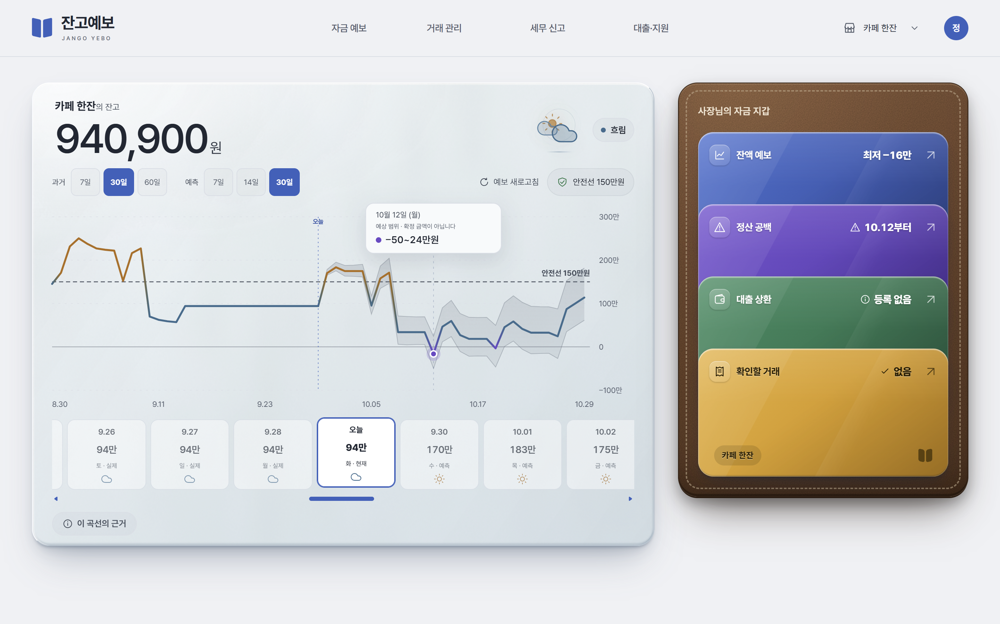
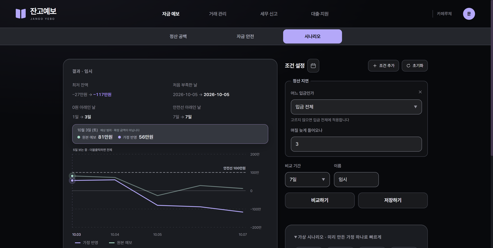
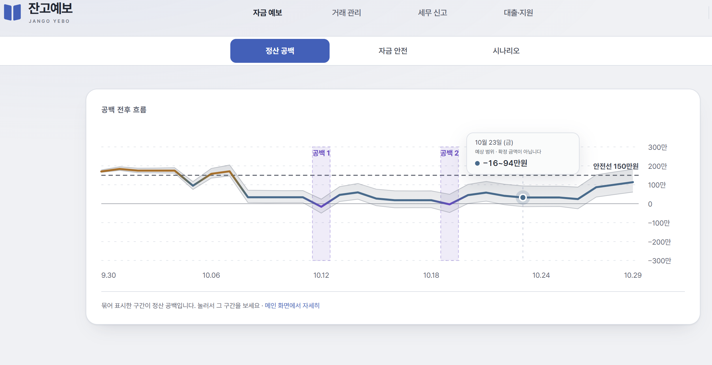
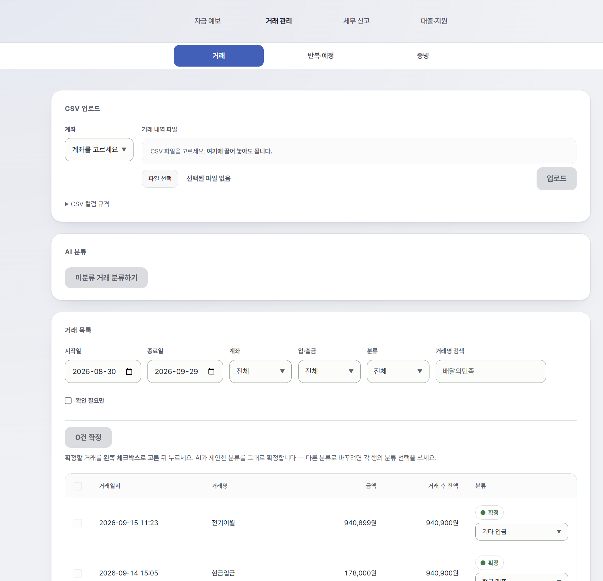

# 잔고예보 (Jango-Yebo)

**소상공인이 「언제 통장이 빌지」를 미리 알 수 있게 하고, 그 기록을 그대로 종합소득세 신고 준비까지 잇는 서비스입니다.**

- 기간 2026.08.31 ~ 2026.09.28 (약 4주) · 팀 6인 · SSAFY 광주 1반 C105
- **최종 발표 2위, 우수상 수상**
- 담당: **백엔드(세무·자금 관리 기능) · 인프라**

---

## 이 저장소를 보시기 전에

**이 저장소는 포트폴리오 검토용 공개본이라 일부를 의도적으로 뺐습니다.**

| 제외한 것 | 이유 |
| --- | --- |
| 금융망 API 키 · AI 서비스 토큰 | 외부 기관에서 발급받은 자격 증명 |
| 운영 데이터베이스 · 업로드된 증빙 파일 | 계좌 거래와 영수증은 개인·사업 정보 |
| 배포 서버의 환경 변수 · 인증서 | 실제 서버 접근에 쓰이는 값 |

그래서 **내려받아 바로 실행하면 외부 연동 기능은 동작하지 않습니다.** 코드·설계·인프라 구성은 이 저장소에서 확인하실 수 있고, **실제 동작은 시연 영상과 발표 자료**로 보실 수 있습니다.

> 공개본에는 실행용 키와 운영 환경 값을 포함하지 않았습니다. 실제 외부 연동에는 별도 자격 증명이 필요합니다.

---

## 1. 무엇을 해결하려 했나

음식점·카페 사장님은 **매출이 나는 날과 돈이 들어오는 날이 다릅니다.**

- 손님이 카드로 결제해도 현금은 **사흘쯤 뒤**에 들어옵니다
- 배달 플랫폼은 또 다른 주기로 정산합니다
- 그 사이에도 재료비·임차료·급여는 날짜를 맞춰 빠져나갑니다

그래서 장사가 잘 되는 달에도 **특정 날짜에 잔고가 비는 일**이 생깁니다. 대부분은 그날이 와서야 알게 됩니다.

**잔고예보는 앞으로 30일의 날짜별 예상 잔액을 그려 「며칠에 얼마가 빈다」를 미리 짚습니다.** 그리고 그 과정에서 정리된 거래와 영수증을 **5월 종합소득세 신고 준비까지 그대로 잇습니다.**

---

## 2. 제가 맡은 범위

팀 프로젝트라 **제가 한 것과 하지 않은 것을 먼저 구분해 적습니다.**

### 처음부터 끝까지 담당한 것

| 영역 | 내용 |
| --- | --- |
| **종합소득세 신고 지원** | 거래를 모아 신고서 초안을 만들고, 세무대리인에게 넘길 자료를 한 벌로 묶는 기능 전체 |
| **자금 안전선 추천** | 「통장에 최소 얼마를 두어야 하는가」의 후보 산출 |
| **대출 정보 자동 갱신** | 매일 새벽 금융망에서 대출 잔액·상환 회차를 받아오는 배치 |
| **증빙 원본 조회 · 반복 거래 알림** | 영수증 원본을 화면에 띄우는 경로, 반복 거래 후보 알림 |
| **AI 브리핑 · 월간 리포트** | 자금 상황 요약 API (※ 아래 「범위와 한계」 참고) |
| **인프라 전반** | 서버 구성, 컨테이너, 배포 자동화, 보안 설정 |

### 협업 영역에서 개선한 것

- 거래처 사전의 방향 키 정합성 보완
- AI 분석 결과가 조용히 유실되던 처리 경로 수정
- 해제 계좌가 거래 분류 대상에 포함되지 않도록 보완

### 제가 하지 않은 것

**계좌 연동(1원 인증) · 거래 수집 · 잔액 예측 모델 · 로그인/권한 · AI 워커 · 프론트엔드**는 다른 팀원이 맡았습니다.

특히 **잔액 예측 모델 자체는 제 작업이 아닙니다.** 제가 담당한 것은 그 예측값을 *읽어서* 쓰는 쪽(안전선·세무·브리핑)입니다.

### AI 도구 사용에 대하여

**팀 전체가 AI 코딩 도구를 적극적으로 사용했고, 제 코드도 초안 비중이 높습니다.**

AI 도구는 구현 초안에 활용했지만, 기능 범위·채택 기준·검증 방식·최종 병합은 제가 결정했습니다. 아래 사례에서 그 판단 과정을 설명합니다.

---

## 3. 주요 설계 판단

### ① 돈을 세는 일에는 AI를 쓰지 않았습니다

신고서 초안을 만드는 경로에는 **AI 호출이 한 번도 없습니다.** 규칙 매핑과 집계만으로 끝냅니다.

AI가 닿는 곳은 **거래 분류와 영수증 글자 읽기까지**이고, 그 결과를 **사람이 확정한 뒤에야** 금액 계산에 들어갑니다. 이유는 다음과 같습니다.

- **같은 입력에 같은 숫자가 나와야 합니다.** 세무 자료는 두 번 뽑아 다르면 쓸 수 없습니다
- **금액이 틀렸을 때 「모델이 그랬다」는 답이 되지 않습니다.** 계산식이 코드에 있어야 되짚습니다
- 화면을 열 때마다 모델을 부르면 그것이 그대로 비용입니다

자금 상황을 문장으로 요약하는 AI 브리핑에서도 **원본 거래를 모델에 보내지 않습니다.** 계산이 끝난 지표만 전달하도록 요청 형식 자체에 거래를 담을 자리를 두지 않았습니다.

### ② 국세청 서식 원문과 직접 대조했습니다

신고서 서식 정의는 처음에 **우리 팀의 API 설계 문서를 옮긴 것**이었습니다. 화면에는 모든 항목과 금액이 정상적으로 나오고 있었습니다.

다만 세금 수치는 한 항목만 어긋나도 사용자 판단을 흐리기 때문에, **관보에 실린 서식 원문 두 장과 직접 대조**했습니다. 그 결과 네 곳을 고쳤습니다.

가장 중요한 것은 **필요경비 합계의 중간 행**이었습니다. 원문은 `매출원가 + 일반관리비등계` 두 단계인데, 우리 정의는 중간 행 없이 한 번에 더하고 있었습니다. **합계 금액은 맞았지만** 서식이 요구하는 그 칸을 채울 값이 없어 **내보낸 파일의 해당 칸이 비어 나갔습니다.**

그 합계식에서 항목 하나가 빠지면 필요경비가 줄고 소득금액이 늘어납니다. **세금을 더 내는 방향의 오류는 사용자에게 즉시 드러나지 않을 수 있습니다.** 그래서 15개 항목이 빠짐없이 합산되는지를 테스트로 고정하고, **일부러 한 줄을 빼 그 테스트가 실제로 실패하는지까지 확인**했습니다.

### ③ 「세지만 확정하지 않는다」를 구조로 만들었습니다

세무 판단은 틀리면 가산세로 이어집니다. 그래서 **서비스가 확정하지 않는 선**을 코드에 고정했습니다.

- **세액은 계산하지 않습니다.** 소득금액까지만 채우고, 공제와 세액 산출은 홈택스에서 사용자가 합니다
- **복식부기 재무제표는 만들지 않습니다.** 대신 세무대리인에게 넘길 서류 목록과 자료를 제공합니다. 만들 수 없는 서식에 초안 생성을 요청하면 **거절하도록** 구현했습니다
- **금액마다 근거를 함께 냅니다.** 항목을 펼치면 그 숫자를 만든 거래 목록이 나오고, **아직 검토하지 않은 건수를 숨기지 않습니다**
- **값이 없으면 `0`이 아니라 항목 자체를 내리지 않습니다.** 「0원」과 「모른다」는 전혀 다른 말이기 때문입니다

---

## 4. 시스템 구조

```
                        [ 사용자 브라우저 ]
                                │  HTTPS
                        ┌───────▼────────┐
                        │     Nginx      │  TLS 종료 · 정적 파일 · /api 프록시
                        └───┬────────┬───┘
                   정적 파일 │        │ /api
                  ┌─────────▼──┐  ┌──▼──────────────┐
                  │  프론트엔드 │  │  백엔드 (Java)   │
                  │  React     │  │  Spring Boot    │
                  └────────────┘  └──┬───────┬───┬──┘
                                     │       │   │ 내부 호출
                      ┌──────────────▼┐ ┌────▼─┐ │  ┌──────────────┐
                      │  PostgreSQL   │ │Redis │ └─▶│  AI 워커      │
                      │  거래·증빙·세무│ │토큰· │    │  FastAPI      │
                      └───────────────┘ │작업큐│    │  분류·OCR·예측 │
                                        └──────┘    └──────┬────────┘
                                                           │
                                                 ┌─────────▼─────────┐
                      [ GitLab ] ──웹훅──▶ [ Jenkins ] 빌드·테스트·배포
                                                 └───────────────────┘
                                   외부: 교육용 금융망 API (계좌·거래·대출)
```

**설계상 지킨 것 두 가지**

- **외부에 열린 포트는 둘뿐입니다.** 데이터베이스·캐시·Jenkins는 서버 내부에서만 접근할 수 있고, 네트워크도 외부용과 내부용으로 나눴습니다
- **백엔드 안에서도 경계를 뒀습니다.** 예측 엔진과 업무 로직이 서로를 직접 참조하지 못하게 모듈 경계를 선언하고, **어기면 테스트가 실패하도록** 했습니다

---

## 5. 핵심 기능

**① 날짜별 예상 잔액과 정산 공백**
반복되는 거래(임차료·카드 정산 등)는 규칙으로 계산하고, 나머지 불규칙한 흐름은 예측 모델이 맡습니다. 둘을 합쳐 30일 곡선을 그리고 **잔고가 비는 날**을 짚습니다. 단일 수치가 아니라 **범위와 근거**를 함께 보여 줍니다.

**② 가정을 바꿔 보는 시나리오**
「정산이 사흘 늦어지면」, 「이 지출을 다음 주로 미루면」 같은 가정을 넣어 원래 예보와 나란히 비교합니다.

**③ 증빙과 거래 연결**
영수증을 올리면 금액·날짜를 읽어 **계좌 거래와 맞춰 후보를 제시**합니다. 금액이 정확히 맞고 같은 날이며 **그런 거래가 하나뿐일 때만** 자동 연결 대상이 됩니다. 서버가 단정하지 않고 사용자가 고릅니다.

**④ 종합소득세 신고서 초안**
1년 치 거래를 서식 항목별로 모아 **홈택스에 옮겨 적을 숫자**를 만듭니다. 항목마다 근거 거래를 되짚을 수 있습니다.

**⑤ 신고 준비자료 묶음**
매출 요약·거래내역·필요경비 명세·정산 대사표 등 **표 일곱 장과 영수증 원본**을 한 파일로 묶습니다. **증빙이 빠진 거래 목록도 함께 넣습니다** — 잘 정리된 것만 보내면 세무대리인이 무엇을 더 물어야 할지 알 수 없기 때문입니다.

### 화면 예시

| 자금 예보와 정산 공백 | 가정 기반 시나리오 비교 |
| --- | --- |
|  |  |

| 정산 공백 예측 | 신고 자료 검토 |
| --- | --- |
|  |  |

---

## 6. 인프라와 배포 자동화

**서버 한 대로 운영했습니다.** 교육 과정에서 제공받은 환경이라 선택지가 없었고, 대신 **한 대 안에서 나눌 수 있는 것은 나눴습니다.**

| 항목 | 구성 |
| --- | --- |
| 실행 | Docker Compose로 서비스별 컨테이너 분리 |
| 입구 | Nginx — TLS 적용, 외부 공개 포트 최소화 |
| 데이터 | PostgreSQL · Redis — 외부 접근 차단, 내부에서만 연결 |
| 배포 | GitLab 웹훅 → Jenkins → 이미지 빌드 → 교체 → 동작 확인 |
| 백업 | 데이터베이스 정기 백업 (보관 기간 지정) |

**자동화 전에 수동 배포를 끝까지 먼저 했습니다.** 정상 기준을 먼저 만들어야 나중에 문제가 생겼을 때 **서비스 문제인지 자동화 문제인지 구분**할 수 있기 때문입니다.

### CI에서 통합 테스트가 빠져 있던 것을 되살린 일

자동화가 돌고 빌드는 초록불이었는데, **실제 데이터베이스를 띄워 검증하는 테스트가 통째로 제외**돼 있었습니다.

설정에는 「환경 문제로 실패한다」고 적혀 있었지만 **확인해 보니 그 원인이 아니었습니다.** 실제 원인은 테스트가 띄운 데이터베이스에 **네트워크 경로가 닿지 않는 것**이었고, 주소를 실행 시점에 찾아 넘기도록 고쳐 해결했습니다.

이때 주소를 코드에 적어 두지 않고 **매번 조회해서 쓰도록** 했습니다. 환경이 바뀌면 증상이 「테스트가 갑자기 전부 실패」로 나타나 원인을 찾기 어렵기 때문입니다.

→ 이 조치로 당시 **555건의 통합 테스트가 자동 검증 범위에 들어왔습니다.** 현재 정적 집계 기준은 **82개 클래스·855건**입니다.

---

## 7. 규모와 검증

| 항목 | |
| --- | ---: |
| 공개 API 엔드포인트 | 95개 |
| 데이터베이스 테이블 | 39개 |
| 스키마 변경 이력 | 37건 |
| 백엔드 테스트 메서드 | 1,352개 |
| 실제 DB를 띄워 검증하는 테스트 | 82개 클래스 · 855건 |

> 공개 API 95개는 프로젝트 문서가 관리하는 공식 수치입니다. 내부 전용 경로와 한 경로의 복수 메서드는 별도 기준으로 집계했으며, 문서 표와 요약 수치가 어긋나면 테스트가 실패하도록 관리했습니다. 테스트 메서드와 통합 테스트 수는 정적 집계 기준입니다. 전체 실행 결과는 Docker를 사용할 수 있는 환경에서 별도로 확인합니다.

**테스트 수보다 중요한 것은 어떤 오류를 잡는지라고 보았습니다.**

변경한 코드가 의도한 테스트에서만 실패하는지도 확인했습니다. 이 과정에서 **실제 검증 없이 통과하던 테스트 2건**을 찾아냈습니다. 한 건은 검사 대상 문자열이 표의 제목과 겹쳐 검사 구간이 비어 있는데도 통과하던 경우였습니다.

---

## 8. 범위와 한계

**교육 과정에서 진행한 팀 프로젝트입니다.** 범위와 한계는 다음과 같습니다.

- **금융 데이터는 교육용 금융망의 시연 계정**이며 실제 개인·사업자 거래가 아닙니다. 금융망이 제공하지 않는 카드 정산·POS 매출 등은 **시연용으로 생성한 데이터**로 보완했습니다
- **실제 소상공인 데이터로 검증하지 않았습니다.** 예측 성능 수치는 합성 데이터 기준이며, 제 담당 영역이 아니므로 이 문서에서는 수치를 인용하지 않습니다
- **AI 브리핑·월간 리포트·안전선 추천은 백엔드까지 완성했고 화면 연결은 범위 밖**이었습니다. 「구현했다」는 사실이지만 「시연했다」는 아닙니다
- **신고서 내보내기는 엑셀 형식만** 지원합니다. PDF는 구현하지 않았습니다
- **홈택스 자동 제출 기능은 없습니다.** 사용자가 화면에 옮겨 적는 것을 돕는 범위입니다
- 성능 측정(부하 시험·응답 시간)은 수행하지 않았습니다

---

## 9. 함께 보실 자료

- [프로젝트 소개 영상](https://drive.google.com/file/d/12OfRj2ece_uKDltwMsqyoH0OgJECKZbe/view?usp=sharing)
- [최종 발표 자료(PPTX)](docs/presentation/잔고예보_발표자료.pptx)

---

## 10. 로컬에서 실행해 보실 경우

```bash
# 저장소 최상위에서
docker compose -f backend/compose.yml up -d  # 데이터베이스·캐시

# 터미널 1
cd backend && ./gradlew bootRun              # 백엔드

# 터미널 2: 저장소 최상위에서
npm run dev                                  # 프론트엔드
```

**다음 기능은 자격 증명이 없어 동작하지 않습니다** — 계좌 연결과 거래 동기화, 영수증 글자 인식, 거래 자동 분류, AI 문장 생성.

**자격 증명 없이도 확인하실 수 있는 것** — 화면 구성과 흐름, 거래 CSV 업로드, 신고서 서식 정의와 초안 집계 로직, 그리고 **테스트 전체 실행**(`cd backend && ./gradlew test`, Docker 필요).

코드를 직접 보신다면 아래 순서를 권합니다.

| 보실 것 | 위치 |
| --- | --- |
| 신고서 초안 집계 | `backend/.../core/tax/` |
| 신고 준비자료 묶기 | `backend/.../core/export/` |
| AI에 보내는 요청 형식 | `backend/.../core/ai/BriefingGenerationHandler.java` |
| 배포 자동화 | `infra/Jenkinsfile` |
| 서버 구성 | `infra/compose.yml`, `infra/nginx/` |
