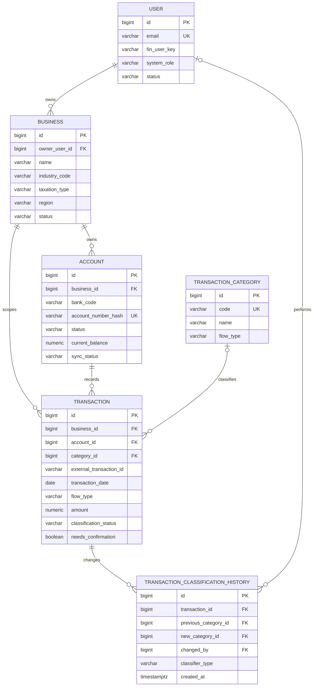
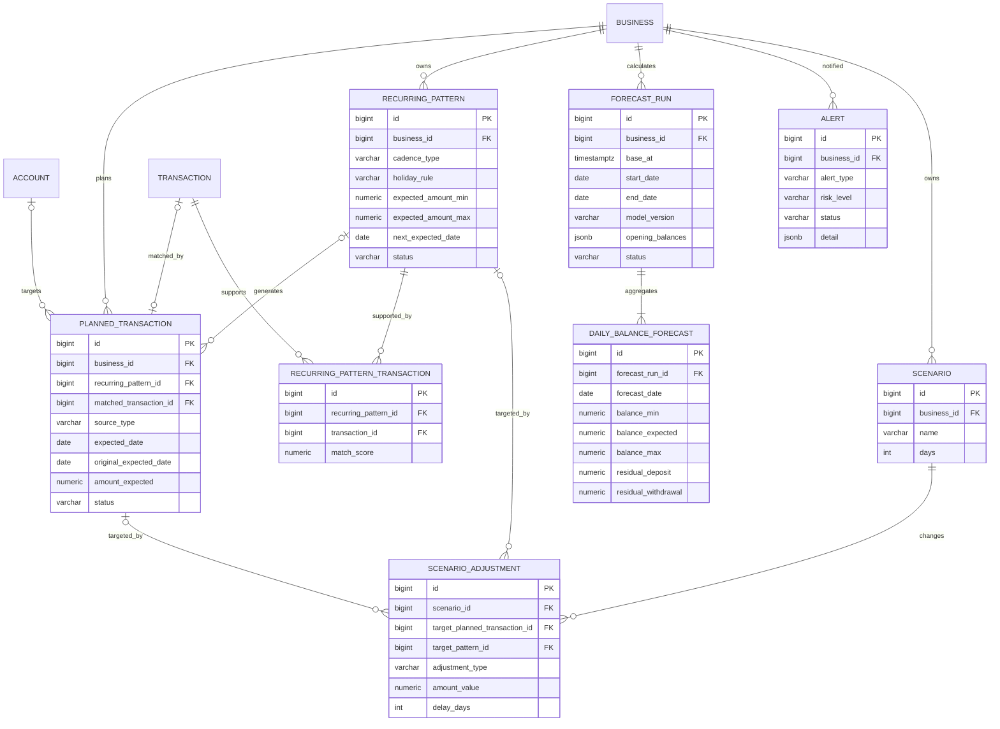
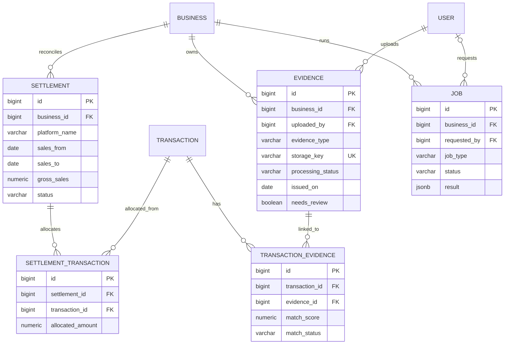
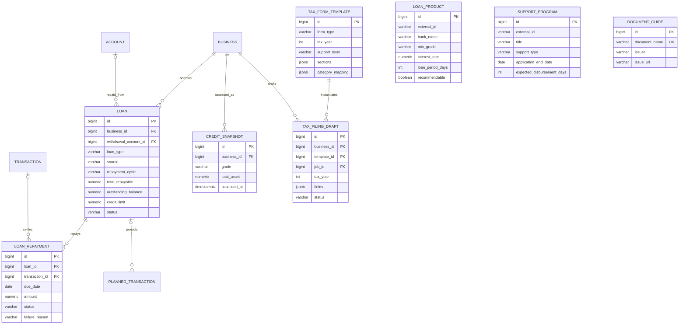
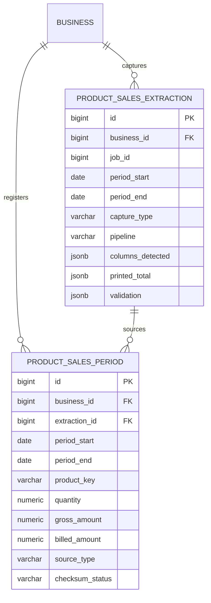

# Jango-Yebo ERD

| 항목 | 내용 |
| --- | --- |
| 문서 목적 | 팀 공용 DB 구조 안내 및 구현 기준 |
| 대상 DB | PostgreSQL |
| 기준 기능 | P0 본체, P1 확장 |
| 기준 문서 | API 명세서 **v1.8** (`docs/api/` — [README](./api/README.md), 장 번호로 분할), SSAFY 교육용 금융망 API 인터페이스 예제, `docs/기능명세서_SRS.md` **v1.8**, [`docs/예측엔진_설계노트.md`](./예측엔진_설계노트.md) **v2** |
| 버전 | v1.18 (2026-09-16) — 시나리오 구현 착수: `SCENARIO_ADJUSTMENT` 의 대상 외래키를 `ON DELETE SET NULL` 로 (`V32`, 테이블 수 43 유지). 구현 상태: [API 구현현황](./api/99_구현현황.md) |

## 0. 변경 요약

### v1.18 (2026-09-16) — 저장한 시나리오가 예정 거래를 붙잡지 않는다

What-if 시나리오(API 11장)의 백엔드가 서면서 `SCENARIO_ADJUSTMENT` 에 <b>행이 생기는 경로가 처음 열렸다</b>. 그 순간 `V1` 이 남겨 둔 외래키 규칙이 문제가 된다.

| 대상 | 변경 | 사유 |
| --- | --- | --- |
| **`SCENARIO_ADJUSTMENT.target_planned_transaction_id`·`target_pattern_id`** (§1.3) | `fk_sa_planned`·`fk_sa_pattern` 을 `V32` 로 DROP 후 **`ON DELETE SET NULL`** 로 재생성. 참조 컬럼에 부분 인덱스 둘 추가 | `V1` 은 `ON DELETE` 절을 두지 않았다(NO ACTION). 저장된 시나리오가 예정 거래를 가리키면 **그 예정 거래를 지우는 모든 경로가 외래키에 막힌다** — 예정 거래 삭제(9.4), 패턴 수정·중지의 회차 재생성, 영업일 달력 변경, 대출 재생성, 그리고 **계좌 삭제 purge 전체**(7.2). `CASCADE` 가 아닌 이유는 조정 행을 함께 지우면 저장한 파라미터가 소리 없이 사라지기 때문이다. 대상만 비우고 `details` 에 남긴 원래 id 로 「대상이 삭제되어 반영하지 않았다」를 경고로 말한다 |

**지우는 데이터가 없다.** 이 시점까지 `scenario_adjustment` 에 행을 만드는 경로가 없었으므로 백필도 정리도 없이 제약만 다시 건다(v1.17 과 같은 사정).

**`details` 의 쓰임이 늘었다.** 전용 컬럼이 없는 값(`EXTRA_*` 의 제목, `PRODUCT_SALES_CHANGE` 의 상품·변화율, `LOAN_EXECUTION` 의 금리·기간·상환 방식)에 더해 **대상 id 의 사본**을 담는다. 외래키가 비워진 뒤 「원래 대상이 있었다」와 「처음부터 패턴 전체였다」를 구분하려면 사본이 필요하다 — 구분하지 못하면 대상이 사라진 시나리오가 조용히 입금 패턴 전체로 넓어진다.

### v1.17 (2026-09-16) — 재료비 변화 What-if 제외

SRS v1.11 이 `MATERIAL_COST_CHANGE` 를 범위에서 뺐다. **테이블 수는 그대로다**(43) — 제약 하나만 다시 건다.

| 대상 | 변경 | 사유 |
| --- | --- | --- |
| **`SCENARIO_ADJUSTMENT.adjustment_type`** (§1.3) | `ck_sa_type` 을 `V29` 로 DROP 후 재생성. **9종 → 8종** | v1.14 는 이 값을 「남는다」고 적었는데 **그 판단이 뒤집혔다.** 남은 `rate` 만으로는 무엇에 곱하는지가 명세에 없었고, 새로 정의해도(예정 거래 중 `MATERIALS` 출금) 패턴으로 안 잡힌 재료비가 잔여 흐름 축에 섞여 분류로 골라낼 수 없다. 상품 단위 매출 시뮬레이션(`PRODUCT_SALES_CHANGE`)이 실측 구성비를 근거로 삼는 더 나은 도구다 |

**지우는 데이터가 없다.** 시나리오(API 11장)는 백엔드 구현이 아직 없어 `forecast.scenario_adjustment` 에 행을 만드는 경로 자체가 없다. 백필도 기존 행 정리도 없이 제약만 다시 건다.

**`TRANSACTION_CATEGORY` 의 `MATERIALS`(재료비)는 건드리지 않는다** — P0-02 이고 `V2` 시드다. 재료비를 분류·집계하는 것과 「재료비가 오르면」을 시뮬레이션하는 것은 다른 기능이다.

### v1.16 (2026-09-15~16) — 신고서 서식 템플릿·초안 착수 (P0-12)

> **v1.15 는 이 목록에 없다.** 계좌 삭제(API 7.2 purge)가 물리 삭제 금지 규칙의 범위를 좁힌 것이라
> 표 변경이 없어 §10 구현 규칙에만 적혔다. 머리말 버전만 올라가 있다.

`TAX_FORM_TEMPLATE`(`V27`)·`TAX_FILING_DRAFT`(`V28`) 를 만들면서 표와 달라진 곳을 적는다. 두 테이블 모두 ERD 에 이미 있던 것이라 **테이블 수는 43 그대로**다.

| 대상 | 변경 | 사유 |
| --- | --- | --- |
| **`TAX_FORM_TEMPLATE.eligibility_note` 추가** | `VARCHAR(500)` Optional | API 14.3 의 서식 목록 응답이 `eligibilityNote` 를 요구하는데 담을 칸이 없었다. 「간편장부대상자 — 음식점업은 직전연도 수입금액 1억 5천만원 미만」처럼 **서식마다 다른 문구**라 상수로 둘 수 없다 |
| `TAX_FILING_DRAFT.fields` 의 ⑤ 소재지 출처 | `AUTO_PROFILE` → **`USER_CONFIRM`** | `BUSINESS` 에 주소 칸이 없다(`region` 뿐). 컬럼을 더하면 7.1 사업장 등록·수정 API 와 화면까지 번진다. 명세 14.3 이 「민감 항목이 비어 있어도 내보낼 수 있다 · 빈 칸은 「직접 기재」로 남긴다」를 이미 정해 두었으므로 그 규칙을 그대로 쓴다 |
| **`TAX_FILING_DRAFT.created_at` 추가** | `TIMESTAMPTZ` NN | 표에는 `updated_at` 만 있다. 저장소의 모든 업무 테이블이 공통 감사 컬럼(§1.1)을 상속해 쓰고 있어 혼자 빠지면 그 상속을 못 받는다 |
| `TAX_FILING_DRAFT.excluded_summary` 에 `unclassified` 추가 | 명세 14.3 의 `excluded` 는 개인 사용·확인 필요 둘뿐 | 집계 대상이 **확정 분류 거래뿐**이라, 분류를 안 돌린 사업장은 초안이 거의 빈 채로 나온다. 담을 칸이 없으면 그 빈 초안이 「매출 0」으로 읽힌다 |

`sections`·`category_mapping`·`sensitive_fields` 는 표 그대로다. **서식 정의를 자바가 아니라 이 JSONB 로 두는 것이 v1.7 의 「서식 개정 시 데이터만 갱신한다」를 지키는 방법이다** — 별지 제74호서식은 해마다 개정되는데 매핑표를 상수로 박으면 개정 때마다 재배포가 된다.

### v1.14 (2026-09-15) — P1-06 원자재 범위 제외

SRS v1.10 이 P1-06 원자재 가격 지표를 범위에서 뺐다(결번). **테이블 3개와 컬럼 1개가 함께 나간다**(46 → **43**).

| 대상 | 변경 | 사유 |
| --- | --- | --- |
| `COMMODITY_INDEX`·`COMMODITY_PRICE`·`BUSINESS_INGREDIENT` 삭제 (§1.8·§9) | 세 테이블 모두 제거. §1.8 은 결번 표시만 남긴다 | 시세를 붙이려면 KAMIS·ECOS 수집 배치부터 사업장별 재료비 비중까지 한 줄로 이어져야 하는데 **어느 것도 시작되지 않았다.** 어느 하나만 남기면 채우는 쪽이 없는 빈 표가 된다 |
| **`FORECAST_SETTING.apply_material_index` 삭제** (§1.3) | `V20` 으로 `DROP COLUMN` | `V7` 이 이 칸을 만든 근거가 P1-06 하나였다. 값을 잃지 않는다 — `NOT NULL DEFAULT FALSE` 였고 켜도 곡선이 달라지지 않아(`applied_options` 에 늘 `false`) 켤 이유가 없었다. `apply_seasonality`(P1-07)·`apply_vat_reserve`(P1-11) 는 **그대로 둔다** — 두 기능은 범위 안이고 저장된 의사를 나중에 읽는다 |
| `FORECAST_RUN.applied_options` 설명 | "계절성·원자재·부가세" → "계절성·부가세" | 스냅샷 JSONB 자체는 그대로다. 키가 하나 줄 뿐이라 마이그레이션이 없다 |
| §9 제목 | 「P1 — 원자재·상품별 매출」 → 「P1 — 상품별 매출」 | 원자재 묶음이 사라져 이 장은 P1-22 하나만 남는다 |

~~**`SCENARIO_ADJUSTMENT.adjustment_type` 의 `MATERIAL_COST_CHANGE` 는 남는다.**~~ ⚠ **v1.17 에서 뒤집혔다** — 무엇에 곱하는지가 명세에 없다는 것이 드러나 `V29` 로 함께 뺐다. 위 v1.17 요약을 본다.

### v1.13 (2026-09-11) — 카드 정산 요일별 금액 (G-2 금액 축)

설계노트 G-2 「금액 축」이 제안한 컬럼이 들어왔다(`V10` · MR !76). **컬럼 하나뿐이고 테이블 수는 그대로다**(46).

| 대상 | 변경 | 사유 |
| --- | --- | --- |
| **`RECURRING_PATTERN.amount_by_weekday` 신설** (§1.3) | nullable `JSONB`. ISO 요일(1=월)을 키로 `{lo,mid,hi}` = q10/q50/q90 | **카드 정산은 요일마다 금액이 다르다.** 주말 매출분이 다음 영업일로 몰려 들어와 실측에서 월요일이 나머지의 3배다(신한카드 124건 — 월 394,300 · 화~금 119,500~134,700). `expected_amount_min`/`max` 두 칸으로 접으면 `110,600~582,100`(폭 471,500)이 되어 **중앙선과 밴드가 함께 망가진다** — 중앙선은 `(min+max)/2`로 고정돼 화~금에 2.7배 과대하고, 하루 폭이 30일(영업일 20)에 쌓여 이 패턴이 밴드에 보태는 몫만 943만원이 된다. 요일별로 나누면 867천원이다(**−91%**). 화면 밴드 전체는 잔여 q10~q90이 지배하므로(30일 밴드 3,287만원 중 예정 전체가 205만원) 이 변경의 값어치는 밴드보다 **중앙선** 쪽이다 — 자세한 것은 설계노트 G-2 「금액 축」 |
| `amount_by_weekday` 를 **스칼라가 아니라 분위수 셋**으로 | 설계노트 제안은 `{"1":385750, ...}` 였다 | 중앙값 하나만 담으면 범위는 여전히 통짜 `min`/`max`에서 와 **밴드가 안 좁아진다** — 문제의 절반만 푼다. 최소·최대가 아니라 q10/q90 인 것은 이상치 한 건이 그 요일 폭을 혼자 만들기 때문이다(화요일 582,100원 한 건이 폭 47만원) |
| 채우는 조건 | 요일당 **6건 이상**, 한 요일이라도 모자라면 전체 `null` | 3~4건으로 뽑은 q10/q90 은 사실상 최소·최대라 폭을 좁히려는 목적을 잃는다. 일부 요일만 채우면 같은 패턴 안에서 기준이 갈린다 |

`null` 이면 기존 `expected_amount_min`/`max` 경로로 그대로 떨어진다. **`BUSINESS_DAILY` 가 아닌 cadence 는 채우지 않는다** — 달에 한 번 오는 것은 요일이 의미가 없다. nullable 컬럼 추가라 `backend-architecture.md` §5 의 허용 목록이고 롤백이 깨지지 않는다.

`SEASONAL_FACTOR` 는 원래 자리(P1-07 계절성 — 월·시즌 배율)에 그대로 둔다. 요일 칸이 없고 사업장 단위라 이 용도를 대신할 수 없다는 판단은 설계노트 G-2 「금액 축」에 있다.

마이그레이션은 **`V10__pattern_amount_by_weekday.sql`** 하나다.

### v1.12 (2026-09-11) — 매출 인쇄물(P1-22) 저장 정합

AI 2번이 합성 90표본(라벨 1,059행)을 실측해 올린 7건([97_AI_백엔드_합의_매출인쇄물.md](./api/97_AI_백엔드_합의_매출인쇄물.md))을 백엔드가 채택한 결과다. **`PRODUCT_SALES_EXTRACTION` 하나가 신설이고 나머지는 제약 완화·문서 정정이다**(45 → 46).

| 대상 | 변경 | 사유 |
| --- | --- | --- |
| **`PRODUCT_SALES_PERIOD.gross_amount`** (§1.9) | **`NN` 해제 + `CHECK (billed IS NOT NULL OR gross IS NOT NULL)`** | **58mm 감열지에는 총매출 열이 인쇄되지 않는다.** 실측 90표본 중 `printout58` 30표본 전부·행 353/1,059(**33.3%**)가 null 이라 그대로 두면 세 레이아웃 중 하나가 통째로 반려된다. 이 문서가 `discount`·`net`·`vat`·`billed` 를 Optional 로 내리며 적은 이유("8열이 한 줄로 안 들어간다")에서 **`gross` 만 빠져 있었다.** 58mm 에서 살아남는 금액 열은 총매출이 아니라 결제금액이고, 이 문서 자신이 구성비 분모를 `COALESCE(billed_amount, gross_amount)` 로 정의해 이미 이 경우를 전제하고 있다 |
| `PRODUCT_SALES_PERIOD.quantity` (§1.9) | `INT NN` → **`NUMERIC(14,3)` Optional** | 워커 계약(`ProductSalesRow.quantity`)이 `float \| None` 이다. 수량 열이 없는 인쇄물이 오면 `NOT NULL` 에서 그 행이 죽는다. 실측에서 위반이 0건이지만 **그 수치는 근거가 못 된다** — 합성 생성기가 세 레이아웃 모두에 수량 열을 넣도록 만들어졌다. 구성비는 금액으로 만들므로 잃는 것이 없다. `NUMERIC` 인 것은 무게 단위 상품(정육·반찬) 때문이다 |
| **`PRODUCT_SALES_EXTRACTION` 신설** (§1.9) | 추출 1회분(기간·읽은 열·합계 행·검산·모델 메타) | 워커 검산(`validation`, 계약 v1.18)과 모델 메타는 **행이 아니라 추출 단위 값**이다. `PRODUCT_SALES_PERIOD` 에 넣으면 80행짜리 인쇄물에서 같은 JSONB 가 80번 저장되고, 한 행을 고칠 때 어느 사본이 정본인지 알 수 없게 된다. `EVIDENCE_EXTRACTION` / `EVIDENCE_ITEM` 과 같은 모양이다. **상품 행은 여기 없다** — 14.7 의 "OCR 결과는 후보이며 저장하지 않는다"는 그대로다 |
| `checksum_status` 값 분포 (§1.9) | `MISMATCHED` 가 **22.2%** 라는 실측을 명시 | 설계는 맞는데 얼마나 자주 어긋나는지가 없었다. 다섯 장 중 한 장꼴로 나오는 **정상값**이고(인쇄물이 잘리면 합계 행은 기간 전체를 담는다) 오류가 아니다. 화면이 이것을 빨간 경고로 그리면 사장님이 매달 경고를 본다 |

| **`EVIDENCE.needs_review` 신설** (§1.2) | 검산 판정 캐시 1개 (테이블 수 변화 없음) | P1-02 완료 기준이 「필드 강조」로 확정되면서 검토 화면의 "먼저 볼 곳"이 `validation.needsReview` **정렬**로 만들어지는데, 그 값이 `EVIDENCE_EXTRACTION.header_data` JSONB 안이라 `ORDER BY`·`WHERE` 의 키가 되지 못했다. 같은 테이블의 `issued_on` 이 같은 이유로 이미 캐시다. **상태가 아니다** — `processing_status` 에 `REVIEW` 를 만들지 않는다는 결정은 그대로다 |

`share`(구성비)는 **저장하지 않는다**는 기존 결정을 유지했다. 워커가 보내는 인쇄된 구성비는 대조용이다 — 자세한 것은 §1.9.

마이그레이션은 **`V8__product_sales.sql`**(매출 인쇄물)과 **`V9__evidence_needs_review.sql`**(검산 캐시 + 백필) 둘이다. V8 은 합의 문서의 `V7` 초안에서 번호가 밀렸다 — 그 사이 `V7__forecast_setting.sql` 이 들어갔다.

### v1.11 (2026-09-10) — 예측 곡선(P0-07·08) 착수 정합

곡선 구현에 들어가기 전 이 문서와 API 명세·마이그레이션을 대조해 나온 네 건이다. **`FORECAST_SETTING` 하나가 신설이고 나머지 셋은 문서 정정이다**(44 → 45).

| 대상 | 변경 | 사유 |
| --- | --- | --- |
| **`FORECAST_SETTING` 신설** (§1.3) | 사업장별 예측 옵션 저장 테이블 | API 10.7 `GET/PATCH /forecast-settings` 가 여섯 필드를 저장하라고 하는데 **이 문서 어디에도 저장할 자리가 없었다.** `BUSINESS` 에 컬럼이 없고 전용 테이블도 없다. `FORECAST_RUN.applied_options` 는 10.7 자신이 "실행 당시 값을 그대로 유지한다"고 못박은 **스냅샷**이라 원본이 될 수 없다 |
| `RECURRING_PATTERN.cadence_type` (§1.3) | **`BUSINESS_DAILY` 추가** (3종 → 4종) | `V5__cadence_business_daily_and_safety_line.sql` 이 이미 `ck_rp_cadence` 에 넣었고 탐지도 구현됐는데 이 문서만 3종으로 남아 **DB 와 어긋난 상태였다**(설계노트 G-2 가 지목한 잔여 건). *같은 날 `develop` 에서도 같은 정정이 들어와 그쪽 문구를 채택했다* |
| `FORECAST_RUN.basis` (§1.3) | `residual` 블록에 **`judgmentAlpha` 추가** | API 10.1 과 20.11 이 "`basis` 에 기록한다 · α 없이는 곡선을 재현할 수 없다"고 정했는데 이 예시에만 빠져 있었다. **예시대로 구현하면 재현성 인수 조건이 조용히 깨진다** |
| 표기 대응 (§11) | `matched_date_diff_days`·`matched_amount_diff`·`cashGapId` 3행 추가 | API 9.5 는 `dateDiffDays`·`amountDiff` 로 부르는데 대응표에 없어 오기인지 의도인지 판정할 수 없었다 |

`FORECAST_SETTING` 은 P0-07 의 `applyResidualModel` 토글 때문에 P0 에 필요하지만 초기 마이그레이션에 없어 별도 마이그레이션으로 만들었다 — **`V7__forecast_setting.sql`, 2026-09-10 적용**.

### v1.10 (2026-09-07) — 문서 내부 불일치 정정

P0 베이스라인 마이그레이션(`V1__p0_baseline.sql`)을 이 문서와 대조하는 과정에서 나온 두 건이다. **설계 변경이 아니라 문서 정정이며 테이블 수·컬럼 구조는 그대로다**(44개 유지).

| 대상 | 변경 | 사유 |
| --- | --- | --- |
| `TRANSACTION.deduplication_key` (§1.2) | 해시 입력을 `(거래일시, 방향, 금액, 적요)`로 정정 | **v1.5가 이미 방향 추가를 변경 요약에 기록했으나 §1.2 컬럼 설명이 옛 값으로 남아 있었다.** 같은 문서 안에서 두 값이 충돌해, §1.2만 보고 구현하면 v1.5가 막으려던 유실이 그대로 재현된다 |
| `JOB.job_type` (§1.4) | `PRODUCT_SALES_OCR` 추가 (7종 → 8종) | v1.8이 상품별 매출(P1-22)을 도입하며 인쇄물 OCR을 비동기 Job으로 정의했으나(API 14.6) 이 목록에 반영되지 않았다. `job_type`은 DB `CHECK` 제약이라 누락되면 해당 Job 생성이 런타임에 거부된다 |

**값 집합의 기준은 API 명세서다.** 상태값을 `VARCHAR + CHECK`로 관리하는 이상(§11) 이 문서의 Enum 나열과 API의 나열이 갈리면 둘 중 하나는 반드시 틀린다. 충돌이 보이면 API 명세를 따르고 이 문서를 고친다.

두 값 모두 `V1__p0_baseline.sql`에는 정정된 상태로 반영되어 있다.

### v1.9 (2026-09-04) — 예측 곡선에 잔여 현금흐름 축

예측 곡선에 들어가는 것이 `PLANNED_TRANSACTION`뿐이라 **반복 패턴으로 잡히지 않는 흐름이 0으로 취급**됐다 — 현금 매출 입금, 소액 부정기 지출, 미분류 거래. 이 축을 **잔여 예측 모델**이 추정하도록 [`예측엔진_설계노트.md`](./예측엔진_설계노트.md) v2가 정했고(M-1), 그 산출값이 앉을 자리를 만든다. **테이블 수는 44개 유지**(컬럼 추가만).

| 대상 | 변경 | 사유 |
| --- | --- | --- |
| `DAILY_BALANCE_FORECAST` | **`residual_deposit`·`residual_withdrawal` 2컬럼 추가** | 모델 기여분을 곡선에서 분리해 보관한다. 합계에 섞으면 화면의 "모델 반영 전/후" 비교와 정확도 리포트의 베이스라인 대비 평가가 불가능해진다 |
| `FORECAST_RUN.model_version` | 의미 확정 — **계산 엔진 버전 + 모델 아티팩트 버전** (`engine-1.2/residual-gru-0.3.0+a82bc981` — 아티팩트 버전에 학습 데이터 지문이 붙는다) | 컬럼은 이미 있었으나 "계산 엔진 버전"으로만 정의돼 있었다. 모델을 바꾸면 같은 입력이 다른 값을 내므로 재현 단위에 모델이 들어가야 한다 |
| `FORECAST_RUN.basis` | `residual` 블록 추가 (분위수 합계·표본 일수·출처·모델명) | **재현성을 저장 구조로 보장한다.** 추론은 스레드 수만 바뀌어도 비트 단위 동일을 못 지키므로, 실행 시점 산출값을 스냅샷으로 고정하고 재조회는 재추론 없이 이 값을 쓴다 |
| `FORECAST_RUN.applied_options` | `applyResidualModel` 추가 | 사용자 토글(API 10.7). 끈 실행도 곡선이 정상 산출돼야 한다는 인수 조건의 근거값 |

**새 테이블은 만들지 않는다.** 잔여는 **항목이 아니라 일별 집계값**이라 `PLANNED_TRANSACTION`에 들어갈 수 없고(승인·매칭 대상이 아니다), 곡선 행에 컬럼 두 개로 붙는 것이 맞다.

**잔여 시계열 자체는 저장하지 않는다.** `일별 실제 합계 − 예정 거래 매칭분`으로 예측 실행마다 재집계한다. 사용자가 반복 후보를 승인하면 매칭 항목이 늘어 **과거 잔여가 소급해서 줄어들기** 때문에, 저장해 두면 승인 직후 이중 계상이 생긴다.

> **`MERCHANT_MASTER`(설계노트 G-3)는 아직 반영하지 않는다.** 지연·금액 보정 모델(M-2)이 채택될 때 함께 들어간다. M-2는 조건부이고 교차 사업장 표본이 그 전제이므로, 채택 판정 전에 테이블만 먼저 만들지 않는다.

### v1.8 (2026-09-03) — 상품별 매출: 일 단위 절대액 → 기간 구성비

`PRODUCT_SALES_DAILY`가 일 단위 매출 **절대액**을 받도록 설계돼 있어 총매출이 계좌 입금·정산 대사와 함께 **세 곳에서 따로 만들어지고** 서로 대조되지 않았다. 입력 주기를 기간(월 권장)으로 올리고 저장 목적을 **구성비**로 좁혀 금액의 단일 출처를 계좌 입금 하나로 되돌린다. 테이블 수는 **44개 유지**(rename).

| 대상 | 변경 | 사유 |
| --- | --- | --- |
| `PRODUCT_SALES_DAILY` → **`PRODUCT_SALES_PERIOD`** (1.9) | `business_date` DATE → `period_start`·`period_end`. UK도 `(business_id, period_start, period_end, product_key)`로 | POS 「상품별 매출현황」의 기본 조회 단위가 `영업일자 from ~ to` 기간이고 「월별 매출현황」 출력물이 따로 있다. 일 단위는 POS 출력물의 실제 모양과 맞지 않았다 |
| 저장 목적 | 매출 절대액 → **구성비 산출용**. 소비처·비소비처를 표로 명시 | 신고서 ⑪ 매출액 중복 계상 위험이 설계상 사라진다. 왜 안 쓰는지가 문서에 없어 "일부러 뺀 것"과 "빠뜨린 것"이 구분되지 않았다 |
| `discount_amount`·`net_amount`·`vat_amount` | NN → **Optional** | 58/80mm 감열지에 8열이 한 줄로 들어가지 않아 실제 인쇄물은 열이 줄거나 접힌다. NN이면 상품명·수량·금액만 있는 **정상 인쇄물을 반려**한다. 금액 검증식도 네 값이 다 있을 때만 적용 |
| `billed_amount` 신설 | 합계(총매출−할인) 열. 있으면 구성비 기준 | POS가 인쇄하는 점유율이 합계 기준이다(실측 확인: 카페라떼 161,950/670,450 = 24.2% ✓ vs 163,000/690,000 = 23.6% ✕) |
| `checksum_status` 신설 | 인쇄물 합계 행과 항목 행 합의 대조 결과 | 월 1회 촬영이면 OCR 실패 1건이 그 달 전체다. 합계 행이 무료 체크섬이라 행 누락(잘림·접힘)을 잡는다 |
| `source_type` | `MANUAL`·`OCR` → `OCR`·`OCR_CORRECTED`·`MANUAL` | 주기가 월로 올라가면 80행을 손으로 치지 않으므로 **OCR이 1차, 수기가 정정**으로 역전된다. 사람이 고친 행을 구분해야 모델 정확도를 되짚을 수 있다 |
| `vat_amount` 용도 | **세무 미사용 명시** | 부가세 예수금은 과세 매출 입금의 10/110(API 12.4) 한 방식만 유지한다. 두 번째 부가세 숫자를 만들지 않는다 |

### v1.7 (2026-09-03) — 종합소득세 검토 상태·신고서 초안 테이블 (복구)

`fe93ab2`가 이 문서를 v1.6 상태로 덮어써 아래 내용이 사라져 있었다. SRS v1.5·v1.5.1과 API v1.5에 맞춰 되살린 것으로, 새 설계가 아니다. 테이블 수는 **44개 유지** — 문서 편집기용 두 테이블을 신고서 초안용으로 바꿨다.

| 대상 | 변경 | 근거 |
| --- | --- | --- |
| `TRANSACTION` | `tax_review_status`(8값), `tax_review_note`, `tax_reviewed_at` 추가 | 기획정리본 §6.5·§6.8 — `07_거래증빙_연결목록.xlsx`의 **검토 상태** 열을 채울 필드가 없었다. `ASSET_REVIEW`는 값만 예약(자산·감가상각 화면은 P2) |
| `TRANSACTION.is_excluded` | 정의를 **예측·집계 제외 전용**으로 좁힘. 컬럼 추가 없음 | 하나의 BOOLEAN이 "예측에서 제외"와 "세무상 경비에서 제외"를 겸하고 있었다. 두 판단은 독립적이다 — 장비 구입은 예측에서 빼되 경비로 인정되고, 개인 사용 지출은 경비에서 빼되 예측에는 반영해야 한다 |
| `DOCUMENT_TEMPLATE` → `TAX_FORM_TEMPLATE` | 신고서 서식 템플릿(귀속연도별 항목 정의·카테고리 매핑·민감 항목)으로 재정의. `form_type`·`tax_year`·`support_level`·`category_mapping` 추가 | API 14.3 서식 템플릿 조회 |
| `BUSINESS_DOCUMENT` → `TAX_FILING_DRAFT` | 신고서 초안(항목 값·출처·근거 요약 JSONB)으로 재정의. `support_program_id` 제거, `tax_year`·`period_*`·`hometax_reference`·`fields`·`overrides`·`excluded_summary`·`based_on_review_rate` 추가. **민감 항목 값은 저장하지 않는다** | API 14.3, SRS 8장 민감 항목 원칙 |
| `JOB.job_type` | `TAX_DRAFT_GENERATION` 추가 | 초안 생성 비동기 Job |
| 소속 | 두 테이블은 P0-12 소속으로 재분류(P0 21 + P1 23). 문서 위치는 1.7·8장 유지 | — |
| `DOCUMENT_GUIDE` | 변경 없음. P1-15 서류 발급처 링크(API 17.2·17.4) | — |
| `TAX_FILING_DRAFT` 다사업장 | 초안 행은 사업장 단위로 두고, 내보내기 시 같은 사용자·귀속연도의 `READY` 초안을 사업장별 열로 합친다(API 14.3 `includeBusinessIds`). 컬럼 변경 없음 | 별지 제74호서식 본표·부표가 개인 단위·사업장 열 4개 구조 |

### v1.6 (2026-09-01) — P1-22 상품별 매출 지표

| 대상 | 변경 | 사유 |
| --- | --- | --- |
| **`PRODUCT_SALES_DAILY` 신설** (1.9) | P1 확장 테이블 1개 추가 (P1 24 → 25, 전체 43 → 44) | 점주마다 정산에 쓰는 지표가 달라 상품 단위 실적을 요구하는 경우가 있다(SRS v1.4). **집계 데이터만 다루므로 테이블 하나로 충분** — 영수증 원본(`SALE`)이 필요 없다. *(v1.8에서 `PRODUCT_SALES_PERIOD`로 개편)* |
| 상품 마스터 | **두지 않음.** `product_key` 정규화 + 파생 목록 | 마스터를 만들면 레시피·원가(P2-03) 작업을 앞당기게 된다. 승격 경로를 문서화해 되돌릴 수 있게 뒀다 |
| 음수 허용 | `quantity`·`gross_amount`·`net_amount`에 양수 CHECK 없음 | 취소·반품이 음수로 들어온다. `TRANSACTION`의 `amount > 0` 제약을 복사하면 취소 데이터가 거부된다 |

### v1.5 (2026-09-01) — 수직 슬라이스 구현 반영

| 대상 | 변경 | 사유 |
| --- | --- | --- |
| `TRANSACTION.deduplication_key` | 해시 입력에 **방향(`flow_type`) 추가** → `(거래일시, 방향, 금액, 적요)` | 방향이 없으면 같은 시각·같은 금액의 입금과 출금이 하나로 뭉개져 **한 건이 유실된다**. 계좌 간 이체가 한 CSV에 담기면 실제로 발생한다. API 7.4도 함께 정정 |
| `ACCOUNT.status` | 구현 초기값은 `CONNECTED` | 1원 인증(금융망 `ACCOUNT_AUTH_01/02`)이 미구현이다. 스키마는 그대로이며 연동 착수 시 `PENDING_VERIFICATION` 흐름으로 전환한다 → [구현현황 3.1](./api/99_구현현황.md) |
| `USER.fin_user_key` | 가입 시 채우지 않음 (null) | 가입 흐름을 외부 API 가용성에 묶지 않는다. ERD가 이미 nullable + "계좌 연결 시 재시도"로 설계한 방향과 일치 |
| 암호화 컬럼 구현 | `registration_number`·`account_number_encrypted` = AES-256, salt는 **키에서 결정적으로 유도** | salt를 매 기동 임의 생성하면 **재시작 후 기존 데이터를 복호화할 수 없다.** 관리할 시크릿을 늘리지 않으려 별도 설정값 대신 키 해시를 쓴다 |
| 계좌 중복 판정 | `account_number_hash` = SHA-256(숫자만 남긴 계좌번호) | 암호문은 매번 달라 비교할 수 없다. 이 컬럼을 별도로 둔 이유 |

### v1.4 (2026-09-01) — P0 베이스라인 DDL 구현 반영

`backend/src/main/resources/db/migration/V1__p0_baseline.sql` 작성 과정에서 확정한 사항이다. **테이블 수 43개 유지**(P0 19 + P1 24).

| 대상 | 결정 | 사유 |
| --- | --- | --- |
| **`USER` → `users`** | 물리 테이블명만 `users` | `USER` 는 PostgreSQL 예약어라 따옴표 없이는 생성되지 않는다. **유일한 명명 예외**이며 다른 테이블은 ERD 이름 그대로다 |
| **PK 채번** | 전 테이블 `GENERATED BY DEFAULT AS IDENTITY` | 시퀀스 + `allocationSize` 방식이 JDBC 배치 삽입에 유리하지만 설정이 복잡하다. **대량 삽입 경로(CSV 업로드·금융망 동기화)는 `JdbcTemplate.batchUpdate` 로 직접 처리**하므로 IDENTITY 의 배치 손실이 문제되지 않는다 |
| **`ALERT` 를 `core` 스키마에** | `core.alert` | `CASH_GAP`·`SAFETY_LINE` 은 forecast 에서, `SETTLEMENT_MISMATCH`·`EVIDENCE_MISSING` 은 core 에서 발생한다. 모듈 의존은 **forecast → core 단방향만 허용**하므로 공용 테이블은 core 가 소유해야 한다 |
| **`ALERT.id` = API `cashGapId`** | 화면 `SC-03-2` 의 `/dashboard/gaps/{cashGapId}` 는 `ALERT.id` 를 쓴다 | 공백 구간 자체는 곡선에서 조회 시 계산하므로(D-13) 안정적인 ID가 없다. `ALERT.detail` 이 최초 부족일·최대 부족액·회복일·원인을 이미 담아 화면 요구와 일치한다 |
| `JOB.started_at` 추가 | `TIMESTAMPTZ` Optional | AI 콜백 유실 감지 스위퍼(아키텍처 §7.2)의 경과 시간 기준. 없으면 `PROCESSING` 영구 잔류를 판별할 수 없다 |
| `TRANSACTION_CATEGORY.sort_order` 추가 | `INT` NN | 카테고리 선택 UI의 표시 순서. `code` 알파벳순은 업무 순서와 무관하다 |
| **P1 전용 FK 컬럼 제외** | `TRANSACTION.counterparty_id`, `PLANNED_TRANSACTION.loan_id` 를 V1에서 생성하지 않음 | 참조 대상(`COUNTERPARTY`·`LOAN`)이 P1 테이블이다. **컬럼 추가는 expand-and-contract 규칙상 가장 싼 변경**이므로 해당 기능 착수 시 FK와 함께 넣는다. 아무도 쓰지 않는 nullable 컬럼을 미리 두지 않는다 |

### v1.3 (2026-09-01) — API 명세서 정합 (백엔드 판정)

ERD와 API 명세서가 같은 날짜에 서로를 기준 문서로 인용하면서 모순된 항목을 해소했다. 테이블 수는 **43개 유지**.

| 대상 | 변경 | 근거 |
| --- | --- | --- |
| **전 테이블 ID 타입** | `UUID` → **`BIGINT`** (108개 컬럼). §11 규칙도 함께 개정 | API 2.2 "ID: JSON number, DB bigint"와 정면 모순이었다. API 예시(`transactionId: 88031`)가 전부 정수이고, 단일 DB 구조라 UUID의 이점이 없다 |
| `JOB.id` | `BIGINT`로 통일. API의 `job_01J9ABCXYZ` 문자열 폐기 | 다른 ID가 전부 순차 정수인데 Job만 ULID로 숨기는 것은 의미가 없다 |
| `FORECAST_RUN.basis` | 요약 → **요약 + 반영 항목 스냅샷 + 보정 내역**. `NN`으로 승격 | v1.1의 `FORECAST_ITEM` 제거로 사라진 감사 추적을 복구. API 10.1의 `adjustments`·`basis` 응답 원천 |
| 세무대리인 | 범위 제외 확정. `BUSINESS.owner_user_id` 1:N 유지(변경 없음) | API 21장과 일치. SRS 3.1·3.2도 v1.3에서 함께 정정했다 |

### v1.2 (2026-09-01) — 기능 우선순위 조정

SRS v1.2·API 명세서 v1.2의 우선순위 조정을 반영했다. 테이블 수는 48개 → **43개** (P0 19 유지, P1 29 → 24).

| 대상 | 변경 | 근거 |
| --- | --- | --- |
| `SCENARIO`·`SCENARIO_ADJUSTMENT` | 구조 변경 없음 — What-if 시뮬레이션 고도화가 P1-10 → P0-13으로 승격되어 두 테이블이 기본(P0-09)·확장(P0-13) 파라미터를 모두 담당. 메뉴 단가 변경(`MENU_PRICE_CHANGE`)은 메뉴 데이터와 함께 P2 보류로 조정 유형 8종만 유지 | SRS v1.2, API 11.1 |
| `SALE`·`SALE_ITEM`·`MENU_ITEM`·`RECIPE_ITEM`·`INVENTORY_ITEM` 제거 | 발주 보조(P1-20·P1-21)가 P2-14·P2-15로 이동해 ERD 범위(P0+P1)에서 제외. P2 착수 시 v1.1 정의 기준으로 재도입 | SRS v1.2, API 1.2 제외 범위 |

### v1.1 (2026-08-31) — API 명세서·금융망 정합

API 명세서 v1.1과 SSAFY 금융망 인터페이스를 기준으로 구조를 정합화하고 규모를 줄였다. 테이블 수는 54개 → **48개** (P0 23 → 19, P1 31 → 29).

#### 금융망·API 정합 변경

| 대상 | 변경 | 근거 |
| --- | --- | --- |
| `USER` | `phone`, `fin_user_key`(암호화), `default_business_id` 추가 | API 6.1 — 가입 시 금융망 계정 생성, userKey 저장 |
| `BUSINESS` | `region`, `taxation_type`, `opened_on`, `annual_revenue`, `employee_count` 추가, `timezone` 제거(Asia/Seoul 고정) | API 7.1 — 부가세 과세유형(P1-11)과 지원 제도 매칭 프로필(P1-15) |
| `ACCOUNT` | 계좌번호 암호화 원문·해시 UK, 1원 인증 상태(`PENDING_VERIFICATION` 등)·`verified_at`, `is_primary` 추가. 잔액은 인증 전 null 허용 | API 7.2 — 1원 인증 플로우, `ACCOUNT_ALREADY_LINKED` |
| `TRANSACTION` | `counterparty_account_no`, `needs_confirmation`, `is_excluded`, `memo` 추가. 중복 키를 `(account_id, external_transaction_id)`로 명시 | API 7.3/8.2 — 금융망 `transactionUniqueNo`, 이체 상대 계좌 |
| `PLANNED_TRANSACTION` | 모든 출처(사용자·패턴·세금·대출)의 **통합 예정 거래**로 확장: `source_type`, 금액 범위, 원래 예정일, 매칭 결과 컬럼 추가 | API 9.1/9.4/9.5 — 예정 거래 통합 리소스와 1:1 매칭 |
| `RECURRING_PATTERN` | `holiday_rule` 추가 | API 9.2 — P1-04 공휴일 보정 규칙 |
| `LOAN` | `loan_type`(마이너스통장), `source`, `repayment_cycle`(금융망 일 단위 자동 상환), `withdrawal_account_id`, 마이너스통장 전용 컬럼 추가 | API 16.1 — 금융망 대출·마이너스통장 동기화 |
| `LOAN_PRODUCT` | 금리 범위 → 단일 `interest_rate`, `min/max_loan_balance`, `loan_period_days`, `min_grade`로 개편 | API 16.3 — 금융망 대출 상품 조회 필드 |
| `CREDIT_SNAPSHOT` | 자산 3분류(수시입출금·예적금·합계) 추가, `score`·`provider` 제거 | API 16.2 — 금융망 자산 기반 A~E 등급 |
| `SUPPORT_PROGRAM` | 검색 컬럼(`support_type`, `max_amount`, `expected_disbursement_days`)과 `raw_text` 승격 | API 17.1/17.3 — 필터·공백 연계 역산 |
| `TAX_SCHEDULE` | `tax_estimate_id`를 Optional로 완화, `planned_transaction_id` 연결 추가 | API 15.1 — 원천세·4대보험은 금액 없는 일정 |
| `TAX_ESTIMATE` | 세액을 `min/max` 범위로 저장 | API 12.4 — 납부액은 항상 범위 표시 |
| 신규 `DOCUMENT_GUIDE` | 서류 발급처 사전 (전역) | API 17.4 |
| 신규 `BUSINESS_INGREDIENT` | 사업장별 관찰 원자재·재료비 비중 | API 10.5 — `COMMODITY_INDEX`는 전역 데이터로 분리 |
| 신규 `JOB` | `EXPORT_JOB`을 범용 비동기 작업으로 일반화 | API 2.7 — 공통 Job 폴링 패턴 |
| 신규 `ALERT` | `CASH_GAP_ALERT`를 범용 인앱 알림으로 일반화 | API 10.3 — 안전선·대사 불일치 등 6개 유형 |

#### 제거 (규모 축소)

| 제거 대상 | 대체 방법 | 근거 |
| --- | --- | --- |
| `BUSINESS_MEMBER` | `BUSINESS.owner_user_id` 1:N | API 21절 — 세무대리인·공유 계정은 범위 제외. 다사업장 원칙은 사용자 1:N 사업장으로 충족. 공유가 필요해지면 멤버십 테이블로 확장 |
| `FORECAST_ACCOUNT_SNAPSHOT` | `FORECAST_RUN.opening_balances` JSONB | 계좌 2~3개 수준의 시작 잔액 보존은 JSONB로 충분. 검색·조인 대상 아님 |
| `FORECAST_ITEM` | `PLANNED_TRANSACTION`이 미래 거래의 단일 원천. 실행 근거는 `FORECAST_RUN.basis` JSONB | API 9.4 — 예정 거래는 실행과 독립적으로 조회·수정·매칭되는 리소스. 실행별 불변 사본은 수정·매칭 대상이 될 수 없음 |
| `FORECAST_RECONCILIATION` | `PLANNED_TRANSACTION.matched_transaction_id` + 오차 컬럼 | API 9.5 — 매칭은 1:1(`MATCH_CONFLICT`). 부분·합산 대사가 필요해지면 재도입 |
| `SCENARIO_DAILY_BALANCE` | 저장하지 않음 (조회 시 재계산) | API 11.2 — 시나리오는 파라미터만 저장하고 결과는 현재 데이터 기준 재계산 |
| `LOAN_RECOMMENDATION` | 요청 시 계산 | API 16.3 — 추천 이력 저장 요구 없음. `isEligibleNow`는 실시간 비교 |
| `SUPPORT_PROGRAM_MATCH` | 요청 시 계산, 알림에는 `ALERT.detail` 스냅샷 | API 17.3 — 매칭 결과 저장 요구 없음 |
| `PURCHASE_RECOMMENDATION` | 요청 시 계산 | API 18.3 — 발주 추천은 저장 리소스가 아닌 계산 응답 |

컬럼 단위 축소: `TRANSACTION_CATEGORY.parent_id`(계층 불필요 — API는 flat Enum 23종), `TRANSACTION.evidence_required`(연결 여부로 파생), `ACCOUNT.currency`(원화 고정), `ITEM.item_type`(`category`와 중복), `SETTLEMENT.account_id`(매칭 거래에서 파생), `SCENARIO`의 결과 컬럼(재계산 모델), `SAFETY_BALANCE_POLICY`의 유효기간(사업장당 1행), `RESERVE_GOAL.contribution_cycle`·`recommended_contribution`(매일 재계산 파생값), `TAX_FILING_DRAFT`(구 `BUSINESS_DOCUMENT`)의 버전 체인·파일 키(항목 JSONB 모델, 파일은 요청 시 생성·미저장).

## 1. 전체 테이블 및 컬럼 설명

### 1.1 표기 규칙

| 표기 | 의미 |
| --- | --- |
| PK | 기본키 |
| FK | 외래키 |
| UK | 유일키 또는 유일 인덱스 |
| NN | `NOT NULL` |
| Optional | nullable |

별도 표기가 없는 업무 테이블은 `created_at`, 변경 가능한 테이블은 `updated_at`을 공통 감사 컬럼으로 추가한다. 금액은 `NUMERIC(19,4)`, 날짜는 `DATE`(Asia/Seoul 기준), 시각은 `TIMESTAMPTZ`를 사용한다. Refresh Token과 멱등 키는 DB가 아니라 Redis에 보관한다.

### 1.2 P0 본체 — 사용자·사업장·거래

#### `USER`

역할: 로그인 사용자, 플랫폼 전역 권한, 금융망 계정 연결

| 컬럼명 | 데이터 타입 | 제약조건 | 설명 |
| --- | --- | --- | --- |
| `id` | `BIGINT` | PK | 사용자 ID. |
| `email` | `VARCHAR` | UK, NN | 로그인 이메일. 금융망 계정 생성 시 `userId`로 사용. |
| `password_hash` | `VARCHAR` | NN | 해시 비밀번호. |
| `name` | `VARCHAR` | NN | 표시 이름. |
| `phone` | `VARCHAR` | Optional | 연락처. |
| `fin_user_key` | `VARCHAR` | Optional | 암호화한 금융망 `userKey`. 응답에 노출하지 않는다. 가입 시 발급 실패하면 null로 두고 계좌 연결 시 재시도. |
| `default_business_id` | `BIGINT` | FK, Optional | 기본 선택 사업장. |
| `system_role` | `VARCHAR` | NN | 일반 사용자 또는 플랫폼 관리자. |
| `status` | `VARCHAR` | NN | 계정 상태. |
| `last_login_at` | `TIMESTAMPTZ` | Optional | 최근 로그인 시각. |

#### `BUSINESS`

역할: 모든 금융·예측 데이터의 최상위 사업장 범위와 매칭 프로필

| 컬럼명 | 데이터 타입 | 제약조건 | 설명 |
| --- | --- | --- | --- |
| `id` | `BIGINT` | PK | 사업장 ID. |
| `owner_user_id` | `BIGINT` | FK, NN | 소유 사용자. 한 사용자가 여러 사업장을 소유할 수 있다(다사업장). 공유 계정이 필요해지면 멤버십 테이블로 확장한다. |
| `name` | `VARCHAR` | NN | 사업장명. |
| `registration_number` | `VARCHAR` | Optional | 암호화·마스킹할 사업자등록번호. |
| `industry_code` | `VARCHAR` | Optional | 업종 코드 (`FOOD_CAFE` 등). |
| `region` | `VARCHAR` | Optional | 지역. 지원 제도 매칭 필터. |
| `taxation_type` | `VARCHAR` | NN | `GENERAL`(일반과세)·`SIMPLIFIED`(간이과세). 부가세 예수금·세금 일정 계산 기준. |
| `opened_on` | `DATE` | Optional | 개업일. 업력 계산. |
| `annual_revenue` | `NUMERIC` | Optional | 연 매출. 지원 제도 매칭 필터. |
| `employee_count` | `INT` | Optional | 직원 수. |
| `status` | `VARCHAR` | NN | 운영 상태. |
| `deleted_at` | `TIMESTAMPTZ` | Optional | soft delete 시각. |

#### `ACCOUNT`

역할: 사업장 계좌, 1원 인증 상태, 최신 잔액·동기화 상태

| 컬럼명 | 데이터 타입 | 제약조건 | 설명 |
| --- | --- | --- | --- |
| `id` | `BIGINT` | PK | 계좌 ID. |
| `business_id` | `BIGINT` | FK, NN | 소유 사업장. |
| `provider` | `VARCHAR` | NN | 금융 데이터 제공자. 기본 `SSAFY_FIN`. |
| `bank_code` | `VARCHAR` | NN | 금융망 은행코드. |
| `account_number_encrypted` | `VARCHAR` | NN | 암호화한 계좌번호 원문. 금융망 호출(동기화·1원 인증·잔액)에 사용. |
| `account_number_hash` | `VARCHAR` | UK, NN | 계좌번호 해시. 동일 계좌 중복 연결 방지(`ACCOUNT_ALREADY_LINKED`). |
| `account_number_masked` | `VARCHAR` | NN | 마스킹 계좌번호. 응답 전용. |
| `name` | `VARCHAR` | NN | 계좌 표시명(alias). |
| `is_primary` | `BOOLEAN` | NN | 주거래 계좌 여부. |
| `status` | `VARCHAR` | NN | `PENDING_VERIFICATION` → `CONNECTED` / `VERIFICATION_EXPIRED` / `DISCONNECTED`. 인증 완료 전에는 동기화·예측 대상에서 제외. |
| `verified_at` | `TIMESTAMPTZ` | Optional | 1원 인증 완료 시각. 인증코드 자체는 금융망이 관리하므로 저장하지 않는다. |
| `current_balance` | `NUMERIC` | Optional | 최신 잔액 캐시. 인증 완료 전 null. |
| `balance_as_of` | `TIMESTAMPTZ` | Optional | 잔액 기준 시각. |
| `last_synced_at` | `TIMESTAMPTZ` | Optional | 마지막 동기화 성공 시각. |
| `sync_status` | `VARCHAR` | NN | `NEVER`·`RUNNING`·`SUCCESS`·`FAILED`. |
| `auto_execute_planned` | `BOOLEAN` | NN | **예정 거래 자동 반영 여부**(API 9.6). 기본 `FALSE`·화면 미노출. 켠 계좌만 서버가 예정일에 실제 출금·입금한다 — 시연용 샌드박스 계좌에만 켠다. 연동 해제·재연결 시 꺼진다. |

#### `TRANSACTION_CATEGORY`

역할: 거래 분류 코드 (flat Enum 시드 데이터)

| 컬럼명 | 데이터 타입 | 제약조건 | 설명 |
| --- | --- | --- | --- |
| `id` | `BIGINT` | PK | 카테고리 ID. |
| `code` | `VARCHAR` | UK, NN | 분류 코드 (`PLATFORM_SETTLEMENT`, `RENT` 등 API 8.1의 23종). |
| `name` | `VARCHAR` | NN | 표시명. |
| `flow_type` | `VARCHAR` | NN | 입금·출금 방향 제한. |
| `active` | `BOOLEAN` | NN | 사용 여부. |

- API가 계층 없는 고정 Enum을 사용하므로 `parent_id` 계층은 두지 않는다.

#### `TRANSACTION`

역할: 금융망·CSV에서 수집한 실제 거래 원본과 현재 분류

| 컬럼명 | 데이터 타입 | 제약조건 | 설명 |
| --- | --- | --- | --- |
| `id` | `BIGINT` | PK | 거래 ID. |
| `business_id` | `BIGINT` | FK, NN | 사업장. |
| `account_id` | `BIGINT` | FK, NN | 계좌. |
| `category_id` | `BIGINT` | FK, Optional | 현재 카테고리. |
| `counterparty_id` | `BIGINT` | FK, Optional | 정규화된 거래처(P1-01 활성화 시 사용). |
| `external_transaction_id` | `VARCHAR` | Optional | 금융망 `transactionUniqueNo`. CSV 거래는 null. |
| `deduplication_key` | `VARCHAR` | Optional | CSV 중복 방지 키 `(거래일시, 방향, 금액, 적요)` 해시. 방향이 빠지면 같은 시각·같은 금액의 입금과 출금이 하나로 뭉개진다(v1.5 정정, API 7.4). |
| `source_type` | `VARCHAR` | NN | `FIN_API`·`CSV`. |
| `occurred_at` | `TIMESTAMPTZ` | NN | 실제 발생 시각(금융망 거래일자+시각 KST → UTC 변환). |
| `transaction_date` | `DATE` | NN | 사업장 기준 거래일. |
| `flow_type` | `VARCHAR` | NN | 입금·출금 방향. |
| `amount` | `NUMERIC` | NN | 양수 거래 금액. |
| `balance_after` | `NUMERIC` | Optional | 거래 후 잔액(금융망 `transactionAfterBalance`). |
| `description` | `VARCHAR` | Optional | 원본 적요(금융망 `transactionSummary`). |
| `counterparty_name` | `VARCHAR` | Optional | 원본 거래처명. |
| `counterparty_account_no` | `VARCHAR` | Optional | 이체 상대 계좌번호(금융망 `transactionAccountNo`). 거래처 식별 보조. |
| `classification_status` | `VARCHAR` | NN | `UNCLASSIFIED`·`SUGGESTED`·`CONFIRMED`. |
| `classification_confidence` | `NUMERIC` | Optional | 분류 신뢰도. |
| `needs_confirmation` | `BOOLEAN` | NN | 확인 질문 노출 대상 여부(신뢰도 미달·신규 거래처). |
| `is_excluded` | `BOOLEAN` | NN | **예측·집계 제외 여부**(반복 패턴 학습·잔액 곡선에서 제외). 세무상 필요경비 제외 판단은 `tax_review_status`가 담당한다 — 두 판단은 독립적이다. |
| `tax_review_status` | `VARCHAR` | NN | 종합소득세 검토 상태. `UNREVIEWED`·`EVIDENCE_CONFIRMED`·`EVIDENCE_MISSING`·`BUSINESS_USE_UNCLEAR`·`PERSONAL_SUSPECTED`·`DUPLICATE_SUSPECTED`·`EXPERT_REVIEW`·`ASSET_REVIEW`. 기본값 `UNREVIEWED`. 기획정리본 §6.5. |
| `tax_review_note` | `TEXT` | Optional | 세무 검토 메모. `memo`(현금흐름용)와 분리한다. |
| `tax_reviewed_at` | `TIMESTAMPTZ` | Optional | 사용자가 검토 상태를 확정한 시각. 자동 판정분은 null. |
| `memo` | `TEXT` | Optional | 사용자 메모. |
| `created_at` | `TIMESTAMPTZ` | NN | 수집 시각. |

- 테이블 제약: 부분 UK: `(account_id, external_transaction_id) WHERE external_transaction_id IS NOT NULL`, `(account_id, deduplication_key) WHERE deduplication_key IS NOT NULL`.

#### `TRANSACTION_CLASSIFICATION_HISTORY`

역할: 규칙·AI·사용자 분류 변경을 append-only로 감사하고 LLM few-shot 원천으로 사용

| 컬럼명 | 데이터 타입 | 제약조건 | 설명 |
| --- | --- | --- | --- |
| `id` | `BIGINT` | PK | 이력 ID. |
| `transaction_id` | `BIGINT` | FK, NN | 대상 거래. |
| `previous_category_id` | `BIGINT` | FK, Optional | 변경 전 카테고리. |
| `new_category_id` | `BIGINT` | FK, Optional | 변경 후 카테고리. |
| `changed_by` | `BIGINT` | FK, Optional | 사용자 변경자; 시스템이면 null. |
| `classifier_type` | `VARCHAR` | NN | 규칙·사전·LLM·사용자. |
| `previous_status` | `VARCHAR` | NN | 변경 전 상태. |
| `new_status` | `VARCHAR` | NN | 변경 후 상태. |
| `confidence` | `NUMERIC` | Optional | 결과 신뢰도. |
| `reason` | `JSONB` | Optional | 분류 근거. |
| `created_at` | `TIMESTAMPTZ` | NN | 변경 시각. |

### 1.3 P0 본체 — 예정 거래·예측·시나리오

#### `PLANNED_TRANSACTION`

역할: 모든 출처(사용자·패턴·세금·대출)의 통합 미래 예정 거래. 예측 계산의 단일 입력이자 API 예정 거래 리소스의 원천

| 컬럼명 | 데이터 타입 | 제약조건 | 설명 |
| --- | --- | --- | --- |
| `id` | `BIGINT` | PK | 예정 거래 ID. |
| `business_id` | `BIGINT` | FK, NN | 사업장. |
| `account_id` | `BIGINT` | FK, Optional | 대상 계좌. |
| `category_id` | `BIGINT` | FK, Optional | 카테고리. |
| `source_type` | `VARCHAR` | NN | `USER`(일회성 등록)·`PATTERN`(반복 패턴 생성)·`TAX`(세금 일정)·`LOAN`(대출 상환). |
| `recurring_pattern_id` | `BIGINT` | FK, Optional | 생성 출처 패턴 (`source_type = PATTERN`). |
| `loan_id` | `BIGINT` | FK, Optional | 생성 출처 대출 (`source_type = LOAN`, P1에서 추가). |
| `created_by` | `BIGINT` | FK, Optional | 등록 사용자. 시스템 생성이면 null. |
| `name` | `VARCHAR` | NN | 표시명. |
| `expected_date` | `DATE` | NN | 공휴일 보정 후 예정일. |
| `original_expected_date` | `DATE` | NN | 보정 전 예정일. 값이 다르면 공휴일 보정이 적용된 것이다. |
| `flow_type` | `VARCHAR` | NN | 입출금 방향. |
| `amount_expected` | `NUMERIC` | NN | 대표 예상액. |
| `amount_min` | `NUMERIC` | NN | 최소 예상액. 확정 금액이면 세 값이 동일. |
| `amount_max` | `NUMERIC` | NN | 최대 예상액. |
| `status` | `VARCHAR` | NN | `EXPECTED`·`CONFIRMED`·`MATCHED`·`MISSED`·`CANCELLED`. |
| `matched_transaction_id` | `BIGINT` | FK, Optional | 매칭된 실제 거래 (1:1). |
| `matched_date_diff_days` | `INT` | Optional | 매칭 시 날짜 오차. |
| `matched_amount_diff` | `NUMERIC` | Optional | 매칭 시 금액 오차. |
| `memo` | `TEXT` | Optional | 사용자 메모. |
| `version` | `INT` | NN | optimistic locking 버전. |

- 테이블 제약: 부분 UK: `(matched_transaction_id) WHERE matched_transaction_id IS NOT NULL` — 실제 거래 하나는 하나의 예정 거래에만 매칭(`MATCH_CONFLICT`).
- 패턴 승인 시 서버가 향후 90일 인스턴스를 생성하고 롤링 배치로 유지한다. 예측 정확도 리포트(P1-05)는 이 테이블의 매칭 결과를 집계한다.

#### `PLANNED_EXECUTION`

역할: 예정 거래를 금융망에 반영한 원장. **이중 출금을 막는 근거이자, 반영된 거래를 예정 거래에 정확히 붙이는 열쇠**(API 9.6)

| 컬럼명 | 데이터 타입 | 제약조건 | 설명 |
| --- | --- | --- | --- |
| `id` | `BIGINT` | PK | 실행 ID. |
| `planned_transaction_id` | `BIGINT` | FK, UK, NN | 대상 예정 거래. **한 예정 거래당 한 행.** |
| `business_id` | `BIGINT` | FK, NN | 사업장. |
| `account_id` | `BIGINT` | FK, NN | 반영한 계좌. |
| `recurring_pattern_id` | `BIGINT` | FK, Optional | 생성 출처 패턴. 회차 중복을 막는 부분 UK 의 키. |
| `due_date` | `DATE` | NN | 예정일. **실제 거래일과 다를 수 있다** — 금융망은 과거 날짜를 만들 수 없어 따라잡기는 실행일로 찍힌다. |
| `flow_type` | `VARCHAR` | NN | `DEPOSIT`·`WITHDRAWAL`. |
| `amount` | `NUMERIC` | NN, `> 0` | 실제로 보낸 정수 원(예상액을 반올림·클램프). |
| `summary` | `VARCHAR` | NN | 보낸 적요(`transactionSummary`). 예정 거래 이름과 같다. |
| `ordinal` | `INT` | NN | 같은 `(예정일, 방향, 금액, 적요)` 안의 순번. 채번과 채택 배정을 가른다. |
| `institution_transaction_unique_no` | `VARCHAR(20)` | Optional | 우리가 보낸 채번. 결정적이라 재전송에도 같다 — 사후 추적용. |
| `fin_transaction_unique_no` | `VARCHAR` | Optional | 금융망 거래고유번호. `TRANSACTION.external_transaction_id` 와 같은 값이며 **정확 매칭의 키**. |
| `fin_transaction_date` | `DATE` | Optional | 금융망에 찍힌 날짜. |
| `status` | `VARCHAR` | NN | `SENT`·`EXECUTED`·`MATCHED`·`FAILED`·`SKIPPED`. |
| `adopted` | `BOOLEAN` | NN | 거래내역에서 주워 왔으면 `TRUE` — 다른 서버나 이전 시도가 보낸 것이다. |
| `executor_id` | `VARCHAR` | Optional | 보낸 실행기(hostname+pid). 두 환경이 겹쳤을 때의 단서. |
| `fin_code` | `VARCHAR` | Optional | 마지막 금융망 응답 코드. |
| `failure_reason` | `TEXT` | Optional | 실패 사유. |
| `attempt_count` | `INT` | NN | 전송 시도 횟수. |
| `retry_after` | `DATE` | Optional | `FAILED` 이고 값이 있으면 그날 이후 재시도, `NULL` 이면 영구 실패. |
| `last_attempt_at` · `executed_at` | `TIMESTAMPTZ` | Optional | 마지막 시도·반영 시각. |
| `created_at` · `updated_at` | `TIMESTAMPTZ` | NN | |

- 테이블 제약: `UNIQUE (planned_transaction_id)` · 부분 UK `(recurring_pattern_id, due_date) WHERE recurring_pattern_id IS NOT NULL`(달력 재생성으로 예정 거래가 새 id 로 다시 만들어져도 **돈은 한 번만**) · 부분 UK `(account_id, fin_transaction_unique_no) WHERE NOT NULL`(한 거래는 한 실행에만 귀속).
- 로컬 DB 와 배포 DB 는 서로를 보지 못하므로 이 테이블은 **한 DB 안의 중복만** 막는다. 두 서버 사이는 금융망 거래내역 사전 조회와 결정적 채번이 맡는다(API 9.6).

#### `RECURRING_PATTERN`

역할: 반복 거래 규칙, 사용자 승인 상태, 공휴일 보정 규칙

| 컬럼명 | 데이터 타입 | 제약조건 | 설명 |
| --- | --- | --- | --- |
| `id` | `BIGINT` | PK | 패턴 ID. |
| `business_id` | `BIGINT` | FK, NN | 사업장. |
| `account_id` | `BIGINT` | FK, Optional | 대상 계좌. |
| `category_id` | `BIGINT` | FK, Optional | 예상 카테고리. |
| `name` | `VARCHAR` | NN | 패턴명(거래처명 기반). |
| `flow_type` | `VARCHAR` | NN | 입출금 방향. |
| `cadence_type` | `VARCHAR` | NN | `WEEKLY`·`MONTHLY`·`INTERVAL`·`BUSINESS_DAILY`. `BUSINESS_DAILY` 는 영업일마다 반복(카드 정산) — `V5` 에서 추가됐다. |
| `interval_value` | `INT` | Optional | 반복 간격(일). |
| `day_of_month` | `INT` | Optional | 월 반복일. |
| `day_of_week` | `INT` | Optional | 주 반복 요일. |
| `holiday_rule` | `VARCHAR` | NN | `NEXT_BUSINESS_DAY`(기본)·`PREVIOUS_BUSINESS_DAY`·`NONE`. 예정일 공휴일 보정 규칙(P1-04). |
| `expected_amount_min` | `NUMERIC` | NN | 최소 예상액. |
| `expected_amount_max` | `NUMERIC` | NN | 최대 예상액. |
| `amount_by_weekday` | `JSONB` | Optional | **`BUSINESS_DAILY` 전용 요일별 금액.** ISO 요일(1=월)을 키로 `{lo,mid,hi}`(q10/q50/q90). `null` 이면 `expected_amount_min`/`max` 를 쓴다 — `V10` 에서 추가됐다. |
| `next_expected_date` | `DATE` | Optional | 다음 예정일 캐시. |
| `confidence` | `NUMERIC` | NN | 탐지 신뢰도. |
| `status` | `VARCHAR` | NN | `CANDIDATE`·`CONFIRMED`·`DISMISSED`·`PAUSED`. |
| `confirmed_by` | `BIGINT` | FK, Optional | 승인 사용자. |
| `confirmed_at` | `TIMESTAMPTZ` | Optional | 승인 시각. |

- 과거 적중률(`hitRate`)은 저장하지 않고 `PLANNED_TRANSACTION` 매칭 결과에서 집계한다.
- `amount_by_weekday` 는 **요일당 6건 이상**일 때만 채운다. 한 요일이라도 모자라면 전체가 `null` 이다 — 일부만 요일별로 쓰면 같은 패턴 안에서 기준이 갈린다. 최소·최대가 아니라 q10/q90 인 이유는 이상치 한 건이 그 요일 폭을 혼자 만들기 때문이다(설계노트 G-2 「금액 축」).

#### `RECURRING_PATTERN_TRANSACTION`

역할: 반복 패턴과 근거 거래의 N:M 연결

| 컬럼명 | 데이터 타입 | 제약조건 | 설명 |
| --- | --- | --- | --- |
| `id` | `BIGINT` | PK | 연결 ID. |
| `recurring_pattern_id` | `BIGINT` | FK, NN | 반복 패턴. |
| `transaction_id` | `BIGINT` | FK, NN | 근거 거래. |
| `match_score` | `NUMERIC` | NN | 일치 점수. |

- 테이블 제약: UK: `(recurring_pattern_id, transaction_id)`.

#### `FORECAST_RUN`

역할: 기준 시점·기간·옵션별 예측 실행과 결과 곡선의 루트

| 컬럼명 | 데이터 타입 | 제약조건 | 설명 |
| --- | --- | --- | --- |
| `id` | `BIGINT` | PK | 실행 ID. |
| `business_id` | `BIGINT` | FK, NN | 사업장. |
| `base_at` | `TIMESTAMPTZ` | NN | 입력 데이터 기준 시각(API `baseTime`). |
| `start_date` | `DATE` | NN | 예측 시작일. |
| `end_date` | `DATE` | NN | 예측 종료일. |
| `status` | `VARCHAR` | NN | 처리 상태 `QUEUED`·`PROCESSING`·`COMPLETED`·`FAILED`. ⚠ **구현은 `COMPLETED`·`FAILED` 만 쓴다**(v1.11) — 실행 행을 끝난 시점에 한 번 넣는다. 시작 시점에 넣으려면 `model_version`·`opening_balances`·`basis` 가 NN 이라 자리표시자를 채워야 하고, 중단된 `PROCESSING` 행을 회수할 스위퍼가 또 필요해진다. |
| `model_version` | `VARCHAR` | NN | **계산 엔진 버전 + 예측 모델 아티팩트 버전** (`engine-<x.y>/<model>-<ver>`). 모델 미사용 실행은 `engine-<x.y>/none`. |
| `applied_options` | `JSONB` | Optional | 계절성·부가세 반영 옵션 스냅샷. |
| `opening_balances` | `JSONB` | NN | 실행 당시 계좌별 시작 잔액 `[{accountId, balance, asOf}]`. |
| `basis` | `JSONB` | NN | 계산 근거. **요약 + 반영 항목 스냅샷 배열**(v1.3 확장). |
| `completed_at` | `TIMESTAMPTZ` | Optional | 완료 시각. |

- 시작 잔액·근거는 검색 대상이 아니므로 JSONB로 보존한다(재현 목적 충족, 별도 테이블 제거).
- **`basis` 구조 (v1.3)** — v1.1에서 제거한 `FORECAST_ITEM` 테이블의 감사 추적 역할을 대신한다. 요약만 남기면 "과거 실행이 왜 그 값을 냈는지"를 설명할 수 없고, `PLANNED_TRANSACTION`이 이후 수정되면 근거가 소급 변경된다.

```jsonc
{
  "summary": {
    "confirmedPlannedCount": 14, "expectedPlannedCount": 6,
    "userAddedCount": 2, "referencePeriod": "2026-06-01~2026-08-30"
  },
  // 잔여 현금흐름 모델 산출 스냅샷 (v1.9). 재조회 시 재추론하지 않고 이 값을 쓴다 = 재현성
  "residual": {
    "applied": true, "source": "MODEL",        // MODEL | BASELINE | NONE
    "modelName": "residual-gru", "modelVersion": "0.3.0+a82bc981",
    "historyDays": 214,
    // 판정 보수성 α (v1.11). 워커가 응답에 실어 준 값을 그대로 적는다 —
    // 같은 modelVersion·같은 입력이어도 α 가 다르면 부족일이 달라지므로
    // 이 값이 빠지면 재현성 보증(API 10.1)이 성립하지 않는다.
    "judgmentAlpha": 0.0,
    "totalDeposit":    { "min": 980000, "expected": 1240000, "max": 1510000 },
    "totalWithdrawal": { "min": 720000, "expected":  860000, "max": 1030000 }
  },
  // 실행 시점의 예정 거래 스냅샷. 원본이 나중에 바뀌어도 이 값은 불변.
  "items": [
    {
      "plannedTransactionId": 4021, "sourceType": "PATTERN",
      "direction": "DEPOSIT", "categoryId": 12,
      "originalExpectedDate": "2026-09-12", "expectedDate": "2026-09-14",
      "amountMin": 700000, "amountExpected": 748000, "amountMax": 800000,
      "confidence": 0.81
    }
  ],
  // API 10.1 adjustments 응답의 원천
  "adjustments": [
    { "type": "HOLIDAY_SHIFT", "affectedDates": ["2026-09-24", "2026-09-28"],
      "description": "추석 연휴(9/24~9/27)로 카드 정산 정지, 9/28 재개" }
  ]
}
```

- 검색·조인 대상이 아니므로 JSONB가 적절하다. 항목 단위 질의가 필요해지면 그때 `FORECAST_ITEM`을 재도입한다.

#### `DAILY_BALANCE_FORECAST`

역할: 날짜별 예상 잔액 범위 (예측 곡선 캐시)

| 컬럼명 | 데이터 타입 | 제약조건 | 설명 |
| --- | --- | --- | --- |
| `id` | `BIGINT` | PK | 행 ID. |
| `forecast_run_id` | `BIGINT` | FK, NN | 예측 실행. |
| `forecast_date` | `DATE` | NN | 예측일. |
| `balance_min` | `NUMERIC` | NN | 최소 잔액. |
| `balance_expected` | `NUMERIC` | NN | 대표 잔액. |
| `balance_max` | `NUMERIC` | NN | 최대 잔액. |
| `expected_deposit` | `NUMERIC` | NN | 해당일 예상 입금 합계 (**원장 + 잔여**). |
| `expected_withdrawal` | `NUMERIC` | NN | 해당일 예상 지출 합계 (**원장 + 잔여**). |
| `residual_deposit` | `NUMERIC` | NN, 기본 `0` | 위 합계 중 **잔여 흐름 모델 기여분**(q50). 모델 미적용 시 `0`. |
| `residual_withdrawal` | `NUMERIC` | NN, 기본 `0` | 동일(지출 축). |
| `confidence` | `NUMERIC` | NN | 날짜별 신뢰도. |

- 테이블 제약: UK: `(forecast_run_id, forecast_date)`.
- 위험 등급(`riskLevel`)은 안전선과 비교한 파생값이므로 저장하지 않는다. 정산 공백 구간(API 10.2)도 이 곡선에서 조회 시 계산한다.
- **`residual_*`는 합계에 포함된 값의 내역이지 별도 항이 아니다.** `expected_deposit`이 이미 잔여를 포함하므로 곡선을 그릴 때 더하면 이중 계상이다. 화면의 "모델 반영분" 표시와 정확도 리포트의 베이스라인 대비 비교에 쓴다.
- 잔여의 정의는 `일별 실제 합계 − 예정 거래에 매칭된 합계`다(설계노트 M-1). 예정 거래와 **중복되지 않도록 뺄셈으로 정의**했으며, 반복 후보가 승인되면 그만큼 잔여가 줄어든다.
- `balance_min`/`balance_max`에는 잔여의 q10·q90이 누적된다. 모델을 쓰지 않은 실행은 세 컬럼이 통계 폭만 반영한다.

#### `FORECAST_SETTING`

역할: 사업장별 예측 옵션 (API 10.7의 저장소) — **v1.11 신설**

| 컬럼명 | 데이터 타입 | 제약조건 | 설명 |
| --- | --- | --- | --- |
| `id` | `BIGINT` | PK | 설정 ID. |
| `business_id` | `BIGINT` | FK, UK, NN | 사업장. 사업장당 하나만 유지. |
| `apply_seasonality` | `BOOLEAN` | NN | 계절성 반영 (P1-07). |
| `apply_vat_reserve` | `BOOLEAN` | NN | 부가세 예수금 반영 (P1-11). |
| `apply_residual_model` | `BOOLEAN` | NN | **잔여 흐름 모델 반영 (P0-07). 기본 `true`.** |
| `peak_months` | `JSONB` | Optional | 사용자 지정 성수기 월 배열 `[7, 8, 12]`. |
| `off_months` | `JSONB` | Optional | 사용자 지정 비수기 월 배열 `[2]`. |
| `created_at` | `TIMESTAMPTZ` | NN | 생성 시각. |
| `updated_at` | `TIMESTAMPTZ` | NN | 변경 시각. |

- **행이 없는 것이 정상이다.** 사용자가 옵션을 한 번도 건드리지 않은 상태이며, 조회는 404 가 아니라 기본값(`apply_residual_model` 만 `true`)을 돌려준다. `SAFETY_BALANCE_POLICY` 와 같은 「사업장당 1행, 없으면 미설정」 모양이다.
- **`FORECAST_RUN.applied_options` 와 역할이 다르다.** 이 테이블이 **현재 의사**이고 저쪽은 **실행 당시 사본**이다. 토글을 바꿔도 이미 저장된 실행의 `applied_options` 는 변하지 않는다(API 10.7).
- P0 범위에서 곡선을 실제로 바꾸는 것은 `apply_residual_model` 하나다. 나머지 둘은 해당 P1 기능이 서기 전까지 저장만 되고 `applied_options` 에는 `false` 로 나간다.
- **`apply_material_index` 는 v1.14 에서 삭제했다**(마이그레이션 `V20`). P1-06 원자재 가격 지표가 범위에서 빠졌다 — SRS v1.10.
- 월 배열은 검색 대상이 아니라 JSONB 로 둔다(§11 규칙). P1-07 착수 시 `SEASONAL_FACTOR` 와 병합되며 그전까지는 저장만 하고 읽지 않는다.
- **초기 마이그레이션에 없다.** `V7__forecast_setting.sql` 로 따로 만들었다(2026-09-10 적용).

#### `ALERT`

역할: 공백·안전선·대사 불일치 등 범용 인앱 알림

| 컬럼명 | 데이터 타입 | 제약조건 | 설명 |
| --- | --- | --- | --- |
| `id` | `BIGINT` | PK | 알림 ID. |
| `business_id` | `BIGINT` | FK, NN | 사업장. |
| `alert_type` | `VARCHAR` | NN | `CASH_GAP`·`SAFETY_LINE`·`RESERVE_SHORTFALL`·`SETTLEMENT_MISMATCH`·`PATTERN_CANDIDATE`·`EVIDENCE_MISSING`. |
| `risk_level` | `VARCHAR` | Optional | `SAFE`·`CAUTION`·`DANGER`·`GAP`. |
| `title` | `VARCHAR` | NN | 제목. |
| `message` | `TEXT` | NN | 본문(확정 표현 금지 문구 규칙 적용). |
| `related_ref` | `JSONB` | Optional | 관련 리소스 식별자. |
| `detail` | `JSONB` | Optional | 유형별 상세. 공백이면 최초 부족일·최대 부족액·회복일·원인·대응 제안. **이 행의 `id` 가 화면 SC-03-2 의 `cashGapId` 다**(v1.4). |
| `dedup_key` | `VARCHAR` | Optional | 동일 원인 중복 방지 키. |
| `status` | `VARCHAR` | NN | `ACTIVE`·`ACKNOWLEDGED`. |
| `created_at` | `TIMESTAMPTZ` | NN | 생성 시각. |

- 테이블 제약: 부분 UK: `(business_id, alert_type, dedup_key) WHERE status = 'ACTIVE'` — 동일 원인 알림은 갱신.

#### `SCENARIO`

역할: What-if 파라미터 저장 (P0-09 기본·P0-13 고도화, 결과는 조회 시 재계산)

| 컬럼명 | 데이터 타입 | 제약조건 | 설명 |
| --- | --- | --- | --- |
| `id` | `BIGINT` | PK | 시나리오 ID. |
| `business_id` | `BIGINT` | FK, NN | 사업장. |
| `created_by` | `BIGINT` | FK, NN | 생성 사용자. |
| `name` | `VARCHAR` | NN | 시나리오명. |
| `days` | `INT` | NN | 계산 기간(7·14·30). |

- API가 재계산 모델(`GET /scenarios/{id}`는 현재 데이터 기준 재계산)이므로 기준 실행 FK·결과 요약·일별 결과를 저장하지 않는다. `save = false` 계산은 DB에 기록하지 않는다.

#### `SCENARIO_ADJUSTMENT`

역할: 시나리오 파라미터(지연·감액·추가 거래·대출 실행 등)

| 컬럼명 | 데이터 타입 | 제약조건 | 설명 |
| --- | --- | --- | --- |
| `id` | `BIGINT` | PK | 조정 ID. |
| `scenario_id` | `BIGINT` | FK, NN | 시나리오. |
| `adjustment_type` | `VARCHAR` | NN | API 11.1의 파라미터 `type` (`SETTLEMENT_DELAY`, `LOAN_EXECUTION` 등 **8종**. v1.8에서 `PRODUCT_SALES_CHANGE` 추가 — 상품 구성비로 총매출 배율을 환산한다. 옛 `MENU_PRICE_CHANGE`는 폐기, `MATERIAL_COST_CHANGE`는 v1.17에서 제외 — `V29`). |
| `target_planned_transaction_id` | `BIGINT` | FK, Optional | 대상 예정 거래 (`EXPENSE_DATE_SHIFT` 등). **`ON DELETE SET NULL`** (v1.18 · `V32`) — 예정 거래 삭제를 막지 않는다. |
| `target_pattern_id` | `BIGINT` | FK, Optional | 대상 반복 패턴 (`SETTLEMENT_DELAY` 등). **`ON DELETE SET NULL`** (v1.18 · `V32`). |
| `flow_type` | `VARCHAR` | Optional | 신규 거래 방향. |
| `amount_value` | `NUMERIC` | Optional | 절대 금액. |
| `percentage_value` | `NUMERIC` | Optional | 증감률. |
| `delay_days` | `INT` | Optional | 지연 일수. |
| `changed_date` | `DATE` | Optional | 변경·발생일. |
| `details` | `JSONB` | Optional | 유형별 부가 값(대출 실행 조건 등). |

### 1.4 P0 본체 — 증빙·정산·비동기 작업

#### `EVIDENCE`

역할: 오브젝트 스토리지 증빙 파일 메타데이터

| 컬럼명 | 데이터 타입 | 제약조건 | 설명 |
| --- | --- | --- | --- |
| `id` | `BIGINT` | PK | 증빙 ID. |
| `business_id` | `BIGINT` | FK, NN | 사업장. |
| `uploaded_by` | `BIGINT` | FK, NN | 업로드 사용자. |
| `evidence_type` | `VARCHAR` | NN | 영수증·세금계산서 등 (API 13.1의 8종). |
| `original_filename` | `VARCHAR` | NN | 원본 파일명. |
| `storage_key` | `VARCHAR` | UK, NN | 오브젝트 저장 키. |
| `mime_type` | `VARCHAR` | NN | MIME 유형. |
| `file_size` | `BIGINT` | NN | 파일 크기. |
| `processing_status` | `VARCHAR` | NN | 파일 단위 OCR 처리 상태 (`QUEUED`~`CONFIRMED`·`FAILED`·`SKIPPED`). |
| `issued_on` | `DATE` | Optional | 발행일 캐시(추출 확정값). |
| `needs_review` | `BOOLEAN` | Optional | 현재 추출의 `validation.needsReview` 캐시 *(v1.12 신설)*. **상태가 아니라 목록의 정렬·필터 키다** — 아래. |
| `created_at` | `TIMESTAMPTZ` | NN | 업로드 시각. 추출 결과는 `EVIDENCE_EXTRACTION`에만 저장한다. |

**`issued_on`·`needs_review`는 캐시다** — 정본은 `EVIDENCE_EXTRACTION.header_data` 안에 있다. 한 번 더 두는 이유는 같다: **JSONB 안에 있으면 `WHERE`·`ORDER BY`의 키가 되지 못한다.** 기간 필터가 `issued_on`을, 검토 화면의 「먼저 볼 곳」 정렬이 `needs_review`를 본다(API 13.2).

- ⚠ **`needs_review`는 상태가 아니다.** `processing_status`에 `REVIEW`를 만들지 않는다는 결정은 그대로다 — **모든 추출이 `EXTRACTED`(사용자 확인 대기)를 거치고** 어떤 흐름도 이 값으로 갈라지지 않는다. 근거: 회계에 영향을 주는 오류 6건(날짜 3·합계 3)을 결정적 검사가 **0/6** 잡는다. 자동 승인의 문이 열리면 그 1.9%가 확인 없이 통과한다.
- ⚠ **`NULL`은 `false`가 아니다.** 아직 추출 결과가 없다는 뜻이고, 검산을 통과했다는 뜻이 아니다. `NOT NULL DEFAULT false`로 두면 업로드 직후의 증빙이 "검산 통과"로 읽힌다.
- 두 캐시 모두 **쓰는 경로가 둘**이다 — 추출 콜백(20.4)과 사용자 검토 저장(13.3). 후자에서 검산을 다시 돌리지 못했으면(워커 부재) `needs_review`를 건드리지 않는다. 판정하지 못한 것을 "통과"로 바꾸면 검토가 필요한 건이 목록에서 내려간다.

#### `TRANSACTION_EVIDENCE`

역할: 실제 거래와 증빙의 N:M 매칭

| 컬럼명 | 데이터 타입 | 제약조건 | 설명 |
| --- | --- | --- | --- |
| `id` | `BIGINT` | PK | 연결 ID. |
| `transaction_id` | `BIGINT` | FK, NN | 거래. |
| `evidence_id` | `BIGINT` | FK, NN | 증빙. |
| `match_score` | `NUMERIC` | Optional | 자동 매칭 점수. |
| `match_status` | `VARCHAR` | NN | 후보·연결·거절 상태. 자동 연결은 높은 신뢰도에서만. |
| `confirmed_by` | `BIGINT` | FK, Optional | 확정 사용자. |
| `confirmed_at` | `TIMESTAMPTZ` | Optional | 확정 시각. |

- 테이블 제약: UK: `(transaction_id, evidence_id)`.

#### `SETTLEMENT`

역할: 플랫폼별 매출·취소·수수료와 예상 정산액 수동 대사

| 컬럼명 | 데이터 타입 | 제약조건 | 설명 |
| --- | --- | --- | --- |
| `id` | `BIGINT` | PK | 정산 ID. |
| `business_id` | `BIGINT` | FK, NN | 사업장. |
| `platform_name` | `VARCHAR` | NN | 정산 플랫폼명(배달의민족 등). |
| `sales_from` | `DATE` | NN | 매출 시작일. |
| `sales_to` | `DATE` | NN | 매출 종료일. |
| `gross_sales` | `NUMERIC` | NN | 총매출. |
| `cancellation_amount` | `NUMERIC` | NN | 취소·환불액. |
| `fee_amount` | `NUMERIC` | NN | 수수료. |
| `status` | `VARCHAR` | NN | `PENDING`·`MATCHED`·`MISMATCHED`. 예상 정산액(`총매출−취소−수수료`)과 실제 입금액(배분 합계)은 파생값으로 계산한다. |

- 입금 계좌는 매칭된 실제 거래에서 파생되므로 별도 컬럼을 두지 않는다.

#### `SETTLEMENT_TRANSACTION`

역할: 정산과 실제 입금 거래의 금액 배분

| 컬럼명 | 데이터 타입 | 제약조건 | 설명 |
| --- | --- | --- | --- |
| `id` | `BIGINT` | PK | 연결 ID. |
| `settlement_id` | `BIGINT` | FK, NN | 정산. |
| `transaction_id` | `BIGINT` | FK, NN | 실제 입금 거래. |
| `allocated_amount` | `NUMERIC` | NN | 배분 금액. |

- 테이블 제약: UK: `(settlement_id, transaction_id)`.

#### `JOB`

역할: 동기화·CSV·LLM 분류·OCR·내보내기 등 범용 비동기 작업 (API 2.7 Job 폴링)

| 컬럼명 | 데이터 타입 | 제약조건 | 설명 |
| --- | --- | --- | --- |
| `id` | `BIGINT` | PK | 작업 ID(API `jobId`). |
| `business_id` | `BIGINT` | FK, Optional | 사업장. **전역 작업은 null** *(V21)* — 공고 구조화(`PROGRAM_STRUCTURING`)는 공고가 사업장 공용 데이터라 소유 사업장이 없다. 아무 사업장이나 넣으면 그 사장님의 Job 목록에 남의 작업이 뜬다. 소유권 검사는 fail-closed라 null 작업은 `GET /jobs/{jobId}`에서 403이다. |
| `requested_by` | `BIGINT` | FK, Optional | 요청 사용자. 시스템 배치는 null. |
| `job_type` | `VARCHAR` | NN | `ACCOUNT_SYNC`·`TRANSACTION_IMPORT`·`TRANSACTION_CLASSIFICATION`·`EVIDENCE_EXTRACTION`·`EXPORT_GENERATION`·`TAX_DRAFT_GENERATION`·`PRODUCT_SALES_OCR`·`LOAN_SYNC`·`PROGRAM_STRUCTURING`. 값 집합의 기준은 API 공통규약 2.7이다. |
| `status` | `VARCHAR` | NN | `QUEUED`·`PROCESSING`·`COMPLETED`·`FAILED`. |
| `progress` | `NUMERIC` | Optional | 진행률. |
| `params` | `JSONB` | Optional | 요청 파라미터(내보내기 기간·필터 등). |
| `result` | `JSONB` | Optional | 결과 참조(`resultRef`, 내보내기 `storage_key`·`expires_at`·요약 등). |
| `error_code` | `VARCHAR` | Optional | 실패 코드. |
| `error_message` | `TEXT` | Optional | 실패 원인. |
| `created_at` | `TIMESTAMPTZ` | NN | 요청 시각. |
| `completed_at` | `TIMESTAMPTZ` | Optional | 완료 시각. |

- 신고자료 내보내기 목록(API 14.2)은 `job_type = 'EXPORT_GENERATION'` 조회로 제공한다. 전용 `EXPORT_JOB` 테이블은 이 테이블로 일반화했다.
- 신고서 초안 생성(API 14.3)은 `job_type = 'TAX_DRAFT_GENERATION'`이며, 결과는 `TAX_FILING_DRAFT.fields`에 저장하고 `result`에는 `draftId`만 남긴다.
- 상품별 매출 인쇄물 OCR(API 14.7, P1-22)은 `job_type = 'PRODUCT_SALES_OCR'`이며, 추출 기록은 `PRODUCT_SALES_EXTRACTION`(§1.9)에 남고 **상품 행은 사용자가 확인한 뒤 14.4가** `PRODUCT_SALES_PERIOD`에 쓴다. 인쇄물이 여러 장이라 동기 처리 시간 안에 끝난다고 볼 수 없어 비동기 + 콜백이다(API v1.7에서 동기 → 비동기).

### 1.5 P1 확장 — 분류·증빙·예측 보정

#### `COUNTERPARTY`

역할: 사업장별 정규 거래처 사전 (확정 매핑 캐시)

| 컬럼명 | 데이터 타입 | 제약조건 | 설명 |
| --- | --- | --- | --- |
| `id` | `BIGINT` | PK | 거래처 ID. |
| `business_id` | `BIGINT` | FK, NN | 사업장. |
| `canonical_name` | `VARCHAR` | NN | 표준 거래처명(API `displayName`). |
| `aliases` | `JSONB` | Optional | 적요 별칭(API `matchPatterns`). |
| `default_category_id` | `BIGINT` | FK, Optional | 확정된 기본 카테고리. 사전 단계 자동 분류에 사용. |
| `default_flow_type` | `VARCHAR` | **NN** | 기본 방향. **`(business_id, canonical_name, default_flow_type)` 유일**  — 같은 적요가 입금·출금 양쪽에 오기 때문이다(배달 플랫폼은 정산금 입금과 광고비 출금이 둘 다 법인명으로 찍힌다). 적요만 열쇠로 쓰면 출금 거래에 입금 카테고리가 붙는다. |
| `active` | `BOOLEAN` | NN | 사용 여부. |

- 거래처별 평균 정산 지연일(API `avgDelayDays`)은 `PLANNED_TRANSACTION` 매칭 결과에서 집계한다.

#### `CLASSIFICATION_RULE`

역할: 적요 패턴 기반 우선 분류 규칙 (규칙 → 사전 → LLM 파이프라인의 1단계)

| 컬럼명 | 데이터 타입 | 제약조건 | 설명 |
| --- | --- | --- | --- |
| `id` | `BIGINT` | PK | 규칙 ID. |
| `business_id` | `BIGINT` | FK, Optional | null이면 전 사업장 공통 규칙(초기 규칙셋). |
| `category_id` | `BIGINT` | FK, NN | 결과 카테고리. |
| `match_type` | `VARCHAR` | NN | 비교 방식. |
| `match_value` | `VARCHAR` | NN | 비교 값. |
| `priority` | `INT` | NN | 우선순위. |
| `active` | `BOOLEAN` | NN | 활성 상태. |

- 거래처 확정 매핑은 `COUNTERPARTY.default_category_id`가 담당하므로 규칙에서 거래처 FK를 두지 않는다.

#### `EVIDENCE_EXTRACTION`

역할: 증빙 OCR/VLM 실행 버전과 헤더 결과의 기준 데이터

| 컬럼명 | 데이터 타입 | 제약조건 | 설명 |
| --- | --- | --- | --- |
| `id` | `BIGINT` | PK | 추출 실행 ID. |
| `evidence_id` | `BIGINT` | FK, NN | 증빙. |
| `model_name` | `VARCHAR` | NN | 모델명. |
| `model_version` | `VARCHAR` | NN | 모델 버전. |
| `pipeline` | `VARCHAR` | NN | `OCR_PIPELINE`·`VLM` — 모델 비교 실험 기록. |
| `status` | `VARCHAR` | NN | 처리 상태. |
| `header_data` | `JSONB` | Optional | 공급자·사업자번호·일자·합계·부가세·필드별 신뢰도. |
| `confidence` | `NUMERIC` | Optional | 전체 신뢰도. |
| `is_current` | `BOOLEAN` | NN | 해당 증빙의 현재 결과 여부. |
| `created_at` | `TIMESTAMPTZ` | NN | 실행 시각. |

- 테이블 제약: 부분 UK: `(evidence_id) WHERE is_current = true`.

#### `EVIDENCE_ITEM`

역할: OCR 추출 품목과 공통 품목 매핑·원본 좌표

| 컬럼명 | 데이터 타입 | 제약조건 | 설명 |
| --- | --- | --- | --- |
| `id` | `BIGINT` | PK | 추출 품목 ID. |
| `extraction_id` | `BIGINT` | FK, NN | 추출 실행. |
| `item_id` | `BIGINT` | FK, Optional | 정규화된 공통 품목. |
| `raw_name` | `VARCHAR` | NN | 원문 품목명. |
| `quantity` | `NUMERIC` | Optional | 수량. |
| `unit` | `VARCHAR` | Optional | 단위. |
| `unit_price` | `NUMERIC` | Optional | 단가. |
| `supply_amount` | `NUMERIC` | Optional | 공급가액. |
| `vat_amount` | `NUMERIC` | Optional | 부가세. |
| `source_coordinates` | `JSONB` | Optional | 원본 좌표(API `boundingBox`). |

#### `ITEM`

역할: 증빙 품목 가계부가 참조하는 사업장별 공통 품목 마스터. P2로 이관된 레시피·재고도 이 마스터를 재사용할 예정이다

| 컬럼명 | 데이터 타입 | 제약조건 | 설명 |
| --- | --- | --- | --- |
| `id` | `BIGINT` | PK | 품목 ID. |
| `business_id` | `BIGINT` | FK, NN | 사업장. |
| `name` | `VARCHAR` | NN | 정규화 이름(API `canonicalName`). |
| `aliases` | `JSONB` | Optional | 표기 흔들림 별칭. |
| `category` | `VARCHAR` | Optional | 재료·소모품 등 분류(API `itemCategory`). |
| `base_unit` | `VARCHAR` | Optional | 기준 단위. |
| `active` | `BOOLEAN` | NN | 사용 여부. 병합된 품목은 비활성화한다. |

- 테이블 제약: UK: `(business_id, name, base_unit)`.

#### `BUSINESS_CALENDAR_DAY`

역할: 공휴일·명절·사업장 휴무일

| 컬럼명 | 데이터 타입 | 제약조건 | 설명 |
| --- | --- | --- | --- |
| `id` | `BIGINT` | PK | 달력 행 ID. |
| `business_id` | `BIGINT` | FK, Optional | null이면 공통 달력(특일 정보 API 시딩). |
| `calendar_date` | `DATE` | NN | 대상일. |
| `day_type` | `VARCHAR` | NN | 영업일·공휴일·휴무일. |
| `source` | `VARCHAR` | NN | 데이터 출처. |
| `name` | `VARCHAR` | Optional | 공휴일·이벤트명. |

- 테이블 제약: UK: `(business_id, calendar_date)`.

#### `SEASONAL_FACTOR`

역할: 요일·월·시즌 예측 계수 (사용자 수동 성수기 포함)

| 컬럼명 | 데이터 타입 | 제약조건 | 설명 |
| --- | --- | --- | --- |
| `id` | `BIGINT` | PK | 계수 ID. |
| `business_id` | `BIGINT` | FK, NN | 사업장. |
| `factor_type` | `VARCHAR` | NN | 계수 유형(자체 이력·업종 지수·사용자 지정). |
| `effective_from` | `DATE` | NN | 시작일. |
| `effective_to` | `DATE` | NN | 종료일. |
| `multiplier` | `NUMERIC` | NN | 적용 배율. |
| `model_version` | `VARCHAR` | NN | 모델 버전. |
| `confirmed` | `BOOLEAN` | NN | 사용자 확인 여부. |

### 1.6 P1 확장 — 안전선·준비금·세금·리포트

#### `SAFETY_BALANCE_POLICY`

역할: 사업장별 최소 운영 잔액 안전선 (사업장당 1행)

| 컬럼명 | 데이터 타입 | 제약조건 | 설명 |
| --- | --- | --- | --- |
| `id` | `BIGINT` | PK | 정책 ID. |
| `business_id` | `BIGINT` | FK, UK, NN | 사업장. 사업장당 하나만 유지. |
| `method` | `VARCHAR` | NN | `MANUAL`·`FIXED_COST_BASED`·`ESSENTIAL_EXPENSE_BASED`. |
| `amount` | `NUMERIC` | NN | 안전선 금액. |
| `auto_update` | `BOOLEAN` | NN | 매월 고정비 집계로 자동 갱신 여부. |
| `calculation_basis` | `JSONB` | Optional | 산출 근거. |
| `updated_at` | `TIMESTAMPTZ` | NN | 변경 시각. |

#### `RESERVE_GOAL`

역할: 목적별 가상 준비금 목표

| 컬럼명 | 데이터 타입 | 제약조건 | 설명 |
| --- | --- | --- | --- |
| `id` | `BIGINT` | PK | 목표 ID. |
| `business_id` | `BIGINT` | FK, NN | 사업장. |
| `purpose_type` | `VARCHAR` | NN | 세금·급여·임대료 등(API `category`, `VAT`는 서버 자동 생성). |
| `name` | `VARCHAR` | NN | 목표명(API `purpose`). |
| `target_amount` | `NUMERIC` | NN | 목표 금액. |
| `target_date` | `DATE` | NN | 필요일. |
| `linked_planned_transaction_id` | `BIGINT` | FK, Optional | 연동 예정 거래. 날짜·금액 변경이 목표에 자동 반영. |
| `priority` | `INT` | NN | 배분 우선순위. |
| `status` | `VARCHAR` | NN | `ACTIVE`·`PAUSED`·`COMPLETED`. |

- 하루 적립 권장액은 매일 재계산하는 파생값이므로 저장하지 않는다.

#### `RESERVE_CONTRIBUTION`

역할: 준비금 목표별 가상 적립 이력

| 컬럼명 | 데이터 타입 | 제약조건 | 설명 |
| --- | --- | --- | --- |
| `id` | `BIGINT` | PK | 적립 ID. |
| `reserve_goal_id` | `BIGINT` | FK, NN | 준비금 목표. |
| `contribution_date` | `DATE` | NN | 적립일. |
| `amount` | `NUMERIC` | NN | 적립액. |
| `source_type` | `VARCHAR` | NN | 사용자·자동 권장 등. |

#### `TAX_ESTIMATE`

역할: 기간별 세금 후보 계산 스냅샷 (항상 범위로 저장)

| 컬럼명 | 데이터 타입 | 제약조건 | 설명 |
| --- | --- | --- | --- |
| `id` | `BIGINT` | PK | 계산 ID. |
| `business_id` | `BIGINT` | FK, NN | 사업장. |
| `tax_type` | `VARCHAR` | NN | 세금 유형. |
| `tax_year` | `INT` | NN | 기준연도. |
| `period_type` | `VARCHAR` | NN | 예정·확정 기간. |
| `source_type` | `VARCHAR` | NN | `SYSTEM_CALCULATED`·`USER_ADJUSTED`·`EXPERT_CONFIRMED`. |
| `taxable_sales` | `NUMERIC` | NN | 과세 매출 후보. |
| `estimated_tax_min` | `NUMERIC` | NN | 예상 세액 하한. |
| `estimated_tax_max` | `NUMERIC` | NN | 예상 세액 상한(API는 항상 범위 반환). |
| `calculation_basis` | `JSONB` | NN | 계산·조정 근거(기준연도·공식 포함). |
| `calculated_at` | `TIMESTAMPTZ` | NN | 계산 시각. |

#### `TAX_SCHEDULE`

역할: 신고·납부 일정 (서버 내장 규칙으로 자동 생성)

| 컬럼명 | 데이터 타입 | 제약조건 | 설명 |
| --- | --- | --- | --- |
| `id` | `BIGINT` | PK | 일정 ID. |
| `business_id` | `BIGINT` | FK, NN | 사업장. |
| `tax_type` | `VARCHAR` | NN | `VAT`·`INCOME_TAX`·`WITHHOLDING`·`SOCIAL_INSURANCE`. 부가세는 과세 유형별 일정. |
| `tax_year` | `INT` | NN | 기준연도. |
| `due_date` | `DATE` | NN | 예정일. |
| `tax_estimate_id` | `BIGINT` | FK, Optional | 적용한 세금 계산. 원천세·4대보험처럼 금액 추정이 없는 일정은 null. |
| `planned_transaction_id` | `BIGINT` | FK, Optional | 예측 반영용 예정 거래(`source_type = TAX`). |
| `status` | `VARCHAR` | NN | 예정·완료·취소. |

- 테이블 제약: UK: `(business_id, tax_type, due_date)`.

#### `REPORT`

역할: 주간·월간 지표와 AI 브리핑 스냅샷

| 컬럼명 | 데이터 타입 | 제약조건 | 설명 |
| --- | --- | --- | --- |
| `id` | `BIGINT` | PK | 리포트 ID. |
| `business_id` | `BIGINT` | FK, NN | 사업장. |
| `report_type` | `VARCHAR` | NN | `WEEKLY`·`MONTHLY`. |
| `period_start` | `DATE` | NN | 집계 시작일. |
| `period_end` | `DATE` | NN | 집계 종료일. |
| `metrics` | `JSONB` | NN | 계산 지표와 근거 참조(API `metrics[].sourceRef`). |
| `headline` | `VARCHAR` | Optional | AI 한 줄 요약. |
| `narrative` | `TEXT` | Optional | AI 브리핑 본문. 생성 실패 시 null(지표만 제공). |
| `status` | `VARCHAR` | NN | `COMPLETED`·`PARTIAL`·`FAILED`. |
| `generated_at` | `TIMESTAMPTZ` | NN | 생성 시각. |

- 테이블 제약: UK: `(business_id, report_type, period_start)`.

### 1.7 P1 확장 — 대출·지원사업 (+ P0-12 신고서 초안 테이블)

#### `LOAN`

역할: 사업장 보유 대출·마이너스통장 현황 (수동 등록 + 금융망 동기화)

| 컬럼명 | 데이터 타입 | 제약조건 | 설명 |
| --- | --- | --- | --- |
| `id` | `BIGINT` | PK | 대출 ID. |
| `business_id` | `BIGINT` | FK, NN | 사업장. |
| `loan_type` | `VARCHAR` | NN | `TERM_LOAN`·`MINUS_ACCOUNT`. |
| `source` | `VARCHAR` | NN | `MANUAL`·`FIN_API`. |
| `external_loan_no` | `VARCHAR` | Optional | 금융망 대출·마이너스통장 계좌번호. 동기화 중복 방지 키. |
| `lender_name` | `VARCHAR` | NN | 금융기관. |
| `product_name` | `VARCHAR` | NN | 상품명. |
| `principal_amount` | `NUMERIC` | Optional | 최초 원금. **수동 등록만 채운다** — 금융망은 원금을 주지 않는다(아래). 마이너스통장도 null. |
| `total_repayable` | `NUMERIC` | Optional | 원금+이자 총액(금융망 `LOAN_08`의 `loanBalance`). **일 상환액의 분자다.** |
| `outstanding_balance` | `NUMERIC` | Optional | 남은 원금+이자(금융망 `LOAN_09`의 `remainingLoanBalance`). |
| `credit_limit` | `NUMERIC` | Optional | 마이너스통장 한도. |
| `used_amount` | `NUMERIC` | Optional | 마이너스통장 사용액. 출금 가능액은 파생값. |
| `accrued_interest` | `NUMERIC` | Optional | 마이너스통장 누적 이자. |
| `interest_rate` | `NUMERIC` | NN | 연 금리. |
| `repayment_cycle` | `VARCHAR` | NN | `MONTHLY`(수동 기본)·`DAILY`(금융망 대출 — 매일 오전 자동 상환)·`INTEREST_MONTHLY`(마이너스통장 이자 납입). |
| `repayment_type` | `VARCHAR` | Optional | 원리금균등 등 상환 방식(수동 등록용). |
| `monthly_payment_day` | `INT` | Optional | 월 상환일·이자 납입일. |
| `monthly_payment_amount` | `NUMERIC` | Optional | 월 상환액(수동 등록용). |
| `withdrawal_account_id` | `BIGINT` | FK, Optional | 상환금 출금 계좌. 해당 계좌 잔액 예측에 반영. |
| `started_on` | `DATE` | NN | 실행일. |
| `maturity_date` | `DATE` | NN | 만기일. |
| `overdue_days` | `INT` | Optional | 연체 일수(금융망 동기화). |
| `status` | `VARCHAR` | NN | `NORMAL`·`REPAYING`·`OVERDUE`·`CLOSED`(금융망 개설/상환중/연체 매핑). |

- 테이블 제약: 부분 UK: `(business_id, external_loan_no) WHERE external_loan_no IS NOT NULL`.
- 상환 스케줄은 `source_type = LOAN` 예정 거래로 예측 엔진에 반영한다: `MONTHLY`는 월 상환일, `DAILY`는 일 단위 상환액, 마이너스통장은 이자 납입일 기준.
- **금융망 대출은 `DAILY`가 기본이다**(2026-09-15 확정 · V23). 개설 다음날부터 매일 08:30에 `(대출금+이자)/대출기간`이 출금 계좌에서 빠진다. 월 1회로 모델링하면 총액은 같아도 곡선 모양이 달라지고, **금융망이 매일 판정하는 자동이체 실패를 못 맞춘다.**
- **금융망은 원금을 주지 않는다.** `LOAN_08`의 `loanBalance`는 「(원금 + 이자) 대출금」이라 `total_repayable`에 넣는다. 역산은 가능하지만 이자가 반올림된 값이라 정확히 되돌아오지 않아, 주지 않은 숫자를 지어내지 않는다.
- **`CLOSED`는 우리가 만든다.** `LOAN_08`의 `status`는 개설/상환중/연체 3종뿐이고, `LOAN_09` 설명이 「상환이 완료되면 대출 계좌는 자동해지된다」고 한다 — **목록에서 빠지는 것**이 완납 신호다. 연체는 만기가 지나도 닫지 않는다(갚지 않은 돈이 곡선에서 사라진다).

#### `LOAN_REPAYMENT`

역할: 대출 회차별 상환 결과 (금융망 상환 내역 동기화)

| 컬럼명 | 데이터 타입 | 제약조건 | 설명 |
| --- | --- | --- | --- |
| `id` | `BIGINT` | PK | 회차 ID. |
| `loan_id` | `BIGINT` | FK, NN | 대출. |
| `installment_no` | `INT` | Optional | 금융망 회차 번호. |
| `due_date` | `DATE` | NN | 상환 예정일. |
| `amount` | `NUMERIC` | NN | 회차 금액(금융망 `LOAN_09`의 `paymentBalance`). **원금·이자로 나누지 않는다** — 아래. |
| `transaction_id` | `BIGINT` | FK, Optional | 실제 출금 거래. 성공해도 비어 있을 수 있다 — 그 계좌를 우리 앱에 연결하지 않았으면 거래가 우리 DB에 없다. |
| `status` | `VARCHAR` | NN | `SCHEDULED`·`SUCCESS`·`FAIL`(잔액 부족 연체 — 금융망 상환 상태 매핑). |
| `failure_reason` | `VARCHAR` | Optional | 금융망 `failureReason` 원문. 실패가 아니면 null. |

- 테이블 제약: UK: `(loan_id, due_date, installment_no)` — **`NULLS NOT DISTINCT`**. 수동 등록 대출은 `installment_no`가 null인데, 기본 UNIQUE는 null을 서로 다른 값으로 봐서 같은 날짜 회차가 몇 번이든 들어간다.
- **금액을 한 칸으로 둔다.** 금융망이 회차 금액(`paymentBalance`) 하나만 주고 원금·이자로 나눠 주지 않는다 — 쪼개면 우리가 지어낸 비율이 저장된다.
- **앞으로의 회차는 여기 쌓지 않는다.** `LOAN_09`는 이미 시도한 회차만 주고, 미래 회차는 계약에서 계산해 `source_type = LOAN` 예정 거래로 만든다. 1년 대출이면 365회차인데 곡선은 30~90일만 본다.
- **`failure_reason`에 「자동이체 실패 잔액 부족」이 그대로 온다.** 우리가 막으려던 사건이 실제로 일어났다는 증거라 원문을 남긴다 — 「우리 예보는 그 전날 경고했는가」를 대조할 수 있는 유일한 기록이다.

#### `CREDIT_SNAPSHOT`

역할: 조회 시점별 금융망 자산 기반 신용등급 이력

| 컬럼명 | 데이터 타입 | 제약조건 | 설명 |
| --- | --- | --- | --- |
| `id` | `BIGINT` | PK | 스냅샷 ID. |
| `business_id` | `BIGINT` | FK, NN | 사업장. |
| `grade` | `VARCHAR` | NN | 신용등급 `A`~`E`(금융망 5등급 체계). |
| `demand_deposit_asset` | `NUMERIC` | NN | 수시입출금 자산. |
| `deposit_savings_asset` | `NUMERIC` | NN | 예·적금 자산. |
| `total_asset` | `NUMERIC` | NN | 합산 자산. |
| `assessed_at` | `TIMESTAMPTZ` | NN | 조회 시각. |

- 등급별 자산 구간(`gradeCriteria`)은 금융망 신용등급 기준 조회로 얻는 전역 기준 데이터라 서버 캐시로 처리하고 테이블을 두지 않는다. 미래 등급 추정 곡선은 잔액 예측과 구간 비교로 조회 시 계산한다.

#### `LOAN_PRODUCT`

역할: 금융망 대출 상품 동기화 (현재 상태 upsert)

| 컬럼명 | 데이터 타입 | 제약조건 | 설명 |
| --- | --- | --- | --- |
| `id` | `BIGINT` | PK | 상품 ID. |
| `provider` | `VARCHAR` | NN | 제공자. 기본 `SSAFY_FIN`. |
| `external_id` | `VARCHAR` | NN | 금융망 상품 고유번호(`accountTypeUniqueNo`). |
| `bank_code` | `VARCHAR` | NN | 은행코드. |
| `bank_name` | `VARCHAR` | NN | 은행명. |
| `name` | `VARCHAR` | NN | 상품명. |
| `description` | `VARCHAR` | Optional | 상품 설명. |
| `loan_type_name` | `VARCHAR` | NN | 대출 구분(신용대출). |
| `min_grade` | `VARCHAR` | NN | 최소 가입 신용등급(`LOAN_03`의 `ratingName`). 그 등급 **이상**이면 가입 가능하다. |
| `min_loan_balance` | `NUMERIC` | NN | 최소 대출 금액. |
| `max_loan_balance` | `NUMERIC` | NN | 최대 대출 금액. |
| `interest_rate` | `NUMERIC` | NN | 금리(금융망은 상품별 단일값). |
| `loan_period_days` | `INT` | NN | 대출 기간(금융망은 일 단위). |
| `repayment_method` | `VARCHAR` | NN | 금융망이 주는 원문(`원리금균등상환`). **이름과 실제 계산이 다르다** — 아래. |
| `recommendable` | `BOOLEAN` | NN | **추천 노출 여부. 기본 `FALSE`.** 동기화는 이 값을 건드리지 않는다 — 아래. |
| `excluded_reason` | `VARCHAR` | Optional | 꺼 둔 이유. null이면 **아직 검토 안 한 것**, 값이 있으면 **검토하고 제외한 것**이다. |
| `collected_at` | `TIMESTAMPTZ` | NN | 마지막 동기화 시각. |

- 테이블 제약: UK: `(provider, external_id)` — 이력 스냅샷 대신 최신 상태를 upsert한다.
- 추천(`isEligibleNow`, 추천 문구)은 현재 등급과 비교해 요청 시 계산하고 저장하지 않는다.
- **동기화(`LOAN_SYNC`)의 upsert는 `recommendable`·`excluded_reason`을 갱신 대상에서 뺀다**(`ON CONFLICT DO UPDATE SET` 목록에 넣지 않는다). 새 행만 기본값 `FALSE`로 들어오고, 사람이 켠 상품은 동기화가 지나가도 켜진 채로 남는다. 추천 조회는 `recommendable = TRUE`인 행만 본다.
- **왜 기본이 꺼짐인가.** 금융망에 대출 상품 삭제 API가 없고(`LOAN_01`~`LOAN_10` 어디에도 없다), 팀 `apiKey`를 가진 누구나 `LOAN_02`로 상품을 만들 수 있다. 동기화가 목록을 그대로 가져오면 누가 시험 삼아 만든 상품이 사장님에게 「이 대출을 받으세요」로 나간다. **잘못 등록한 상품을 화면에서 지우는 유일한 수단이기도 하다.** 같은 규칙을 `ACCOUNT.auto_execute_planned`와 예측 시작 잔액이 이미 쓴다 — 모르는 것은 기본 차단.
- **`repayment_method`를 화면에 그대로 내지 않는다.** 금융망이 「원리금균등상환」이라는 이름으로 주지만 실제 계산은 **단리 일할 + 매일 자동이체**다(이자 = 원금 × (금리/100) × (기간/365), 회차 = (원금+이자)/기간). 월납으로 오해하면 곡선 해석이 통째로 틀린다 — 표시는 「매일 자동이체」로 한다.

#### `SUPPORT_PROGRAM`

역할: 지원사업 공고 수집·구조화 결과 (검색 필터는 일반 컬럼)

| 컬럼명 | 데이터 타입 | 제약조건 | 설명 |
| --- | --- | --- | --- |
| `id` | `BIGINT` | PK | 공고 ID. |
| `source_name` | `VARCHAR` | NN | 수집 출처(`BIZINFO` 등). |
| `external_id` | `VARCHAR` | NN | 외부 공고 ID. |
| `title` | `VARCHAR` | NN | 공고명. |
| `organizer` | `VARCHAR` | Optional | 주관 기관. |
| `source_url` | `VARCHAR` | NN | 원문 링크. |
| `support_type` | `VARCHAR` | Optional | `FUNDING`·`SUBSIDY`·`VOUCHER` 등 검색 필터. |
| `max_amount` | `NUMERIC` | Optional | 최대 지원 금액. |
| `interest_rate` | `NUMERIC` | Optional | 융자 금리. |
| `application_start_date` | `DATE` | Optional | 신청 시작일. |
| `application_end_date` | `DATE` | Optional | 마감일. |
| `expected_disbursement_days` | `INT` | Optional | 예상 집행 소요일. 공백 연계 역산에 사용. |
| `eligibility` | `JSONB` | NN | 지역·업종·매출 상한·업력·제외 대상·불확실 조건·필수 서류. |
| `raw_text` | `TEXT` | Optional | 공고 원문(LLM 구조화 입력·RAG 검색용). |
| `collected_at` | `TIMESTAMPTZ` | NN | 수집 시각. |
| `status` | `VARCHAR` | NN | 모집 상태. |

- 테이블 제약: UK: `(source_name, external_id)` — 재수집 시 upsert.
- 프로필·공백 연계 추천은 요청 시 계산하고, 공백 알림에 포함한 후보는 `ALERT.detail`에 스냅샷으로 남긴다.

#### `DOCUMENT_GUIDE`

역할: 서류 발급처 사전 (전역 기준 데이터)

| 컬럼명 | 데이터 타입 | 제약조건 | 설명 |
| --- | --- | --- | --- |
| `id` | `BIGINT` | PK | 사전 ID. |
| `document_name` | `VARCHAR` | UK, NN | 서류명(사업자등록증명 등). |
| `issuer` | `VARCHAR` | NN | 발급처(홈택스·정부24 등). |
| `issue_url` | `VARCHAR` | NN | 발급 링크. |
| `method` | `VARCHAR` | NN | 발급 방법. |
| `fee` | `NUMERIC` | NN | 수수료. |
| `estimated_time` | `VARCHAR` | Optional | 소요 시간. |
| `notes` | `VARCHAR` | Optional | 준비물 등 비고. |

#### `TAX_FORM_TEMPLATE`

역할: 종합소득세 신고서 서식 템플릿 (기준 데이터 — 귀속연도별 서식 항목·출처·민감 여부·카테고리 매핑). P0-12(API 14.3)

| 컬럼명 | 데이터 타입 | 제약조건 | 설명 |
| --- | --- | --- | --- |
| `id` | `BIGINT` | PK | 템플릿 ID. |
| `form_type` | `VARCHAR` | NN | `SIMPLE_LEDGER`·`STANDARD_RATE`·`SIMPLE_RATE`·`DOUBLE_ENTRY`. UK: `(form_type, tax_year)`. |
| `tax_year` | `INT` | NN | 귀속연도. |
| `name` | `VARCHAR` | NN | 서식명. |
| `official_form` | `VARCHAR` | Optional | 근거 서식(소득세법 시행규칙 별지 서식명). |
| `support_level` | `VARCHAR` | NN | `DRAFT`·`DRAFT_OPTIONAL`·`GUIDE_ONLY`·`CHECKLIST_ONLY`. |
| `eligibility_note` | `VARCHAR` | Optional | 누가 이 서식을 쓰는지. **구현에서 추가한 컬럼**(v1.16) — API 14.3 서식 목록 응답의 `eligibilityNote` 를 담을 자리가 표에 없었다. |
| `sections` | `JSONB` | NN | 섹션·필드 정의(fieldKey, label, source, sensitive, formula). |
| `category_mapping` | `JSONB` | NN | 거래 카테고리 → 필드 매핑(API 14.3 매핑표). |
| `sensitive_fields` | `JSONB` | NN | AI 미전달·서버 미저장 필드 키 목록. |
| `active` | `BOOLEAN` | NN | 사용 여부. |

#### `TAX_FILING_DRAFT`

역할: 사업장 신고서 초안 (항목 값·출처·근거 요약 JSONB). **민감 항목 값은 저장하지 않는다.** P0-12(API 14.3)

| 컬럼명 | 데이터 타입 | 제약조건 | 설명 |
| --- | --- | --- | --- |
| `id` | `BIGINT` | PK | 초안 ID(API `draftId`). |
| `business_id` | `BIGINT` | FK, NN | 사업장. |
| `template_id` | `BIGINT` | FK, NN | 서식 템플릿. |
| `job_id` | `BIGINT` | FK, Optional | 생성 Job(`TAX_DRAFT_GENERATION`). |
| `tax_year` | `INT` | NN | 귀속연도. |
| `period_start` | `DATE` | NN | 집계 시작일. |
| `period_end` | `DATE` | NN | 집계 종료일. |
| `status` | `VARCHAR` | NN | `PROCESSING`·`READY`·`STALE`·`FAILED`. 검토 상태가 바뀌면 `STALE`. |
| `hometax_reference` | `JSONB` | Optional | 사용자가 옮겨 적은 홈택스 참고값(신고안내 유형·기장의무·업종코드·국세청 수입금액). |
| `fields` | `JSONB` | NN | 필드별 value·source·status·basisSummary·reviewNote. 민감 필드는 키만 있고 값은 항상 null. |
| `overrides` | `JSONB` | Optional | 사용자 수정값·메모(fieldKey별). 집계값과 분리 보관. |
| `excluded_summary` | `JSONB` | Optional | 개인 사용 제외·확인 필요 합계. |
| `based_on_review_rate` | `NUMERIC` | NN | 생성 시점 검토 확정률. |
| `generated_at` | `TIMESTAMPTZ` | Optional | 집계 완료 시각. |
| `updated_at` | `TIMESTAMPTZ` | NN | 마지막 저장 시각. |

- 근거 거래·증빙 목록(API 14.3 `basis`)은 저장하지 않고 `TRANSACTION`·`TRANSACTION_EVIDENCE`를 `category_mapping`으로 조회해 계산한다. `fields.basisSummary`는 생성 시점 스냅샷이다.
- PDF·홈택스 입력용 시트는 요청 시 생성해 응답으로만 반환하고 저장하지 않는다. 민감 항목 값은 요청 본문에만 존재하며 감사 로그에는 필드 키만 남긴다.
- 재생성마다 새 행을 만들고 이전 행은 `STALE`로 둔다(이력). 같은 기간에 유일 제약을 두지 않는다.
- 서식(별지 제74호서식)은 개인 단위라 사업장이 여럿이면 열로 합쳐 내보낸다. 초안 행은 사업장 단위로 유지하고 병합은 내보내기 시점에 계산한다(API 14.3 `includeBusinessIds`). `fields`의 `source`에는 `AUTO_PROFILE`(사업장·사용자 프로필)이 포함된다.

### 1.8 P1 확장 — (결번)

> **원자재 테이블은 v1.14 에서 삭제했다.** `COMMODITY_INDEX`·`COMMODITY_PRICE`·`BUSINESS_INGREDIENT` 셋이 여기 있었고, 근거였던 P1-06 원자재 가격 지표가 SRS v1.10 에서 범위 제외(결번)됐다. 절 번호는 다른 문서가 §1.9를 가리키고 있어 그대로 비워 둔다.

> 판매·메뉴·레시피·재고 테이블(`SALE`, `SALE_ITEM`, `MENU_ITEM`, `RECIPE_ITEM`, `INVENTORY_ITEM`)은 발주 보조의 P2 이관(P2-14·P2-15, SRS v1.2)에 따라 ERD 범위(P0+P1)에서 제외했다. P2 착수 시 v1.1 정의를 기준으로 재도입한다.

### 1.9 P1 확장 — 상품별 매출 구성비 (P1-22)

#### `PRODUCT_SALES_PERIOD`

역할: 기간·상품별 매출 집계. POS 「상품별 매출현황」 인쇄물을 촬영해 OCR로 등록한다

> **이 테이블은 구성비 산출용이다.** 매출 금액의 단일 출처는 계좌 입금(`TRANSACTION`)이며, 여기 저장한 금액은 **상품 간 비율을 구하기 위한 분자**로만 쓴다. 세무 집계(API 14.3)·부가세(P1-11)·잔액 예측에는 들어가지 않는다 — 근거는 아래 「소비처와 비소비처」.

| 컬럼명 | 데이터 타입 | 제약조건 | 설명 |
| --- | --- | --- | --- |
| `id` | `BIGINT` | PK | 행 ID. |
| `business_id` | `BIGINT` | FK, NN | 사업장. |
| `period_start` | `DATE` | NN | 집계 시작 영업일. **인쇄물 헤더에서 읽는다.** |
| `period_end` | `DATE` | NN | 집계 종료 영업일. 달력 월과 일치하지 않아도 된다(월중 출력). |
| `product_name` | `VARCHAR` | NN | 인쇄물의 상품명 원문. 화면 표시용. |
| `extraction_id` | `BIGINT` | FK, Optional | 어느 추출에서 온 행인가. 수기 입력(`MANUAL`)이면 `null`. |
| `product_key` | `VARCHAR` | NN | 정규화한 집계 키. 중복 판정·집계·추이 조회는 모두 이 값을 쓴다. **백엔드가 만든다**(아래). |
| `quantity` | `NUMERIC` | Optional | 판매 수량. 취소·반품 상계 후 값이라 **음수 가능.** 수량 열이 없는 인쇄물이 있어 Optional 이다(v1.12). |
| `gross_amount` | `NUMERIC` | Optional | 총매출. **음수 허용.** **58mm 인쇄물에는 이 열이 없다**(v1.12 — 아래). |
| `discount_amount` | `NUMERIC` | Optional | 총할인. 인쇄물에 열이 없으면 `null`. |
| `net_amount` | `NUMERIC` | Optional | 실매출(공급가액). 인쇄물에 열이 없으면 `null`. |
| `vat_amount` | `NUMERIC` | Optional | 부가세. 인쇄물에 열이 없으면 `null`. **세무 계산에 쓰지 않는다.** |
| `billed_amount` | `NUMERIC` | Optional | 합계(총매출 − 총할인). 손님이 실제 낸 금액. 있으면 **구성비의 기준**이 된다. |
| `source_type` | `VARCHAR` | NN | `OCR` · `OCR_CORRECTED`(OCR 후 사람이 고침) · `MANUAL`. |
| `checksum_status` | `VARCHAR` | NN | `MATCHED` · `MISMATCHED` · `UNAVAILABLE`. 인쇄물 합계 행과의 대조 결과(아래). |

- 테이블 제약: UK: `(business_id, period_start, period_end, product_key)`. 같은 기간 재등록은 **upsert**로 갱신한다.
- **금액·수량에 `> 0` CHECK를 걸지 않는다.** 집계 데이터라 취소분이 상계돼 음수가 될 수 있다. `TRANSACTION`의 `amount > 0` 제약을 복사하면 취소 데이터가 통째로 거부된다.
- **금액 열은 전부 Optional이다**(v1.12에서 `gross_amount`도 내렸다). 58/80mm 감열지에 8열이 한 줄로 들어가지 않아 실제 인쇄물은 열이 줄거나 두 줄로 접힌다. `NOT NULL`을 걸면 **정상 인쇄물을 반려하게 된다.**
- 대신 **구성비의 분모가 될 값이 하나는 있어야 한다**: `CHECK (billed_amount IS NOT NULL OR gross_amount IS NOT NULL)`. 이 테이블의 존재 이유가 구성비이므로 진짜 지켜야 할 불변식은 "총매출이 있다"가 아니라 이쪽이다. 실측 1,059행 전부 만족한다.
- 금액 관계는 **네 값이 모두 있을 때만** 검증한다: `gross_amount − discount_amount = net_amount + vat_amount`.

**58mm 인쇄물에는 총매출 열이 없다** *(v1.12, 실측 2026-09-10)*

합성 90표본(라벨 1,059행)을 레이아웃별로 보면 `gross_amount`의 `NOT NULL`이 왜 성립하지 않는지가 분명하다.

| 레이아웃 | 폭 | 인쇄되는 열 | `gross_amount` |
| --- | --- | --- | --- |
| `screen` (POS 화면) | 1280px | 8열 전부 | 있음 |
| `printout80` (80mm) | 576px | 6열 | 있음 |
| **`printout58` (58mm)** | 384px | **상품명·수량·결제금액·구성비 4열** | **30표본 전부 없음** |

전체로는 353행(33.3%)이 `gross_amount` null이다. 좁은 감열지에서 살아남는 금액 열은 **총매출이 아니라 결제금액**이다 — 손님이 실제 낸 금액이 남는 것이 자연스럽고, 아래 「구성비 기준」이 분모를 `COALESCE(billed_amount, gross_amount)`로 정의한 것도 같은 이유다.

**`product_key` 정규화는 백엔드가 한다** *(v1.12)*

규칙은 NFKC · 공백 제거 · 대소문자 통일 · **괄호 보존**(`아메리카노(HOT)`과 `(ICE)`가 같아지면 안 된다)이다. 순서가 있다 — NFKC를 먼저 해야 전각 공백·비분리 공백이 보통 공백이 돼 다음 단계에서 지워진다.

**OCR 워커는 이 값을 만들지 않는다.** UK를 가진 쪽이 만들어야 upsert가 성립하고, 같은 규칙이 두 곳에 살면 반드시 갈라진다 — 갈라지는 순간 같은 상품이 두 행으로 쌓인다. 워커는 `productName` 원문만 보낸다(상품명 exact 99.8%).

> 워커의 매입 품목 정규화(API 20.5)와 **같은 규칙이 아니다.** 그쪽은 브랜드 접두·등급 토큰을 떼는데, 그 규칙을 매출 상품에 쓰면 `아메리카노(ICE)` 같은 것이 뭉개진다.

**구성비 기준 — `billed_amount` 우선**

POS가 계산해 인쇄하는 점유율은 **합계(총매출 − 할인) 기준**이다. 첨부 화면 실측으로 확인했다.

| 기준 | 카페라떼 계산 | 화면 표시 |
| --- | --- | --- |
| 합계 | 161,950 / 670,450 = 24.2% | **24.2%** ✓ |
| 총매출 | 163,000 / 690,000 = 23.6% | ✕ |

카페모카로 교차 검증해도 같다(69,650 / 670,450 = 10.4% ✓ · 70,000 / 690,000 = 10.1% ✕).

따라서 구성비 분모는 `COALESCE(billed_amount, gross_amount)`를 쓰고, 어느 기준이었는지 API 응답의 `shareBasis`(`BILLED`·`GROSS`)로 밝힌다. 한 기간 안에서는 기준을 섞지 않는다. 합계 기준이 목적에도 더 맞다 — 합계는 손님이 실제 낸 금액이고 정산으로 흘러가는 것도 그 금액이다.

**합계 행 체크섬 — 인쇄물이 스스로 검증한다**

인쇄물 맨 아래 합계 행이 무료 정합성 검사다. 항목 행의 합이 합계 행과 다르면 **행이 누락된 것**이며, 이것이 긴 인쇄물의 주 실패 모드(잘림·접힘·하단 흐림)를 정확히 잡는다.

첨부 화면으로 검증하면(스크롤로 7행만 보이는 상태):

| | 보이는 7행 합 | 합계 행 |
| --- | ---: | ---: |
| 총매출 | 406,500 | **690,000** |
| 점유율 | 60.5% | **100.0%** |

283,500원 / 39.5%가 아래에 남아 있다. `checksum_status`가 이 대조 결과다.

- 월 1회 촬영이면 한 번의 OCR 실패가 그 달 데이터 전체다. 일 단위 대비 **실패 비용이 30배**이므로 이 검증은 선택이 아니다.
- 다만 `MISMATCHED`여도 **저장은 허용한다.** 막으면 인쇄물이 잘린 사장님이 아무것도 넣을 수 없다. 구성비에 "불완전" 표시를 달아 리포트에서 구분한다.
- 인쇄물에 합계 행이 없으면 `UNAVAILABLE`이다.

**⚠ `MISMATCHED`는 오류 상태가 아니다** *(v1.12, 실측 2026-09-10)*

라벨 90개 중 **20개(22.2%)** 가 `Σ항목 ≠ 합계 행`이다. 그리고 이것은 오독이 아니라 **정상**이다 — 위 예시가 그 자체로 정상 동작을 보여준다. 다섯 장 중 한 장꼴이라는 뜻이므로 두 가지를 못박는다.

1. **화면이 이것을 빨간 경고로 그리지 않는다.** 그렇게 그리면 사장님이 매달 경고를 본다. 상태명과 함께 "아래쪽 행이 빠진 것 같습니다" 수준의 안내로 충분하다(도메인 규칙 6 — 색상 단독으로 상태를 구분하지 않는다).
2. 리포트에서는 **「보이는 행 기준」** 임을 표시한다. 잘린 인쇄물에서 합계 행을 분모로 쓰면 구성비 총합이 100%가 되지 않는다 — 분모는 **보이는 행의 합**이다.

**이 검사는 `PRODUCT_SALES_EXTRACTION.validation`(아래)과 다른 검사다.** 하나를 다른 하나로 대신할 수 없다.

| | 무엇을 보나 | 누가 계산 | 실측 |
| --- | --- | --- | --- |
| `checksum_status` | Σ항목 vs 합계 행 — **행이 빠졌나** | 백엔드 | 22.2%가 `MISMATCHED`(정상) |
| `validation` | **행 안의** 산술 4식 + 합계 행 자체의 정합 | OCR 워커 (계약 v1.18) | 게이트 2.2%, 정밀도 2/2 |

워커 검산에 `Σ항목 = 합계 행`이 **없는 것은 의도**다. 넣으면 정상 인쇄물의 22%를 틀렸다고 잡는다.

#### `PRODUCT_SALES_EXTRACTION`

역할: 인쇄물 추출 1회분의 기록 *(v1.12 신설)*

> **상품 행은 여기 없다.** API 14.7이 "OCR 결과는 후보이며 저장하지 않는다"고 못박았고 그 결정은 그대로다 — 행은 사용자가 검토·확정한 뒤 14.4가 `PRODUCT_SALES_PERIOD`에 쓴다. 여기 남는 것은 **모델이 무엇을 어떻게 읽었나**다.

| 컬럼명 | 데이터 타입 | 제약조건 | 설명 |
| --- | --- | --- | --- |
| `id` | `BIGINT` | PK | 행 ID. |
| `business_id` | `BIGINT` | FK, NN | 사업장. **콜백에는 이 값이 없다** — `PRODUCT_SALES_OCR` Job이 사업장 단위라 Job에서 얻는다. |
| `job_id` | `BIGINT` | Optional | 추출을 만든 Job. 같은 Job의 콜백이 두 번 와도 두 행이 되지 않게 하는 판정 키이기도 하다. |
| `period_start`·`period_end` | `DATE` | Optional | 인쇄물 헤더에서 읽은 집계 기간. **헤더에 없으면 `null`이고 그것이 정상 동작이다.** |
| `period_source` | `VARCHAR` | Optional | `HEADER` 또는 `null`. 워커는 추론하지 않는다 — 촬영 시각으로 채우면 월중에 뽑은 반달치가 그 달 전체가 된다. |
| `capture_type` | `VARCHAR` | NN | `SCREEN` · `PRINTOUT`. 프롬프트와 기대 정확도가 다르다. 요청에만 있어 Job 파라미터에서 되찾는다. |
| `model_name` | `VARCHAR` | NN | |
| `model_version` | `VARCHAR` | Optional | **워커는 항상 `null`을 보낸다.** `EVIDENCE_EXTRACTION`과 같은 이유다. |
| `prompt_version` | `VARCHAR` | Optional | 재현성의 실제 키. |
| `pipeline` | `VARCHAR` | NN | `OCR_PIPELINE` · `VLM` · **`STUB`**. `STUB`을 빠뜨리면 API 키 없이 백엔드·워커를 잇는 유일한 경로가 막힌다. |
| `status` | `VARCHAR` | NN | `COMPLETED` · `PARTIAL`. `PARTIAL`을 `FAILED`로 접지 않는다. |
| `columns_detected` | `JSONB` | Optional | 인쇄물에 실제로 있던 열. **없는 열을 0으로 채우지 않기 위한 근거다.** |
| `printed_total` | `JSONB` | Optional | 합계 행 원본. 위 체크섬의 재료다. |
| `validation` | `JSONB` | Optional | 워커 검산(계약 v1.18)을 **가공 없이.** 검산 필드가 계약 개정마다 늘어나(v1.14 세율 · v1.15 정렬 · v1.18 매출) 컬럼으로 펴면 마이그레이션이 개정마다 따라붙는다. |
| `warnings` | `JSONB` | Optional | |
| `created_at` | `TIMESTAMPTZ` | NN | |

- `PRODUCT_SALES_PERIOD.extraction_id`가 이 테이블을 가리킨다(`ON DELETE SET NULL`).
- **`share`(구성비)는 저장하지 않는다.** 워커가 인쇄된 구성비를 함께 보내지만(열 정확도 95.0%, n=1,051) 쓰임은 **대조** 하나다 — 우리가 계산한 값과 다르면 금액 오독이거나 분모 선택이 틀린 것이므로 로그로 남긴다. 저장하면 `billed_amount`와 `share` 두 곳에서 같은 사실이 관리되고 반드시 갈라진다.
- ⚠ 그 대조는 **행 밀림을 잡지 못한다.** 구성비도 밀린 숫자 뭉치에 같이 실려 온다(실측 0/57).
- 남기는 이유는 **수명**이다. 추출 결과는 `JOB.result` JSONB에만 있었는데 Job은 90일 뒤 정리 대상이라(공통규약 23장) 검산 근거가 Job과 함께 사라진다. 사용자가 저장한 구성비가 나중에 틀린 것으로 드러났을 때 "모델이 그때 무엇을 읽었고 검산이 무엇을 걸렀나"에 답할 수 있어야 한다.

**소비처와 비소비처**

| 쓰는 곳 | 무엇을 |
| --- | --- |
| 상품별 매출 화면 (화면구성도 SC-09-3) | 구성비·증감·할인율·순위 |
| P1-19 월별 리포트 | `contributionToChange` — 총매출 변동의 상품별 기여도 |
| P1-17 AI 브리핑 | 위 지표를 문장화 |
| P0-13 What-if | `PRODUCT_SALES_CHANGE` — 구성비로 총매출 배율을 환산해 입금 패턴에 곱한다(API 11.1) |

| 안 쓰는 곳 | 이유 |
| --- | --- |
| 신고서 초안 ⑪ 매출액 (API 14.3) | **중복 계상 방지.** 매출액은 계좌 입금과 정산 대사에서만 집계한다. 판매 층을 더하면 같은 매출이 두 번 들어간다 |
| 부가세 예수금 (P1-11) | `vat_amount`가 있어도 쓰지 않는다. 예수금은 **과세 매출 입금의 10/110**(API 12.4) 한 가지 방식만 유지한다. 두 번째 부가세 숫자를 만들지 않는다 |
| 잔액 예측 Layer 2 원장 | 판매를 입금으로 바꾸려면 채널 구성비·정산 주기·수수료율이 필요하다. 예측 엔진은 매출 레이어를 두지 않는다(`docs/예측엔진_설계노트.md`) |

What-if만 예외처럼 보이지만 아니다. 구성비에서 **배율 하나**를 만들어 기존 입금 패턴에 곱하는 것이므로 원장(Layer 2)을 건드리지 않고 Layer 3의 결정론적 변환 안에서 끝난다.

**`product_key` 정규화 규칙**

| 적용 | 미적용 |
| --- | --- |
| 유니코드 정규화(NFKC) | **괄호·기호 보존** |
| 공백 전부 제거 | |
| 대소문자 통일 | |

> 괄호를 제거하면 `아메리카노(HOT)`과 `아메리카노(ICE)`가 같은 상품이 된다. 정규화는 과하면 정반대 사고를 낸다.

**상품 마스터를 두지 않는 이유**

메뉴 목록은 `SELECT DISTINCT product_key`로 파생한다. 사용자 입장에서는 "한 번 등록한 메뉴가 다음에 뜨는" 경험이라 마스터가 있는 것과 구분되지 않는다.

ERD에 이미 있는 `ITEM`은 **매입 품목**(우유·A4용지)이고 여기는 **판매 상품**(카페라떼)이다. 둘을 잇는 것이 레시피이며 P2-03 범위다. 지금 마스터를 만들면 P2 작업을 앞당기게 된다.

마스터가 필요해지면 **expand-and-contract 순서로 승격**한다: ① `product_key` DISTINCT를 마스터 행으로 생성 → ② `product_id` Optional 컬럼 추가 → ③ 백필 → ④ `NOT NULL` 승격.

**표기 흔들림 통제 — 월 단위에서 더 중요하다**

일 단위였다면 매일 사람 눈을 거치므로 오인식이 그날 걸린다. 월 단위는 중간 검토가 없어 오인식이 다음 달까지 살아남는다.

| 리스크 | 통제 |
| --- | --- |
| 표기 차이("카페라떼"/"카페 라떼") | `product_key` 정규화 |
| **OCR 오인식이 새 상품이 됨** | 등록 응답의 `newProducts`로 신규 상품을 명시 확인 + 기존 이름과 유사하면 경고(반복 패턴 탐지의 유사도 로직 재사용). 워커에 `knownProducts`를 함께 보내 스냅을 유도한다(API 20.9) |
| **첫 등록에서 전 품목이 신규로 뜸** | 사업장 최초 등록은 **일괄 수락(부트스트랩)**, 2회차부터 진짜 신규만 표시 |
| 행 누락 | 합계 행 체크섬(위) |
| 누적 후 정리 | rename API — `product_key` 기준 병합 |
| 이름 변경 시 이력 단절 | rename(수동). 마스터 승격으로만 근본 해결되며 현 범위에서는 감수한다 |

#### 관련 없음 — 혼동 주의

`SALE`·`SALE_ITEM`·`MENU_ITEM`·`RECIPE_ITEM`·`INVENTORY_ITEM`은 **부활시키지 않는다.** P1-22는 영수증 단위 원본이 아니라 **기간 집계 데이터**만 다루므로 테이블 하나로 충분하다.

## 2. 문서 읽는 방법

- **P0 본체**는 코어 MVP 구현을 위해 반드시 생성하는 테이블이다.
- **P1 확장**은 해당 기능 개발 시 추가하며 P0 테이블의 식별자와 책임을 변경하지 않는다. 단 `TRANSACTION.counterparty_id`, `PLANNED_TRANSACTION.loan_id`처럼 P1 기능이 쓰는 Optional FK 컬럼은 P1 마이그레이션에서 추가한다.
- 각 다이어그램은 가독성을 위해 도메인별로 나눴지만 실제로는 하나의 PostgreSQL DB를 사용한다.
- 다이어그램에는 관계 이해에 필요한 주요 컬럼만 표시한다. 전체 컬럼의 타입·필수 여부·설명은 1장의 데이터 사전을 기준으로 한다.
- 모든 금융·예측 조회는 `business_id`를 접근 범위로 사용하고, 소유권은 `BUSINESS.owner_user_id`로 검증한다.

### 관계 표기

| 표기 | 의미 |
| --- | --- |
| `||` | 반드시 하나 |
| `o|` | 없거나 하나 |
| `|{` | 하나 이상 |
| `o{` | 없거나 여러 개 |

## 3. 전체 도메인 구조

```text
사용자 ─ 소유 ─ 사업장
    └─ 계좌(1원 인증) / 실제 거래 / 분류
          ├─ 통합 예정 거래(사용자·패턴·세금·대출) ── 실제 거래 1:1 매칭
          │     └─ 예측 실행 / 일별 잔액 곡선 → 인앱 알림
          │            └─ What-if 시나리오(파라미터만 저장, 결과는 재계산)
          ├─ 증빙 / OCR / 품목 지출
          ├─ 정산 대사 / 신고자료 내보내기(범용 JOB)
          └─ 비동기 작업(JOB)

P1 확장
    ├─ 거래처 사전 / 분류 규칙 / 영업일 달력 / 계절 계수
    ├─ 안전선 / 준비금 / 세금 추정·일정
    ├─ 대출·마이너스통장 / 신용 스냅샷 / 대출 상품 / 지원 공고 / 서류 사전 / 문서
    ├─ 리포트·브리핑
    └─ 상품별 매출 구성비 (판매·메뉴·레시피·재고는 발주 보조와 함께 P2 이관)
```

### 테이블 수

| 구분 | 수 | 생성 시점 |
| --- | ---: | --- |
| P0 본체 | 19 | 초기 마이그레이션 |
| P0-12 신고서 초안 | 2 | 신고서 초안 구현 시 (`TAX_FORM_TEMPLATE`·`TAX_FILING_DRAFT` — 문서 위치는 1.7) |
| P0-07 예측 옵션 | 1 | **`V7` 적용 완료**(2026-09-10). `FORECAST_SETTING` — 문서 위치는 1.3, v1.11 신설 |
| P1 확장 | 21 | 기능별 마이그레이션 |
| 합계 | 43 | P1 전체 구현 완료 시 |

v1.1 대비 6개 감소(판매·메뉴·레시피·재고의 P2 이관, 원자재 3종의 범위 제외, `PRODUCT_SALES_PERIOD`·`PRODUCT_SALES_EXTRACTION` 신설). 제거·대체 근거는 0장 변경 요약을 본다.

`PRODUCT_SALES_PERIOD`·`PRODUCT_SALES_EXTRACTION` 둘은 **`V8` 적용 완료**(2026-09-11)로 P1 확장 중 먼저 나갔다 — 워커가 결과를 보내고 있는데 넣을 곳이 없었고, 첫 `CREATE TABLE` 을 맞게 쓰는 것이 나중의 `ALTER`·백필보다 싸다.

## 4. P0 — 사용자·사업장·거래

### 역할

| 테이블 | 역할 |
| --- | --- |
| `USER` | 로그인 사용자, 전역 권한, 금융망 `userKey` |
| `BUSINESS` | 금융·예측 데이터의 최상위 범위와 매칭 프로필 (소유자 1:N) |
| `ACCOUNT` | 사업장 계좌, 1원 인증 상태, 최신 잔액, 동기화 상태 |
| `TRANSACTION` | 금융망·CSV에서 수집한 실제 거래 원본 |
| `TRANSACTION_CATEGORY` | 거래 분류 코드(flat Enum 시드) |
| `TRANSACTION_CLASSIFICATION_HISTORY` | 규칙·AI·사용자의 분류 변경 이력 (few-shot 원천) |



### 핵심 규칙

- 한 사용자는 여러 사업장을 소유할 수 있다(다사업장). 사용자 간 사업장 공유는 API 범위 밖이며, 필요해지면 멤버십 테이블을 도입한다.
- 계좌는 1원 인증(`CONNECTED`) 후에만 동기화·예측 대상이 된다. 계좌번호 원문은 암호화하고 해시 UK로 중복 연결을 막는다.
- 실제 거래는 정확히 하나의 계좌와 사업장에 속한다. 원본을 보존하고 현재 분류만 갱신하며, 모든 분류 변경은 이력에 추가한다.
- 재수집 중복은 금융망 거래가 `(account_id, external_transaction_id)`, CSV가 `(account_id, deduplication_key)`로 차단한다.

## 5. P0 — 예정 거래·예측·시나리오

### 역할

| 테이블 | 역할 |
| --- | --- |
| `PLANNED_TRANSACTION` | 모든 출처(사용자·패턴·세금·대출)의 통합 예정 거래와 실제 거래 1:1 매칭 |
| `RECURRING_PATTERN` | 반복 규칙, 승인 상태, 공휴일 보정 규칙 |
| `RECURRING_PATTERN_TRANSACTION` | 패턴 후보와 근거 거래의 N:M 관계 |
| `FORECAST_RUN` | 기준 시점·기간·옵션별 예측 실행 (시작 잔액·근거는 JSONB 보존) |
| `DAILY_BALANCE_FORECAST` | 날짜별 예상 잔액 범위 곡선 (원장 기여분 + 잔여 흐름 모델 기여분) |
| `FORECAST_SETTING` | 사업장별 예측 옵션 (모델 토글·성수기 — 실행 스냅샷의 원본) |
| `ALERT` | 공백·안전선·대사 불일치 등 범용 인앱 알림 |
| `SCENARIO` | What-if 파라미터 (결과는 조회 시 재계산) |
| `SCENARIO_ADJUSTMENT` | 지연·감액·추가 거래·대출 실행 등 조정값 |



### 데이터 흐름

```text
실제 거래
  → 반복 패턴 탐지·승인
  → 통합 예정 거래 생성(사용자 일회성·세금·대출 상환 포함, 롤링 90일)
  → 예측 실행: 시작 잔액(JSONB) + 예정 거래 → 날짜별 잔액 곡선
  → 공백·안전선 하회 시 ALERT 생성
  → 실제 거래 발생 시 예정 거래와 1:1 자동 매칭(오차 기록 → 다음 예측 보정)
  → 시나리오는 파라미터만 저장하고 조회할 때마다 현재 데이터로 재계산
```

## 6. P0 — 증빙·정산·비동기 작업

### 역할

| 테이블 | 역할 |
| --- | --- |
| `EVIDENCE` | 오브젝트 스토리지 증빙 파일 메타데이터 |
| `TRANSACTION_EVIDENCE` | 실제 거래와 증빙의 N:M 매칭 |
| `SETTLEMENT` | 플랫폼별 매출·취소·수수료와 정산 대사 |
| `SETTLEMENT_TRANSACTION` | 정산과 실제 입금 거래의 금액 배분 |
| `JOB` | 동기화·분류·OCR·내보내기 등 범용 비동기 작업 |



## 7. P1 — 거래 이해·현금흐름 확장

### 역할

| 영역 | 테이블 | 역할 |
| --- | --- | --- |
| 자동 분류 | `COUNTERPARTY`, `CLASSIFICATION_RULE` | 거래처 사전(확정 매핑 캐시)과 적요 규칙 |
| OCR·품목 | `EVIDENCE_EXTRACTION`, `EVIDENCE_ITEM`, `ITEM` | 추출 실행 버전·추출 품목·공통 품목 마스터 |
| 예측 보정 | `BUSINESS_CALENDAR_DAY`, `SEASONAL_FACTOR` | 영업일 달력과 계절성 계수 |
| 안전 운영 | `SAFETY_BALANCE_POLICY` | 사업장별 최소 잔액 안전선 |
| 준비금 | `RESERVE_GOAL`, `RESERVE_CONTRIBUTION` | 목적별 목표와 가상 적립 내역 |
| 세금 | `TAX_ESTIMATE`, `TAX_SCHEDULE` | 세금 후보 범위 계산과 신고·납부 일정 |
| 리포트 | `REPORT` | 계산 지표와 AI 브리핑 스냅샷 |

- 예측 정확도(P1-05)는 별도 테이블 없이 `PLANNED_TRANSACTION`의 매칭 결과(`matched_*` 컬럼)를 집계한다.

```mermaid
erDiagram
    BUSINESS ||--o{ COUNTERPARTY : registers
    TRANSACTION_CATEGORY o|--o{ COUNTERPARTY : defaults_to
    COUNTERPARTY o|--o{ TRANSACTION : normalizes
    BUSINESS o|--o{ CLASSIFICATION_RULE : owns
    TRANSACTION_CATEGORY ||--o{ CLASSIFICATION_RULE : assigns

    EVIDENCE ||--o{ EVIDENCE_EXTRACTION : processed_as
    EVIDENCE_EXTRACTION ||--o{ EVIDENCE_ITEM : extracts
    ITEM o|--o{ EVIDENCE_ITEM : normalizes

    BUSINESS o|--o{ BUSINESS_CALENDAR_DAY : customizes
    BUSINESS ||--o{ SEASONAL_FACTOR : configures

    BUSINESS ||--o| SAFETY_BALANCE_POLICY : configures
    BUSINESS ||--o{ RESERVE_GOAL : reserves
    RESERVE_GOAL ||--o{ RESERVE_CONTRIBUTION : accumulates
    PLANNED_TRANSACTION o|--o{ RESERVE_GOAL : funded_for
    BUSINESS ||--o{ TAX_ESTIMATE : estimates
    BUSINESS ||--o{ TAX_SCHEDULE : schedules
    TAX_ESTIMATE o|--o{ TAX_SCHEDULE : applied_to
    PLANNED_TRANSACTION o|--o| TAX_SCHEDULE : reflected_as
    BUSINESS ||--o{ REPORT : receives

    COUNTERPARTY {
        bigint id PK
        bigint business_id FK
        varchar canonical_name
        bigint default_category_id FK
    }
    CLASSIFICATION_RULE {
        bigint id PK
        bigint business_id FK
        bigint category_id FK
        varchar match_type
        int priority
    }
    EVIDENCE_EXTRACTION {
        bigint id PK
        bigint evidence_id FK
        varchar model_name
        varchar pipeline
        boolean is_current
    }
    EVIDENCE_ITEM {
        bigint id PK
        bigint extraction_id FK
        bigint item_id FK
        varchar raw_name
        numeric unit_price
    }
    ITEM {
        bigint id PK
        bigint business_id FK
        varchar name
        varchar category
        varchar base_unit
    }
    BUSINESS_CALENDAR_DAY {
        bigint id PK
        bigint business_id FK
        date calendar_date
        varchar day_type
    }
    SEASONAL_FACTOR {
        bigint id PK
        bigint business_id FK
        varchar factor_type
        numeric multiplier
    }
    SAFETY_BALANCE_POLICY {
        bigint id PK
        bigint business_id FK,UK
        varchar method
        numeric amount
        boolean auto_update
    }
    RESERVE_GOAL {
        bigint id PK
        bigint business_id FK
        bigint linked_planned_transaction_id FK
        varchar purpose_type
        numeric target_amount
        date target_date
    }
    RESERVE_CONTRIBUTION {
        bigint id PK
        bigint reserve_goal_id FK
        date contribution_date
        numeric amount
    }
    TAX_ESTIMATE {
        bigint id PK
        bigint business_id FK
        varchar tax_type
        int tax_year
        numeric estimated_tax_min
        numeric estimated_tax_max
    }
    TAX_SCHEDULE {
        bigint id PK
        bigint business_id FK
        bigint tax_estimate_id FK
        bigint planned_transaction_id FK
        varchar tax_type
        date due_date
    }
    REPORT {
        bigint id PK
        bigint business_id FK
        varchar report_type
        jsonb metrics
        text narrative
    }
```



## 8. P1 — 대출·지원사업·문서

### 역할

| 테이블 | 역할 |
| --- | --- |
| `LOAN` | 보유 대출·마이너스통장 현황 (수동 + 금융망 동기화) |
| `LOAN_REPAYMENT` | 대출 회차별 상환 일정·결과 (금융망 상환 내역 매핑) |
| `CREDIT_SNAPSHOT` | 조회 시점별 자산 기반 신용등급 A~E |
| `LOAN_PRODUCT` | 금융망 대출 상품 동기화 (단일 금리·일 단위 기간) |
| `SUPPORT_PROGRAM` | 지원사업 공고 수집·구조화 결과 |
| `DOCUMENT_GUIDE` | 서류 발급처 사전 (전역) |
| `TAX_FORM_TEMPLATE` | 종합소득세 서식 템플릿 (귀속연도별 항목·카테고리 매핑, P0-12) |
| `TAX_FILING_DRAFT` | 사업장 신고서 초안 (항목 값·출처 JSONB, 민감값 미저장, P0-12) |

- 대출 추천·지원 제도 매칭은 요청 시 계산하며 저장 테이블을 두지 않는다.



## 9. P1 — 상품별 매출

### 역할

| 테이블 | 역할 |
| --- | --- |
| `PRODUCT_SALES_PERIOD` | 기간·상품별 매출 집계 → **구성비** (P1-22) |
| `PRODUCT_SALES_EXTRACTION` | 인쇄물 추출 1회분의 기록 — 기간·읽은 열·합계 행·검산·모델 메타 (P1-22) |

- 판매·메뉴·레시피·재고 테이블(`SALE`, `SALE_ITEM`, `MENU_ITEM`, `RECIPE_ITEM`, `INVENTORY_ITEM`)은 발주 보조의 P2 이관에 따라 제외했다(0장 v1.2 요약).
- `PRODUCT_SALES_PERIOD`는 `BUSINESS`와 `PRODUCT_SALES_EXTRACTION` 외에는 FK로 이어지지 않는다. 이 묶음은 홀로 서서 **구성비만 밖으로 내보낸다**. `ITEM`(매입 품목)과 잇는 것은 레시피이며 P2-03 범위다.



## 10. 기능별 주요 테이블

### P0

| 기능 | 주요 테이블 |
| --- | --- |
| 계좌 연결·1원 인증 | `ACCOUNT` (+ 금융망 1원 송금·검증 호출) |
| 거래 수집·분류 | `ACCOUNT`, `TRANSACTION`, `TRANSACTION_CATEGORY`, 분류 이력, `JOB` |
| 반복 탐지·다음 거래 추천 | `RECURRING_PATTERN`, 근거 거래, `PLANNED_TRANSACTION` |
| 일회성 거래 | `PLANNED_TRANSACTION` (`source_type = USER`) |
| 예상 잔액 | `FORECAST_RUN`, `DAILY_BALANCE_FORECAST`, `PLANNED_TRANSACTION`, `FORECAST_SETTING`(모델 토글) |
| 공백 알림 | `DAILY_BALANCE_FORECAST`(조회 시 구간 계산), `ALERT` |
| What-if (P0-09·P0-13) | `SCENARIO`, `SCENARIO_ADJUSTMENT` (결과는 재계산) |
| 증빙 | `EVIDENCE`, `TRANSACTION_EVIDENCE` |
| 정산 대사 | `SETTLEMENT`, `SETTLEMENT_TRANSACTION`, `TRANSACTION` |
| 신고서 초안·신고자료 (P0-12) | `TAX_FORM_TEMPLATE`, `TAX_FILING_DRAFT`, `JOB` (`TAX_DRAFT_GENERATION`·`EXPORT_GENERATION`), 거래·분류·증빙·정산 |

### P1

| 기능 영역 | 주요 테이블 |
| --- | --- |
| 자동 분류·OCR | `COUNTERPARTY`, `CLASSIFICATION_RULE`, `EVIDENCE_EXTRACTION`, `EVIDENCE_ITEM`, `ITEM` |
| 영업일·계절성 | `BUSINESS_CALENDAR_DAY`, `SEASONAL_FACTOR`, `RECURRING_PATTERN.holiday_rule` |
| 예측 vs 실제 | `PLANNED_TRANSACTION`의 매칭 결과 집계 |
| 안전선·준비금·부가세 | `SAFETY_BALANCE_POLICY`, `RESERVE_GOAL`·`RESERVE_CONTRIBUTION`, `TAX_ESTIMATE`·`TAX_SCHEDULE` |
| 대출·신용 | `LOAN`·`LOAN_REPAYMENT`, `CREDIT_SNAPSHOT`, `LOAN_PRODUCT` (추천은 계산) |
| 지원사업·서류 안내 | `SUPPORT_PROGRAM`, `DOCUMENT_GUIDE` (매칭은 계산) |
| 브리핑·월별 피드백 | `REPORT` |
| 상품별 매출 구성비 (P1-22) | `PRODUCT_SALES_PERIOD` + `PRODUCT_SALES_EXTRACTION` (구성비는 조회 시 계산, 저장 없음) |
| 다사업장·자금 융통 | 사업장별 예측 실행 집계 + 시뮬레이션(계산, 저장 없음) |

## 11. 구현 시 공통 규칙

- **ID는 전부 `BIGINT` (identity/sequence)** 로 통일한다. API 명세 2.2("ID: JSON number, DB bigint")와 정합하며, 응답·URL 경로 변수도 정수를 사용한다.
  - v1.2까지 `UUID`로 규정했으나 API 명세와 모순되어 v1.3에서 `BIGINT`로 확정했다. 단일 DB·단일 API 서버 구조라 UUID의 이점(분산 채번, ID 추측 방지)이 없고, 인덱스 크기가 절반이며, 모든 접근이 사업장 소유권 검증을 거치므로 순차 ID 노출 위험이 없다.
  - `JOB.id`도 동일하게 `BIGINT`다. API 예시의 `job_01J9ABCXYZ` 형태 문자열은 v1.3에서 폐기했다.
- 금액은 `NUMERIC(19,4)`, 시각은 `TIMESTAMPTZ`, 날짜는 Asia/Seoul 기준 `DATE`를 사용한다(시간대 고정 — API 공통 규약 2.2).
  - **API 응답은 정수 원 단위**이므로 경계에서 변환한다. **반올림은 `HALF_UP`, 소수점 0자리.** DB가 소수 4자리를 갖는 이유는 이자·부가세·비율 계산의 중간값 보존이며, 사용자에게 보이는 값은 항상 정수 원이다.
  - 중간 계산은 `NUMERIC`/`BigDecimal`로 하고 **마지막 출력 직전에 한 번만 반올림**한다. 단계마다 반올림하면 곡선 30일 누적에서 오차가 벌어져 인수조건(재현성)을 해친다.

### 표기 대응 (DB ↔ API)

같은 개념을 층마다 다르게 부르는 항목이다. 매퍼에서 변환하며, **DB 컬럼명을 API에 맞춰 바꾸지 않는다**(ERD 전반 개정 비용이 이득보다 크다).

| 개념 | DB (ERD) | API (JSON) | 값 |
| --- | --- | --- | --- |
| 입출금 방향 | `flow_type` | `direction` | `DEPOSIT` / `WITHDRAWAL` |
| 예측 기준 시각 | `FORECAST_RUN.base_at` | `baseTime` | `TIMESTAMPTZ` ↔ ISO 8601 UTC |
| 금액 | `NUMERIC(19,4)` | 정수 (원) | `HALF_UP`, scale 0 |
| 작업 식별자 | `JOB.id` | `jobId` | `BIGINT` |
| 매칭 날짜 오차 | `PLANNED_TRANSACTION.matched_date_diff_days` | `dateDiffDays` | `INT` (실제일 − 예정일) |
| 매칭 금액 오차 | `PLANNED_TRANSACTION.matched_amount_diff` | `amountDiff` | `NUMERIC` (실제액 − 예정액) |
| 정산 공백 식별자 | `ALERT.id` (공백 구간은 저장 안 함) | `cashGapId` | `BIGINT` |
| 위험 등급 | 저장하지 않음 (파생) | `riskLevel` | `SAFE`/`CAUTION`/`DANGER`/`GAP` |
| 분류 주체 | `classifier_type` | `classification.source` | `RULE`·`DICTIONARY`·`USER` 는 같고 **`LLM` ↔ `AI`** 하나만 다르다 |

분류 주체는 **네 값 중 하나만 이름이 다르다.** DB(`ck_tch_classifier`)는 `LLM`, 외부 API(8.2)는 `AI` 이며, 구현 용어 대신 사용자에게 보일 상위 용어를 API 에 둔 것이다. 분류 이력(P1-01) 착수 시 매퍼에서 이 한 값만 변환하면 된다 — **`AI` 를 그대로 넣으면 CHECK 제약에 걸린다.**

AI 워커 응답의 `pipeline`(20.2 — `OCR_PIPELINE`·`VLM`·`RULE`·`LLM`·`STUB`)은 **다른 개념이다.** 어느 기술 경로가 실제로 돌았는지를 가리키며 `classification.source` 로 그대로 옮기지 않는다.

- 상태값은 PostgreSQL enum 대신 `VARCHAR + CHECK`로 관리하고, 값 집합은 API 명세서의 Enum 정의를 따른다.
- `JSONB`는 계산 근거·옵션 스냅샷·외부 원문처럼 구조가 유동적이고 검색하지 않는 값에만 사용한다. 검색·조인·정렬 대상은 일반 컬럼으로 승격한다.
- 계좌번호·사업자등록번호·금융망 `userKey`는 암호화 저장하고 응답에는 마스킹하거나 노출하지 않는다.
- 실제 거래와 분류 이력은 과거 재현을 위해 **시스템이** 덮어쓰거나 물리 삭제하지 않는다. 동기화·분류·재계산·배치 어느 것도 이미 쌓인 거래를 지우지 않는다는 뜻이다. 예측 실행·일별 곡선은 보존 정책에 따라 오래된 실행을 일괄 삭제할 수 있다.
  - **사용자가 명시로 요청한 삭제는 예외다** *(v1.15)*. 계좌 삭제(API 7.2 `POST /accounts/{accountId}/purge`)는 그 계좌의 `TRANSACTION`과 `TRANSACTION_CLASSIFICATION_HISTORY`를 실제로 지운다. 잘못 등록한 계좌를 치울 방법이 연동 해제뿐이었고, 해제는 계좌 행을 목록에 영구히 남긴다. **무엇을 잃는지 알고 여는 문이다** — 분류 이력은 few-shot 원천이자 감사 기록인데 `transaction_id`가 `NOT NULL`이라 거래만 지우고 남길 수가 없다. 그래서 별칭 재입력으로 한 번 더 확인받고, 화면이 "되돌릴 수 없다"를 먼저 말한다.
  - **`EVIDENCE`는 이 예외에 들어가지 않는다.** 증빙은 계좌가 아니라 사장님이 올린 것이고(`business_id`만 있다), `TRANSACTION_EVIDENCE`가 N:M이라 한 증빙이 여러 계좌의 거래에 붙어 있을 수 있다. 계좌 삭제는 **연결만 끊고** 증빙 행·파일·`EVIDENCE_CORRECTION`을 남긴다. 사용자가 opt-in하면 *이 계좌 거래에만* 붙어 있던 것을 소프트 삭제(`deleted_at`)로 표시할 뿐이며, 그것도 V18이 정한 대로 행과 파일은 남는다.
- 요청 시 계산으로 정의한 응답(공백 구간, 발주·대출·지원 추천, 시나리오 결과, 예측 정확도)은 저장하지 않는다. 저장이 필요해지는 시점에 별도 테이블을 추가한다.
- Refresh Token, 비동기 멱등 키(`X-Request-Id`), LLM 분류 캐시는 Redis에 보관한다.
- JPA 연관관계는 자식→부모 단방향 `LAZY`를 기본으로 하며 대량 `@OneToMany` 컬렉션 로딩을 피한다. 연결 테이블에 점수·상태·배분액이 있으면 `@ManyToMany` 대신 독립 엔티티로 구현한다.
- P1 테이블·컬럼은 기능 착수 시 마이그레이션으로 추가하되 P0 PK와 업무 의미를 변경하지 않는다.
