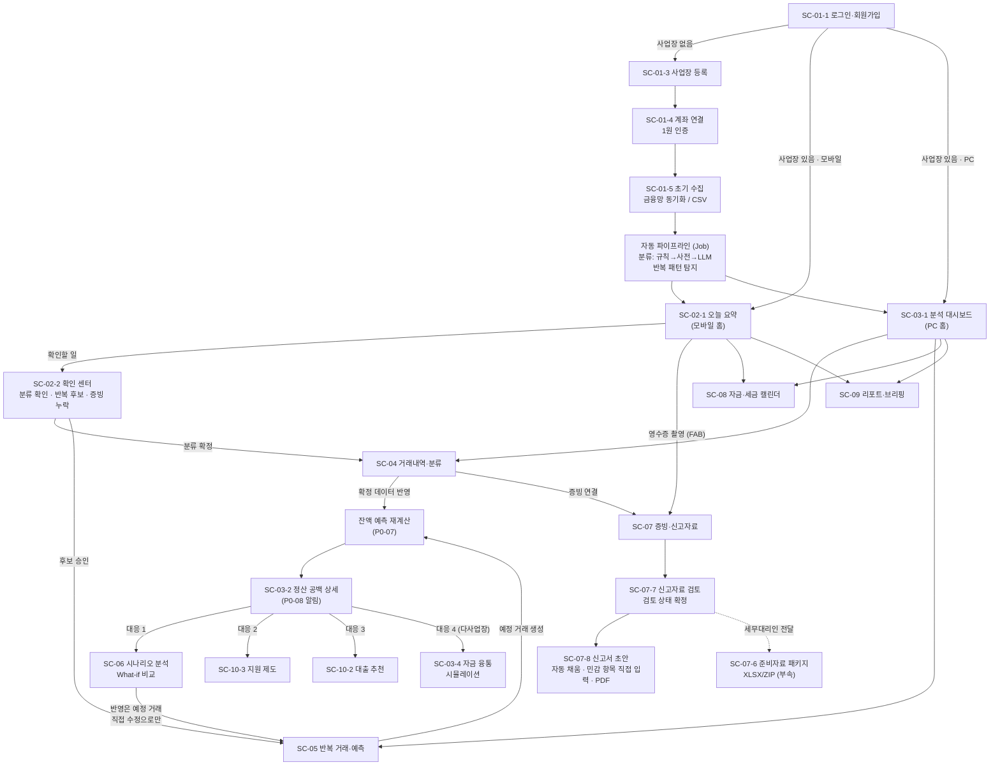
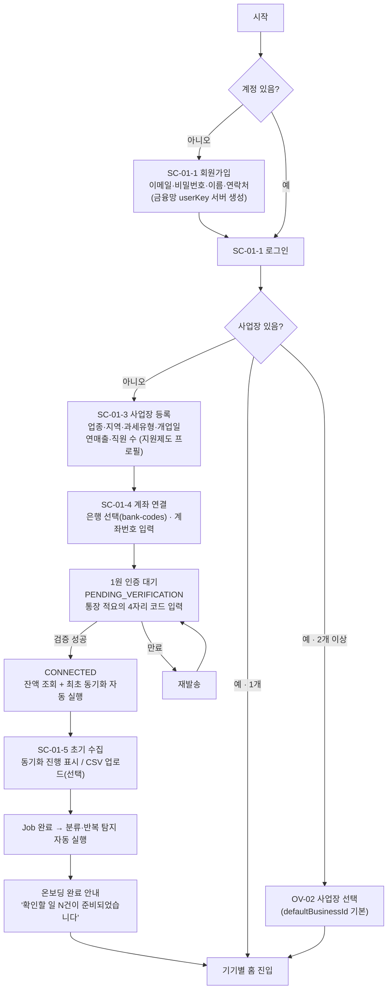
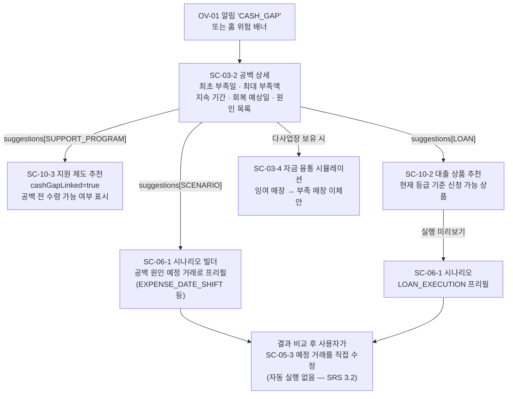

# 화면 구성도

# Jango-Yebo(잔고예보) — 화면 구성도 · IA(Information Architecture) 문서

| 항목 | 내용 |
| --- | --- |
| 문서명 | Jango-Yebo 화면 구성도 |
| 버전 | v1.6 |
| 작성일 | 2026-09-01 |
| 작성자 | SSAFY 광주 1반 C105 |
| 문서 상태 | Draft — 팀 검토용 |
| 근거 문서 | `docs/기능명세서_SRS.md` v1.8 (6장 화면 목록, 7장 기능 요구사항), `docs/api/` v1.8 (README 4장 화면↔API 매핑 및 각 도메인 명세, 10.1·10.4·10.7 예측 모델, 14.3 신고서 초안, 14.4~14.7 상품별 매출 구성비), `docs/예측엔진_설계노트.md` v2, `소상공인_정산공백_예측서비스_기획정리본.md` §4.6·§6.5·§6.8 |
| 문서 범위 | P0 코어 MVP 13개 + P1 우선 확장 18개 기능의 화면 구성. SC-11(요식업 운영)은 P2 이관으로 예약만, SC-10-5(문서 편집기)는 v1.2에서 범위 제외, 원자재 지표(P1-06)는 v1.5에서 범위 제외, 재료비 변화 What-if는 v1.6에서 범위 제외 |

> API 참조 표기: `API 15.4`는 `docs/api/15_캘린더_리포트_대시보드.md`의 15.4절을 뜻한다(도메인 파일의 장 번호 규칙, API README 참조).

---

## 1. 설계 원칙 — 디바이스 적응형 우선순위

### 1.1 핵심 원칙: "기능은 동등하게, 우선순위는 다르게"

SRS 1.3의 "반응형 매장용 화면과 심층 분석용 웹 대시보드"를 다음 원칙으로 구체화한다.

1. **기능 게이팅 없음** — 모든 P0·P1 기능은 모바일과 PC 양쪽에서 사용할 수 있다. 특정 기기 전용 기능은 없다.
2. **우선순위 차등** — 기기별 주 사용 맥락에 맞춰 3가지를 다르게 설계한다.
   - **기본 랜딩 화면**: 로그인 후 모바일은 SC-02(오늘 요약), PC는 SC-03(분석 대시보드)에 도착한다.
   - **진입 깊이(depth)**: 주 사용 기능일수록 얕게 배치한다. 예: 영수증 촬영은 모바일에서 0-depth(하단 탭 중앙 FAB), PC에서는 1-depth(증빙 화면 내 업로드 버튼).
   - **기본 뷰(view)**: 같은 화면이라도 기기별 기본 형태가 다르다. 예: 캘린더는 PC에서 월간 그리드, 모바일에서 주간 스트립+아젠다 리스트.
3. **같은 데이터, 같은 API** — 기기별 화면은 동일 API를 사용하며 표현만 다르다. 별도 모바일 API를 만들지 않는다.

### 1.2 기기별 주 사용 맥락

| 기기 | 사용 맥락 | 대표 상황 |
| --- | --- | --- |
| **모바일** (스마트폰) | 매장 현장에서 짬이 날 때, 즉시 확인·즉시 처리 | 영업 중 잔액·오늘 입출금 확인, 배송 직후 영수증 촬영, 알림 받고 바로 확인, 확인 질문에 "맞아요" 한 번으로 응답 |
| **태블릿** (매장 카운터·포스 옆) | 모바일과 같은 맥락, 상시 거치 | 오늘 요약 상시 표시, 정산·입금 확인 |
| **PC** (사무·마감 시간) | 앉아서 하는 심층 분석·대량 정리·문서 작업 | 잔액 곡선·공백 원인 분석, 시나리오 조합 비교, 거래 일괄 분류 정리, 캘린더로 한 달 계획, 신고서 초안 검토·다운로드 |

### 1.3 기기별 우선 기능 매트릭스

"우선"은 진입 깊이와 기본 노출을 의미하며 기능 제한이 아니다.

| 기능 | 모바일 배치 | PC 배치 | 우선 기기 |
| --- | --- | --- | --- |
| 오늘 요약 (잔액·오늘 입출금·위험) | **홈 (0-depth)** | 대시보드 상단 KPI 스트립으로 흡수 | 모바일 |
| 영수증 촬영·증빙 업로드 (P0-10, P1-02) | **하단 탭 중앙 FAB (0-depth)** | 증빙 화면 내 드래그앤드롭 (1-depth) | 모바일 |
| 확인 질문 응답 — 분류·반복 후보 (P0-05, P1-01) | **홈 '확인할 일' 카드 스택 (1-depth)** | 거래·패턴 화면에서 테이블 인라인 처리 | 모바일 |
| 오늘 모아둘 돈·적립 기록 (P1-09) | **홈 카드 (0-depth)** | 대시보드 위젯 | 모바일 |
| 알림 확인·이동 (P0-08) | 헤더 벨 → 알림 센터 | 헤더 벨 → 알림 센터 | 모바일 |
| 잔액 예보 곡선·공백 분석 (P0-07·08) | 예보 탭 요약 → 상세 (1~2-depth) | **대시보드 = PC 홈 (0-depth)** | PC |
| 자금·세금 캘린더 (P1-18) | 캘린더 탭, 기본 아젠다 뷰 | **LNB 2순위, 월간 그리드** | PC |
| What-if 시나리오 (P0-09·13) | 프리셋 위저드 (전체 메뉴) | **3패널 빌더 (LNB)** | PC |
| 거래내역 정리·일괄 분류 (P0-02, P1-01) | 리스트+스와이프 (탭) | **필터+테이블+인라인 편집 (LNB)** | PC |
| 증빙 OCR 검토·매칭 (P1-02) | 촬영 직후 간이 검토 시트 | **원본+추출 필드 좌우 분할 검토**(좌표 하이라이트 없음 — SC-07-3) | PC |
| 정산 수동 대사 (P0-11) | 간이 폼 | **명세서 대조형 폼+결과 표** | PC |
| 신고서 초안·신고자료 내보내기 (P0-12) | 초안 요약·근거 열람, 생성 요청 | **초안 검토·민감 항목 입력·다운로드** | PC |
| 신고자료 검토 상태 확정 (P0-12, P1-23) | 진행률·남은 건수 확인 | **상태별 목록+다중 선택 일괄 지정** | **PC** |
| 리포트·브리핑 (P1-17·19) | **브리핑 읽기(피드) 우선** | 월별 리포트 차트 우선 | 브리핑=모바일 / 리포트=PC |
| 대출 현황·상환 일정 (P1-13) | 카드 요약 | 테이블+예측 반영 표시 | 공통 |
| 신용등급·대출 추천 (P1-14) | 카드 요약 | **비교 테이블+시나리오 연계** | PC |
| 지원 제도 검색·추천 (P1-15) | 추천 카드·마감 D-day 확인 | **자연어 검색+필터+비교** | PC |
| 다사업장 통합·자금 융통 (P1-12) | 스위처 내 요약 | **통합 대시보드+시뮬레이터** | PC |
| 계좌 연결·1원 인증 (P0-01) | 온보딩 공통 (통장 앱 전환이 잦아 모바일이 자연스러움) | 온보딩 공통 | 공통 |
| CSV 업로드 (P0-01) | 가능(파일 선택) | **권장 경로로 안내** | PC |
| 일회성 예정 거래 등록 (P0-06) | FAB 롱프레스 '빠른 추가' | 캘린더·예정 거래 화면의 등록 버튼 | 공통 |

### 1.4 반응형 브레이크포인트

| 구간 | 폭 | 레이아웃 |
| --- | --- | --- |
| Mobile | < 768px | 하단 탭 바 + 단일 컬럼 카드. 기본 랜딩 SC-02 |
| Tablet (매장용) | 768 ~ 1279px | **모바일 IA 유지**(하단 탭), 카드 2컬럼 확장. SRS·API 15.4의 "매장용 화면(태블릿/포스기)" 구간 |
| Desktop | ≥ 1280px | 좌측 LNB + 상단 GNB + 멀티컬럼. 기본 랜딩 SC-03 |

- 기준은 뷰포트 폭이다. PC 브라우저를 좁혀도 모바일 IA로 전환된다(반응형 단일 웹).
- 기본 랜딩만 기기별로 다르고, 이후 이동은 사용자가 자유롭다. 마지막 방문 화면 복원은 하지 않는다(항상 기기별 홈에서 시작).

---

## 2. 화면 목록 총괄

### 2.1 화면 ID 체계

- `SC-XX` : SRS 6장의 화면 ID를 그대로 사용한다.
- `SC-XX-N` : 본 문서에서 부여한 서브 화면 ID.
- `SET-XX` : 설정 그룹(SRS 화면 목록 외, 계좌·안전선 등 관리 진입점).
- `OV-XX` : 특정 화면에 속하지 않는 공통 오버레이(패널·시트·모달).

### 2.2 화면 총괄표

| ID | 화면 | 라우트(안) | 우선순위 | 연결 기능 | 우선 기기 |
| --- | --- | --- | --- | --- | --- |
| SC-01-1 | 로그인·회원가입 | `/auth/login`, `/auth/signup` | P0 | 인증 | 공통 |
| SC-01-2 | 사업장 선택·전환 | OV-02로 구현 | P0 | 권한 범위 선택 | 공통 |
| SC-01-3 | 온보딩 — 사업장 등록 | `/onboarding/business` | P0 | P1-15 프로필 수집 겸용 | 공통 |
| SC-01-4 | 온보딩 — 계좌 연결·1원 인증 | `/onboarding/account` | P0 | P0-01 | 공통 |
| SC-01-5 | 온보딩 — 초기 데이터 수집 | `/onboarding/import` | P0 | P0-01 | PC(CSV)/공통 |
| SC-02-1 | 오늘 요약 (모바일 홈) | `/b/{businessId}/today` | P0 | P0-07·08, P1-09·11·17 요약 | **모바일** |
| SC-02-2 | 확인 센터 (할 일) | `/b/{businessId}/inbox` | P0 | P0-05, P1-01, P0-10 누락 | **모바일** |
| SC-03-1 | 분석 대시보드 (PC 홈) | `/b/{businessId}/dashboard` | P0 | P0-07·08, P1-05~09·11 | **PC** |
| SC-03-2 | 정산 공백 상세 | `/b/{businessId}/dashboard/gaps/{cashGapId}` | P0 | P0-08 | 공통 |
| SC-03-3 | 자금 안전 관리 (안전선·준비금·부가세) | `/b/{businessId}/safety` | P1 | P1-08·09·11 | 공통 |
| SC-03-4 | 다사업장 통합·자금 융통 | `/overview` | P1 | P1-12 | **PC** |
| SC-04-1 | 거래 목록·필터 | `/b/{businessId}/transactions` | P0 | P0-02, P1-01 | **PC**(정리)/모바일(확인) |
| SC-04-2 | 거래 상세 | `/b/{businessId}/transactions/{transactionId}` | P0 | P0-02·10 | 공통 |
| SC-04-3 | 거래처 사전 | `/b/{businessId}/merchants` | P1 | P1-01·05 | PC |
| SC-05-1 | 반복 후보 인박스 | `/b/{businessId}/patterns?status=CANDIDATE` | P0 | P0-03·04·05 | 공통(모바일은 확인 센터 경유) |
| SC-05-2 | 확정 패턴 관리 | `/b/{businessId}/patterns` | P0 | P0-05, P1-04 | PC |
| SC-05-3 | 예정 거래 목록·등록 | `/b/{businessId}/planned` | P0 | P0-06, P1-04·05 | 공통 |
| SC-05-4 | 예측 정확도 | `/b/{businessId}/accuracy` | P1 | P1-05 | PC |
| SC-06-1 | 시나리오 빌더·결과 | `/b/{businessId}/scenarios/new` | P0 | P0-09·13, P1-14 연계 | **PC** |
| SC-06-2 | 저장 시나리오 목록 | `/b/{businessId}/scenarios` | P0 | P0-13 | 공통 |
| SC-07-1 | 증빙 업로드 (촬영) | OV-03 → 업로드 플로우 | P0 | P0-10, P1-02 | **모바일** |
| SC-07-2 | 증빙함 (목록) | `/b/{businessId}/evidences` | P0 | P0-10 | 공통 |
| SC-07-3 | 증빙 검토 (OCR 추출·매칭) | `/b/{businessId}/evidences/{evidenceId}` | P1 | P1-02 | **PC**(정밀)/모바일(간이) |
| SC-07-4 | 품목 가계부 | `/b/{businessId}/items` | P1 | P1-03 | PC |
| SC-07-5 | 정산 수동 대사 | `/b/{businessId}/settlements` | P0 | P0-11 | PC |
| SC-07-6 | 신고자료 내보내기 (부속 패키지) | `/b/{businessId}/exports` | P0 | P0-12 | **PC** |
| SC-07-7 | 신고자료 검토 (검토 상태 확정) | `/b/{businessId}/exports/review` | P0(최소)/P1(전용 화면) | P0-12, P1-23 | **PC** |
| SC-07-8 | 신고서 초안 (자동 채움·근거·민감 항목 입력·내보내기) | `/b/{businessId}/tax-drafts`, `/b/{businessId}/tax-drafts/{draftId}` | P0 | P0-12 | **PC** |
| SC-08-1 | 자금·세금 캘린더 | `/b/{businessId}/calendar` | P1 | P1-18·04 | **PC**(월간)/모바일(아젠다) |
| SC-08-2 | 일자 상세 | `/b/{businessId}/calendar/{date}` | P1 | P1-18 | 공통 |
| SC-08-3 | 세금 일정 | `/b/{businessId}/taxes` | P1 | P1-11·18 | 공통 |
| SC-09-1 | AI 브리핑 피드·상세 | `/b/{businessId}/briefings` | P1 | P1-17 | **모바일**(읽기) |
| SC-09-2 | 월별 지출·수익 리포트 | `/b/{businessId}/reports/{month}` | P1 | P1-19 | **PC** |
| SC-09-3 | 상품별 매출 구성비 등록·조회 | `/b/{businessId}/product-sales` | P1 | P1-22 | 등록 **모바일** / 조회 **PC** |
| SC-10-1 | 대출 현황 | `/b/{businessId}/loans` | P1 | P1-13 | 공통 |
| SC-10-2 | 신용등급·대출 상품 추천 | `/b/{businessId}/credit` | P1 | P1-14 | PC |
| SC-10-3 | 지원 제도 검색·추천 | `/b/{businessId}/support` | P1 | P1-15 | PC |
| SC-10-4 | 지원 제도 상세 | `/b/{businessId}/support/{programId}` | P1 | P1-15 | 공통 |
| SC-11 | 요식업 운영 (발주·재고·원가) | — | P2 | P2-14·15 등 | 이관 — v1 네비게이션에서 제외 |
| SET-01 | 설정 홈·프로필 | `/b/{businessId}/settings` | P0 | — | 공통 |
| SET-02 | 사업장 관리 | `/b/{businessId}/settings/business` | P0 | P1-15 프로필 | 공통 |
| SET-03 | 계좌·데이터 관리 | `/b/{businessId}/settings/accounts` | P0 | P0-01 | 공통 |
| SET-04 | 예측 옵션 | `/b/{businessId}/settings/forecast` | P1 | P0-07·P1-07 | PC |
| OV-01 | 알림 센터 | 패널(PC)/시트(모바일) | P0 | P0-08 알림 전 유형 | 공통 |
| OV-02 | 사업장 스위처 | 헤더 드롭다운/시트 | P0 | P1-12 | 공통 |
| OV-03 | 빠른 추가 (촬영·예정 거래) | 모바일 FAB 시트 | P0 | P0-06·10 | 모바일 |
| OV-04 | 작업(Job) 센터 | 헤더 인디케이터+패널 | P0 | 202 Job 공통 패턴 | 공통 |

### 2.3 기능 커버리지 점검 (P0·P1 → 화면)

| 기능 | 주 화면 | 보조 노출 |
| --- | --- | --- |
| P0-01 수집 | SC-01-4·5 | SET-03 (재동기화·CSV·연동 해제) |
| P0-02 분류 | SC-04-1·2 | SC-02-2 확인 카드 |
| P0-03 반복 탐지 | SC-05-1 | OV-01 `PATTERN_CANDIDATE` 알림 |
| P0-04 다음 입출금 추천 | SC-05-1·2 (`nextExpected`) | SC-08 캘린더 표시 |
| P0-05 확인·수정 | SC-05-1·2, SC-02-2 | — |
| P0-06 일회성 등록 | SC-05-3 | OV-03, SC-08(날짜에서 등록) |
| P0-07 잔액 곡선 | SC-03-1 | SC-02-1 요약, SC-08 잔액 표시 |
| P0-08 공백 알림 | SC-03-2, OV-01 | SC-02-1 위험 배너 |
| P0-09·13 시나리오 | SC-06-1·2 | SC-03-2 '시나리오로' 진입 |
| P0-10 증빙 | SC-07-1·2 | SC-04-2 연결, SC-02-2 누락 카드 |
| P0-11 정산 대사 | SC-07-5 | OV-01 `SETTLEMENT_MISMATCH` |
| P0-12 신고서 초안·내보내기 | SC-07-8 | SC-07-7 검토 → 초안 진입, SC-07-6 부속 패키지 |
| P1-01 LLM 분류 | SC-04-1 (재실행·신뢰도) | SC-02-2, SC-04-3 사전 |
| P1-02 증빙 인식·매칭 | SC-07-3 | SC-07-1 직후 간이 검토 |
| P1-03 품목 가계부 | SC-07-4 | SC-09-2 하이라이트 링크 |
| P1-04 영업일·명절 보정 | 공통 뱃지(6.2) | SC-05·08·03 표시 |
| P1-05 예측 vs 실제 | SC-05-4 | SC-04-3 `avgDelayDays`, SC-03-1 품질 위젯 |
| P1-07 계절성 | SET-04 토글·피크월 | SC-03-1 적용 표시 |
| P0-07 잔여 흐름 모델 | SET-04 토글 | SC-03-1 마커·근거 요약, SC-05-4 베이스라인 비교 |
| P1-08 안전선 | SC-03-3 | SC-03-1 위젯, 곡선 기준선 |
| P1-09 준비금 | SC-03-3 | SC-02-1 오늘 모아둘 돈 |
| P1-11 부가세 | SC-03-3 | SC-02-1 가용잔액, SC-08-3 |
| P1-12 다사업장 | SC-03-4 | OV-02 |
| P1-13 대출 현황 | SC-10-1 | SC-08 상환일, 곡선 반영 |
| P1-14 신용·추천 | SC-10-2 | SC-06-1 `LOAN_EXECUTION` |
| P1-15 지원 제도 | SC-10-3·4 | SC-03-2 suggestions, SC-10-4 서류 발급처 링크 |
| P1-17 브리핑 | SC-09-1 | SC-02-1·03-1 헤드라인 |
| P1-18 캘린더 | SC-08-1·2·3 | — |
| P1-19 월별 리포트 | SC-09-2 | 브리핑 근거 재사용 |
| P1-22 상품별 매출 구성비 | SC-09-3 | SC-09-2 리포트 상품 기여도 블록, SC-06 `PRODUCT_SALES_CHANGE` 프리필 |
| P1-23 신고자료 검토·확정 | SC-07-7 | SC-07-6 요약 "미확인 N건" → 검토, 완료 시 SC-07-8 |

---

## 3. 전체 화면 흐름도

### 3.1 서비스 전체 흐름

SRS 6장의 주요 흐름 `연동/업로드 → 거래 분류 → 반복 후보 확인 → 잔액 예측 → 공백 알림 → 시나리오·대응 → 신고서 초안 채움·내보내기`를 화면 단위로 전개한 그림이다.



### 3.2 온보딩 흐름 (SC-01)



- 온보딩은 **건너뛰기 가능**(계좌 연결·수집 단계). 건너뛰면 홈에 "계좌를 연결하면 예보가 시작됩니다" 배너를 고정 노출한다.
- 계좌 인증 완료 전에는 동기화·예측 대상에서 제외된다(API 7.2) — 홈은 빈 상태 UX(6.4)로 대응.

### 3.3 정산 공백 대응 흐름 (P0-08 → 대응 기능)



### 3.4 알림 딥링크 라우팅

OV-01 알림 센터와 홈 배너에서 알림을 탭하면 `relatedRef`를 사용해 아래 화면으로 이동한다 (API 10.3의 알림 `type` 기준).

| 알림 type | 이동 화면 | 비고 |
| --- | --- | --- |
| `CASH_GAP` | SC-03-2 공백 상세 (`cashGapId`) | 모바일은 요약 시트 → 상세 |
| `SAFETY_LINE` | SC-03-3 자금 안전 관리 — 안전선 탭 | 하회일·원인 표시 |
| `RESERVE_SHORTFALL` | SC-03-3 — 준비금 탭 | 미달분 재배분 안내 |
| `SETTLEMENT_MISMATCH` | SC-07-5 해당 대사 상세 | 차이 금액 강조 |
| `PATTERN_CANDIDATE` | 모바일: SC-02-2 확인 센터 / PC: SC-05-1 | 새 후보 승인 유도 |
| `EVIDENCE_MISSING` | 모바일: OV-03 촬영 유도 / PC: SC-04-1 `hasEvidence=false` 필터 | 누락 다건 묶음 알림 |

---

## 4. 네비게이션 구조

### 4.1 모바일 — 하단 탭 바 + 중앙 FAB

```text
┌────────────────────────────────────────────┐
│ [카페 한잔 ▾]              [↻ 10:50] [🔔2] │ ← 상단 헤더 (고정)
│  OV-02 스위처               OV-04   OV-01  │
├────────────────────────────────────────────┤
│                                            │
│                (콘텐츠 영역)                │
│                                            │
├────────────────────────────────────────────┤
│   홈      거래    ( 📷 )   캘린더    전체   │ ← 하단 탭 바 (고정)
│ SC-02-1  SC-04-1  OV-03   SC-08-1   메뉴   │
└────────────────────────────────────────────┘
```

| 탭 | 화면 | 뱃지 |
| --- | --- | --- |
| 홈 | SC-02-1 오늘 요약 | 위험 등급 점 표시(`riskLevel != SAFE`) |
| 거래 | SC-04-1 거래 목록 (모바일 뷰) | 확인 필요 수(`classificationConfirmations`) |
| **📷 (중앙 FAB)** | OV-03 빠른 추가 — 탭: 카메라 즉시 실행(영수증 촬영), 위로 스와이프/롱프레스: 시트(갤러리 선택 · 예정 거래 등록 · CSV는 PC 안내) | — |
| 캘린더 | SC-08-1 (기본 아젠다 뷰) | 오늘 세금 일정 존재 시 점 |
| 전체 | 전체 메뉴 (아래 트리) | — |

**전체 메뉴 구성** (모바일 5번째 탭):

```text
전체
├─ 분석
│  ├─ 잔액 예보·대시보드 (SC-03-1 모바일 뷰)
│  ├─ 시나리오 분석 (SC-06)
│  ├─ 리포트·브리핑 (SC-09)
│  ├─ 상품별 매출 구성비 (SC-09-3)
│  └─ 예측 정확도 (SC-05-4)
├─ 거래 관리
│  ├─ 반복 거래·예정 거래 (SC-05)
│  ├─ 확인 센터 (SC-02-2)
│  └─ 거래처 사전 (SC-04-3)
├─ 증빙·세금
│  ├─ 증빙함 (SC-07-2)
│  ├─ 품목 가계부 (SC-07-4)
│  ├─ 정산 대사 (SC-07-5)
│  ├─ 신고자료 검토 (SC-07-7)
│  ├─ 신고서 초안 (SC-07-8)
│  ├─ 준비자료 내보내기 (SC-07-6)
│  └─ 세금 일정 (SC-08-3)
├─ 자금·지원
│  ├─ 자금 안전 관리 — 안전선·준비금·부가세 (SC-03-3)
│  ├─ 대출·신용 (SC-10-1·2)
│  └─ 지원 제도 (SC-10-3)
├─ 다사업장 통합 (SC-03-4) ※ 사업장 2개 이상일 때 노출
└─ 설정 (SET-01~04)
```

### 4.2 PC — 좌측 LNB + 상단 GNB

```text
┌──────────┬─────────────────────────────────────────────────────┐
│ 잔고예보  │ [카페 한잔 ▾]  [↻ 동기화 10:50 · 정상]   [🔔2] [김사장]│ ← GNB
│          ├─────────────────────────────────────────────────────┤
│ 대시보드  │                                                     │
│ 캘린더    │                                                     │
│ 거래내역  │                                                     │
│ 반복·예정 │                   (콘텐츠 영역)                      │
│ 시나리오  │                                                     │
│ 증빙·품목 │                                                     │
│ 정산·신고 │                                                     │
│ 리포트    │                                                     │
│ 대출·지원 │                                                     │
│ ──────── │                                                     │
│ 설정      │                                                     │
└──────────┴─────────────────────────────────────────────────────┘
```

| LNB 항목 | 화면 | 하위 |
| --- | --- | --- |
| 대시보드 | SC-03-1 | 공백 상세(SC-03-2), 자금 안전(SC-03-3) 위젯 진입 |
| 캘린더 | SC-08-1 월간 | 일자 상세 패널(SC-08-2), 세금 일정(SC-08-3) |
| 거래내역 | SC-04-1 | 거래 상세(SC-04-2), 거래처 사전(SC-04-3) 탭 |
| 반복·예정 | SC-05 | 후보/확정/예정/정확도 탭 |
| 시나리오 | SC-06-2 목록 | 빌더(SC-06-1) |
| 증빙·품목 | SC-07-2 | 검토(SC-07-3), 품목(SC-07-4) 탭 |
| 정산·신고 | SC-07-5 | 검토(SC-07-7), 신고서 초안(SC-07-8), 준비자료 내보내기(SC-07-6) 탭 |
| 리포트 | SC-09 | 브리핑/월별 리포트/상품별 매출 탭 |
| 대출·지원 | SC-10 | 대출/신용·추천/지원제도 탭 |
| 설정 | SET-01~04 | — |

**GNB 공통 요소**

| 요소 | 동작 | 근거 |
| --- | --- | --- |
| 사업장 스위처 (OV-02) | 사업장 전환 + "전체 사업장 보기"(SC-03-4). 현재 사업장의 `currentRiskLevel` 점 표시 | API 7.1, 19.1 |
| 동기화 상태 (OV-04) | `lastSyncedAt`·`syncStatus` 상시 표시. `FAILED` 시 경고색+재시도 버튼. 클릭 → 작업 센터 패널(진행 중 Job 목록) | API 7.3, SRS 가용성 |
| 알림 벨 (OV-01) | 활성 알림 수 뱃지 → 알림 패널. 항목 탭 시 3.4 라우팅 | API 10.3 |
| 프로필 | 내 정보(SET-01), 로그아웃 | API 6.3 |

### 4.3 사업장 컨텍스트 규칙

- 모든 화면은 **하나의 사업장 컨텍스트** 안에서 동작한다(라우트 `/b/{businessId}/...`). API 호출도 동일 businessId로 고정한다(SRS 3.2 권한 원칙).
- 사업장 전환은 어느 화면에서든 OV-02로 가능하며, 전환 시 **같은 화면의 동일 위치**로 재조회한다(예: 캘린더 9월 보던 중 전환 → 새 사업장의 9월 캘린더).
- 예외: SC-03-4(다사업장 통합)만 사용자 단위(`/users/me/dashboard`)로 동작하고, 매장 카드 클릭 시 해당 사업장 컨텍스트로 진입한다.
- 사업장이 1개면 OV-02는 사업장명만 표시(전환 UI 숨김), SC-03-4는 네비게이션에서 숨긴다.

---

## 5. 화면별 상세

> 각 화면의 "표시 데이터"는 해당 API 응답 필드 기준이다. 공통 뱃지(위험 등급·확실성·신뢰도·보정)는 6장 규칙을 따른다.

---

### 5.1 SC-01 로그인·사업장 선택·온보딩

| 항목 | 내용 |
| --- | --- |
| 목적 | 인증 후 사업장/계좌 범위를 확정하고, 첫 사용자를 데이터 수집까지 안내 |
| 연결 기능 | P0-01 (계좌 거래내역 수집) |
| 주요 API | `POST /auth/signup`·`/auth/login`(API 6), `GET/POST /businesses`(API 7.1), `GET /bank-codes`, `POST /businesses/{id}/accounts`, `POST /accounts/{id}/verify`(API 7.2), `POST /accounts/{id}/sync`, `POST /accounts/{id}/transactions/import`(API 7.3~7.4) |
| 진입 | 최초 접속, 로그아웃 후, 토큰 만료 |
| 이탈 | 완료 시 기기별 홈 (모바일 SC-02-1 / PC SC-03-1) |
| 우선 기기 | 공통 (단계 UI 동일, PC는 중앙 카드형) |

**구성 요소**

1. **SC-01-1 로그인·회원가입** — 이메일/비밀번호. 가입 필드: 이메일·비밀번호(8~64자, 영문+숫자+특수문자)·이름·연락처. 이메일 중복(`AUTH_EMAIL_DUPLICATED`) 인라인 오류. 금융망 userKey 생성은 서버 내부 처리라 UI 노출 없음(실패해도 가입 완료 — API 6.1).
2. **SC-01-3 사업장 등록** — 상호명, 사업자등록번호, 업종(`FOOD_CAFE` 등 7종 셀렉트), 지역, 과세 유형(일반/간이 — "부가세 일정 계산에 사용" 헬프 텍스트), 개업일, 연매출, 직원 수. 연매출·지역·개업일·직원 수는 "지원 제도 맞춤 추천에 사용됩니다" 안내(P1-15 프로필).
3. **SC-01-4 계좌 연결·1원 인증** — 은행 셀렉트(`GET /bank-codes`) → 계좌번호·별칭·주계좌 여부 → 등록 시 "입금된 1원의 적요에서 인증코드 4자리를 확인하세요" 안내 화면 → 코드 입력(4자리) → 성공 시 잔액·최초 동기화 자동 시작. 실패 분기: 코드 불일치(인라인), 만료(`ACCOUNT_AUTH_EXPIRED` → 재발송 버튼), 금융망 장애(`FIN_API_FAILED` → 재시도), 중복 연결(`ACCOUNT_ALREADY_LINKED`).
4. **SC-01-5 초기 데이터 수집** — 동기화 Job 진행 표시(가져온 거래 수), 또는 CSV 업로드(컬럼 규격 안내 표: 거래일시·적요·입금액·출금액·잔액, 10MB). CSV 결과에서 `rejectedRows`(행 번호·사유)와 `duplicateCount` 표시. "CSV 정리는 PC가 편해요" 안내(모바일).
5. **완료 스텝** — "거래 N건 수집 · 분류 진행 중 · 확인할 일 N건" 요약 후 홈 이동.

**PC 레이아웃** — 중앙 480px 카드, 상단 스텝 인디케이터(사업장 → 계좌 → 수집). 좌우 여백에 서비스 소개.

**모바일 레이아웃** — 전체 화면 스텝. 1원 인증 단계는 은행 앱 전환을 고려해 코드 입력창을 상단 고정, "은행 앱에서 확인하고 돌아오세요" + 재발송 타이머.

```text
[모바일 · SC-01-4]                 [PC · 공통 스텝 카드]
┌──────────────────────┐   ┌────────────────────────────────┐
│ ← 계좌 연결   (2/3)   │   │   ① 사업장 ─ ② 계좌 ─ ③ 수집    │
│                      │   │  ┌──────────────────────────┐  │
│ 신한은행 110-***-789  │   │  │  은행     [신한은행 ▾]     │  │
│ 로 1원을 보냈어요      │   │  │  계좌번호  [___________]   │  │
│                      │   │  │  별칭     [주거래 사업용]   │  │
│ 통장 입금내역 적요의    │   │  │  ☑ 주계좌로 사용           │  │
│ 4자리 숫자를 입력하세요 │   │  │        [1원 보내기]        │  │
│   [ 8 ][ 2 ][ 1 ][ 2 ]│   │  └──────────────────────────┘  │
│                      │   │   나중에 하기(건너뛰기) →        │
│ 재발송 (02:41 후 가능) │   └────────────────────────────────┘
│      [ 확인 ]         │
└──────────────────────┘
```

**상태** — 인증 대기 중 계좌는 목록에 `PENDING_VERIFICATION` 뱃지, 만료 시 `VERIFICATION_EXPIRED`+재발송. 온보딩 건너뛰기 시 홈 상단 고정 배너("계좌를 연결하면 잔액 예보가 시작됩니다 → 연결하기").

---

### 5.2 SC-02 매장용 오늘 요약 (모바일 홈)

| 항목 | 내용 |
| --- | --- |
| 목적 | 매장 현장에서 3초 안에 "오늘 돈 상태"와 "지금 할 일"을 파악 |
| 연결 기능 | P0-07·08 요약, P1-09(오늘 모아둘 돈), P1-11(가용잔액), P1-17(브리핑 헤드라인), P0-05·P1-01(확인할 일) |
| 주요 API | `GET /businesses/{id}/dashboard` (단일 조회 — API 15.4), 확인 센터: `GET /transactions?needsConfirmation=true`, `GET /recurring-patterns?status=CANDIDATE`, `GET /evidences?linked=false` |
| 진입 | 모바일·태블릿 기본 랜딩, 하단 탭 '홈' |
| 우선 기기 | **모바일·태블릿** (PC에서는 SC-03-1 상단 KPI로 흡수, 별도 화면 없음) |

**구성 요소 (카드 순서 = 우선순위)**

| # | 카드 | 표시 데이터 (API 15.4 응답 필드) | 탭 동작 |
| --- | --- | --- | --- |
| 1 | 위험 배너 (조건부) | `riskLevel != SAFE`일 때: 등급명+아이콘, `nearestCashGap.firstShortfallDate`·`maxShortfallAmount`·`dDay` — "9/14 잔액 부족 가능성 · 최대 80만 원 · D-14" | SC-03-2 공백 상세 |
| 2 | 잔액 카드 | `currentBalance`, `availableBalance`("지금 쓸 수 있는 돈"), `vatExcluded`("부가세 예수금 제외" 캡션), `lastSyncedAt`·`syncStatus` | 당겨서 새로고침=수동 동기화, 캡션 탭 → SC-03-3 부가세 탭 |
| 3 | 오늘 예정 | `today.expectedDeposit/Withdrawal`, `today.items[]` (제목·방향·금액 범위 "82만~96만 원") | 항목 탭 → SC-08-2 오늘 상세 |
| 4 | 오늘 모아둘 돈 | `todayReserve.totalDailyAmount`, `topPurpose`, `progressRate` 게이지, `remainingBusinessDays` — "9월 급여 40% 확보 · 6영업일" | [오늘 적립 기록] → `POST /reserves/{id}/deposits` 시트, 카드 탭 → SC-03-3 준비금 탭 |
| 5 | 확인할 일 | `pendingActions`: 반복 후보 N · 분류 확인 N · 증빙 누락 N · 알림 N (합계 뱃지) | SC-02-2 확인 센터 |
| 6 | 브리핑 헤드라인 | `latestBriefingHeadline` | SC-09-1 브리핑 상세 |

**모바일 레이아웃**

```text
┌─────────────────────────────┐
│ 카페 한잔 ▾        ↻10:50 🔔2│
├─────────────────────────────┤
│ ⚠ 주의 — 9/14 잔액 부족 가능 │
│   최대 80만 원 · D-14      ›│
├─────────────────────────────┤
│ 현재 잔액       5,000,000원 │
│ 지금 쓸 수 있는 돈           │
│              1,800,000원    │
│ (부가세 예수금 320만 원 제외)│
├─────────────────────────────┤
│ 오늘 예정                   │
│ ↓ 카드 정산   +82만~96만 원 │
│ ↑ 공과금            -3만 원 │
├─────────────────────────────┤
│ 오늘 모아둘 돈   300,000원  │
│ 9월 급여 ▓▓▓▓░░░░░░ 40%    │
│ 남은 영업일 6일             │
│        [ 오늘 적립 기록 ]    │
├─────────────────────────────┤
│ 확인할 일               10 ›│
│ 반복 후보 2 · 분류 확인 5    │
│ 증빙 누락 3                 │
├─────────────────────────────┤
│ 💬 "정산 입금은 줄고 급여    │
│    출금을 앞두고 있어요"   ›│
├─────────────────────────────┤
│  홈   거래  (📷)  캘린더 전체│
└─────────────────────────────┘
```

**태블릿(매장 거치)** — 동일 카드를 2컬럼 배치(좌: 위험·잔액·오늘 예정 / 우: 준비금·확인할 일·브리핑). 자동 새로고침 주기 옵션(5분).

**PC 대응** — 별도 화면 없음. SC-03-1 상단 KPI 스트립과 위젯이 동일 데이터를 흡수한다(1.1 원칙).

**SC-02-2 확인 센터 (할 일 카드 스택)** — 모바일 핵심 처리 UX. 카드 1장 = 확인 1건, 상단부터 순서대로 처리.

| 카드 유형 | 내용·근거 표시 | 액션 (API) |
| --- | --- | --- |
| 분류 확인 (P1-01) | "이거 **배달의민족 정산금** 맞나요?" + 적요·금액·`classification.reason`·신뢰도 | [맞아요] `POST /transactions/{id}/confirm-classification` / [다른 항목] 카테고리 시트 → `PATCH /transactions/{id}` / [나중에] |
| 반복 후보 (P0-05) | `suggestionMessage` 그대로("매주 화요일 정산금… 등록할까요?") + 주기·금액 범위·최근 거래 3건·적중률 | [등록] `POST /recurring-patterns/{id}/confirm` / [수정 후 등록] 금액·주기 시트 → confirm(body) / [반복 아니에요] `/dismiss` |
| 증빙 누락 (P0-10) | 증빙 없는 최근 지출 거래(일시·적요·금액) | [영수증 촬영] OV-03 → 업로드 시 `transactionId` 자동 연결 / [건너뛰기] |
| 예정 미발생 (P1-05) | `MISSED` 예정 거래 — "8/20 OO보험료가 아직 안 나갔어요" | [실제 거래와 연결] 매칭 시트 `POST /planned-transactions/{id}/match` / [취소 처리] `PATCH status=CANCELLED` |

- 처리할 때마다 스택이 줄고, 완료 시 "모두 확인했어요 — 예보 정확도가 올라갑니다" 완료 화면.
- PC에서는 이 화면 대신 SC-04-1(확인 필요 필터)·SC-05-1 테이블에서 같은 액션을 인라인 처리한다. PC 대시보드의 '할 일' 위젯에서 링크로 진입 가능.

---

### 5.3 SC-03 분석 대시보드 (PC 홈)

| 항목 | 내용 |
| --- | --- |
| 목적 | 잔액 곡선·공백 원인·신뢰 수준을 한 화면에서 심층 분석 (SRS SC-03) |
| 연결 기능 | P0-07·08, P1-05·07·08·09·11, P1-12(통합), P1-17 헤드라인 |
| 주요 API | `GET /forecast/balance`(10.1), `/forecast/cash-gaps`(10.2), `/alerts`(10.3), `/safety-line`(12.1), `/reserves/daily-plan`(12.3), `/vat/status`(12.4), `/forecast/accuracy`(10.4), `/forecast/seasonality`(10.6), `GET /users/me/dashboard`(19.1) |
| 진입 | PC 기본 랜딩, LNB '대시보드', 모바일 '전체 > 잔액 예보' |
| 우선 기기 | **PC** (모바일은 세로 스크롤 간소화 뷰) |

**SC-03-1 구성 요소**

1. **KPI 스트립** — 현재 잔액 / 가용 잔액(부가세 제외) / 30일 최저 잔액+날짜(`lowestPoint`) / 최초 부족일 D-day / 활성 알림 수. (모바일 홈 카드의 PC 대응)
2. **잔액 예보 곡선** (메인, P0-07)
   - 기간 토글 `7 | 14 | 30`일 (기본 30).
   - 라인: `expectedBalance`, 음영 밴드: `balanceMin~balanceMax`(범위), 기준선 2개: 안전선(`safetyLine`, 미설정 시 숨김+설정 유도), 0원.
   - 날짜 구간을 `riskLevel`로 색+패턴 구분(SAFE/CAUTION/DANGER/GAP — 색상 단독 금지, 6.1).
   - `adjustments[]` 마커: ⚑ 명절 지연(HOLIDAY_SHIFT)·계절성(SEASONALITY)·부가세(VAT_DUE)·오차 보정(ACCURACY_CORRECTION)·**잔여 흐름 모델(MODEL_RESIDUAL)**. 호버 시 `description` 툴팁.
   - 포인트 호버: 해당 일자 `expectedDeposit/Withdrawal`·잔액 범위. 클릭 → SC-08-2 일자 상세.
   - 헤더에 `confidence` 뱃지 + `basis` 요약("확정 14건·예측 6건·직접 입력 2건 기준") + `baseTime`.
   - **모델 반영 표시** — `basis.residual.applied`가 `true`면 요약 끝에 "+ 패턴 외 흐름(AI 추정)" 칩을 붙이고, 호버 시 `basis.residual`의 30일 합계 범위와 `modelName`·`modelVersion`을 보여 준다. `source: BASELINE`이면 "통계 추정", `applied: false`면 칩을 숨기고 `warnings`의 사유를 6번 경고 영역에 표시한다.
   - 칩 클릭 → SET-04(예측 옵션). **모델을 껐다 켜면 밴드 폭과 부족일이 달라지는 것이 곡선에서 그대로 보인다** — 모델 기여를 설명 없이 보여 주는 지점이다.
3. **정산 공백 패널** (우측, P0-08) — `cash-gaps.items[]` 카드: 최초 부족일, 최대 부족액·일자, 지속 기간, 회복 예상일, 원인 상위 2건, `suggestions` 3버튼(시나리오로 / 지원 제도 / 대출 확인). 카드 클릭 → SC-03-2.
4. **위젯 행** — ① 안전선: 설정액·하회 예상일·부족분(`shortfallAgainstLine`), 미설정 시 "추천값으로 설정"(12.1 recommendations) ② 준비금: 오늘 모아둘 돈·최우선 목표 진행률 ③ 부가세: 예상 납부 범위(`estimatedPayable.min~max`)·다음 납부일 ④ 예측 품질: 적중률(`hitRate`)·평균 날짜 오차·적용 중 보정, 클릭 → SC-05-4.
5. **브리핑 바** — 최신 헤드라인 + [열기] → SC-09-1.
6. **경고 영역** — `warnings[]`, `confidence: LOW/UNPREDICTABLE` 시 데이터 부족 안내(6.4).
7. **예보 준비 중 상태** *(2026-09-10)* — 첫 진입이라 아직 계산된 곡선이 없으면 `409 FORECAST_NOT_READY` 가 온다. **오류 화면이 아니다** — 서버가 그 호출로 계산을 예약하므로 "예보를 준비하고 있습니다" 안내와 함께 잠시 뒤 다시 부른다. 계좌가 하나도 연결되지 않은 경우는 `422 FORECAST_INSUFFICIENT_DATA` 로 6.4 의 빈 상태를 띄운다. 「지금 다시 계산」 버튼은 `POST /forecast/refresh` 이며 반영까지 몇 초 걸린다는 것을 문구에 남긴다.

**PC 레이아웃**

```text
┌──────┬────────────────────────────────────────────────────────────┐
│ LNB  │ 카페 한잔 ▾    ↻ 동기화 10:50 정상     🔔 2      김사장      │
│      ├────────────────────────────────────────────────────────────┤
│ 대시  │ 현재 잔액   가용 잔액    30일 최저        최초 부족일   알림  │
│ 보드● │ 500만 원   180만 원   -42만 (9/14)    9/14 (D-14)    2건  │
│ 캘린더├───────────────────────────────────────────┬────────────────┤
│ 거래  │ 잔액 예보  [7|14|30]  신뢰도 MEDIUM        │ 정산 공백 2건   │
│ 반복  │   ╭─╮  ░░범위 밴드░░                      │ ⛔ 9/14~15 (2일)│
│ 예정  │ ──╯  ╰──╮    ⚑주말이월   ⚑부가세          │ 최대 80만 부족  │
│ 시나  │ ---------╲------------- 안전선 200만      │ 회복 9/16      │
│ 리오  │           ╲   ╭────                      │ 원인: 급여 300만│
│ 증빙  │ ═══════════╲═╱═══════ 0원 ═══            │  주말 정산없음  │
│ 정산  │        GAP ╰╯ (9/14)                     │ [시나리오로]    │
│ 리포트│ 확정 14 · 예측 6 · 직접 2 · 기준 08-31 11시│ [지원제도][대출]│
│ 대출  ├──────────┬──────────┬──────────┬─────────┴────────────────┤
│ 지원  │ 안전선    │ 준비금    │ 부가세    │ 예측 품질                │
│ ───  │ 200만 원  │ 오늘 30만 │ 150~210만│ 적중률 87% · 오차 1.2일  │
│ 설정  │ 9/12 하회 │ 급여 40%  │ 10/25 예정│ 보정: 배민 +1일 적용 중  │
│      ├──────────┴──────────┴──────────┴──────────────────────────┤
│      │ 💬 최신 브리핑: "정산 입금은 줄고 급여 출금을 앞두고…" [열기] │
└──────┴────────────────────────────────────────────────────────────┘
```

**모바일 레이아웃 (전체 > 잔액 예보)** — 세로 1컬럼: KPI 2×2 그리드 → 곡선(가로 스크롤 없이 기간 토글, 마커는 탭 툴팁) → 공백 카드 → 위젯 아코디언. 곡선 터치 시 해당 일자 하단 요약 바.

**SC-03-2 공백 상세** — 공백 1건의 전체 정보: 기간 타임라인(부족 시작→최대→회복), 원인 목록(`causes[]` — 각 항목이 예정 거래로 링크: SC-05-3), 관련 곡선 확대, 대응 3버튼(3.3 흐름), 안내 문구는 가능성 표현(6.3). 모바일은 알림 탭 시 바텀시트 요약 → 전체 보기.

**SC-03-3 자금 안전 관리** — 탭 3개:

| 탭 | 내용 | API |
| --- | --- | --- |
| 안전선 (P1-08) | 현재 금액·산정 방식(`MANUAL`/`FIXED_COST_BASED`/`ESSENTIAL_EXPENSE_BASED`)·자동 갱신 토글, 추천값 2종 비교 카드("최근 30일 고정비 220만" / "급여+임차료 180만") → 원클릭 적용, 현재 상태(하회 예상일·부족분·원인) | 12.1 |
| 준비금 (P1-09) | 준비금 카드 목록(목적·카테고리·목표액/일·진행 게이지·하루 적립액·`achievable`), 우선순위 드래그 정렬, [+ 준비금 만들기](예정 거래 연결 옵션), 오늘 적립 기록, `basis` 토글(SAFE/EXPECTED), 이월 안내(`carryOver`), 달성 불가 시 대응 링크(`unachievableFallback` → 시나리오·지원·대출) | 12.2~12.3 |
| 부가세 (P1-11) | 과세 유형, 현재 과세기간·신고 기한·예정고지일, 예수금 추정(`estimatedVatHeld`)·매입세액·예상 납부 범위, 가용 잔액 분해 도넛(잔액=쓸 수 있는 돈+부가세 몫), 주간 적립 추천액, `disclaimer` 고정 노출 | 12.4 |

**SC-03-4 다사업장 통합·자금 융통 (P1-12)** — 사업장 2개 이상일 때. 상단 합산(`totalBalance`, `combined.next30dLowestBalance/Date`) + 매장 카드 그리드(매장별 잔액·위험 등급·가까운 공백일·30일 최저 — 클릭 시 해당 사업장 컨텍스트 전환). 하단 **자금 융통 시뮬레이터**: 날짜 선택 → `POST /users/me/transfer-simulations` → 매장별 잉여/부족 표, 이체 계획(`plans[]`: from→to·금액, MCMF 최소 건수), 적용 후 예상(`afterSimulation`), 미해결분(`unresolvedAmount`)은 지원·대출 연계 표시. **"시뮬레이션 결과이며 실제 이체는 수행하지 않습니다" 고정 문구**(API 19.2). 모바일: 매장 카드 세로 스크롤 + 시뮬레이터는 결과 요약 중심.

---

### 5.4 SC-04 거래내역·분류

| 항목 | 내용 |
| --- | --- |
| 목적 | 거래 확인·분류 수정·증빙 연결 (SRS SC-04) |
| 연결 기능 | P0-02, P1-01, P0-10(연결) |
| 주요 API | `GET /businesses/{id}/transactions`(8.2), `PATCH /transactions/{id}`(8.3), `POST /transactions/{id}/confirm-classification`(8.4), `POST /businesses/{id}/classification-jobs`(8.5), `GET /merchants`(8.6), `POST /evidences/{id}/link`(13.4) |
| 진입 | 탭/LNB '거래', 홈 확인할 일, 알림 `EVIDENCE_MISSING`, 캘린더 과거 일자 |
| 우선 기기 | **PC = 대량 정리** / 모바일 = 확인·검색 |

**공통 필터** (8.2 쿼리와 1:1): 기간(기본 최근 31일), 계좌, 방향, 카테고리, 분류 상태(`UNCLASSIFIED/SUGGESTED/CONFIRMED`), **세무 검토 상태**(`taxReviewStatus`, 복수 선택), 확인 필요만, 증빙 없는 것만, 금액 범위, 적요·거래처 검색.

**해제된 계좌의 거래는 기본으로 안 보인다** — 연동을 끊은 계좌의 거래를 목록에 섞어 두면 그것을 더해 만드는 숫자가 전부 부풀고, 그 계좌 잔액은 이미 총잔액에서 빠져 있어 앞뒤가 맞지 않는다(8.2 `includeDisconnected`). 계좌 필터에 해제된 계좌를 노출하는 경우 그 항목을 고를 때 `includeDisconnected=true` 를 함께 보낸다 — 안 보내면 빈 목록이 와서 「거래 없음」과 구분되지 않는다. 포함해 보고 있는 동안에는 **「해제된 계좌 포함」이 켜져 있음을 목록 위에 표시**한다(색 단독 금지 — 도메인 규칙 6).

**PC 레이아웃 — 테이블 + 우측 상세 패널**

```text
┌────────────────────────────────────────────────────────────────┐
│ [기간 8/1~8/31▾][계좌▾][방향▾][카테고리▾][상태▾]  ☑확인필요 ☑증빙없음│
│ [🔍 적요·거래처 검색]                [CSV 업로드] [AI 분류 재실행]│
├──────────────────────────────────────────────┬─────────────────┤
│ 일시     적요        분류▾        금액   증빙 │ 거래 상세        │
│ 8/25 화  우아한형제들  플랫폼 정산   +85만  —  │ 우아한형제들     │
│          AI 86% ? [맞아요][수정]              │ +850,000원      │
│ 8/24 월  서울우유광주  재료비 ✓확정  -15.6만 📎│ 잔액 585만      │
│ 8/23 일  김철수       미분류        -30만  —  │ ───────────    │
│ …                                            │ 분류: 플랫폼 정산│
│                                              │ 근거: "적요 '우아│
│                                              │ 한형제들'은 배민 │
│                                              │ 정산 계좌명"     │
│                                              │ [분류 수정▾]     │
│                                              │ [증빙 연결 +]    │
│                                              │ 메모 [________] │
│ ‹ 1 2 3 … ›                                  │ ☐ 집계에서 제외  │
└──────────────────────────────────────────────┴─────────────────┘
```

- 분류 컬럼 인라인 편집: 셀렉트에서 카테고리 변경 → 즉시 `PATCH`(→ `CONFIRMED`·`USER` 전환, 거래처 사전 축적 — 8.3).
- `SUGGESTED` 행은 신뢰도·[맞아요]/[수정] 인라인 버튼(확인 질문의 PC 대응).
- [AI 분류 재실행] → `classification-jobs`(202) → OV-04 진행 표시, 완료 시 "34건 분류 · 6건 확인 필요" 토스트.
- 행 클릭 → 우측 상세 패널(SC-04-2): `classification.reason`, 분류 이력, 증빙 연결(+후보 추천 — 13.4), 메모, `isExcluded` 토글("**예측에서 제외**"), 세무 검토 상태(읽기 전용 — 편집은 SC-07-7).
- `isExcluded`(예측 제외)와 세무 검토 상태는 독립적이다. 장비 구입은 예측에서 빼되 경비로 인정될 수 있어 라벨을 "집계 제외"에서 "예측에서 제외"로 바꿨다(6.2 참조).

**모바일 레이아웃 — 리스트 + 스와이프**

```text
┌─────────────────────────────┐
│ 거래         [🔍] [필터 ⚙(2)]│
│ ‹ 확인 필요 5 › (상단 고정 칩)│
├─────────────────────────────┤
│ 8월 25일 (화)               │
│ ↓ 우아한형제들     +850,000 │
│   플랫폼 정산? AI 86%       │
│   [맞아요]  [다른 항목]      │
│ ↑ 공과금            -30,000 │
│   ✓ 확정 · 증빙 없음 [📷]   │
│ 8월 24일 (월)               │
│ ↑ 서울우유광주     -156,000 │
│   재료비 ✓ · 📎1            │
│ …                           │
├─────────────────────────────┤
│  홈  [거래] (📷) 캘린더 전체 │
└─────────────────────────────┘
```

- 항목 탭 → 상세 바텀시트(분류 수정 칩 그리드, 증빙 썸네일, 메모).
- 지출 항목 좌스와이프 → [📷 증빙 촬영](OV-03, `transactionId` 자동 연결). `SUGGESTED` 항목 우스와이프 → [맞아요].
- 필터는 풀스크린 시트, 적용 개수 뱃지.

**SC-04-3 거래처 사전 (P1-01·05, PC 우선)** — 테이블: 표시명, 매칭 패턴(칩 편집), 기본 카테고리, 확정 횟수, 평균 정산 지연일(`avgDelayDays` — "예측 보정에 사용" 툴팁), 최근 사용일. `PATCH /merchants/{id}`. "수정하면 이후 같은 적요는 자동 분류됩니다" 안내.

**상태** — 빈 목록: 계좌 연결/CSV 유도. `UNCLASSIFIED` 다수: 상단 "미분류 34건 — AI 분류 실행" 배너.

---

### 5.5 SC-05 반복 거래·예측

| 항목 | 내용 |
| --- | --- |
| 목적 | 반복 후보 승인과 미래(예정) 거래 관리 — 예측 입력 데이터의 관리 화면 (SRS SC-05) |
| 연결 기능 | P0-03·04·05·06, P1-04·05 |
| 주요 API | `GET /recurring-patterns`(9.2), `POST …/confirm`·`/dismiss`, `PATCH /recurring-patterns/{id}`(9.3), `GET/POST /planned-transactions`(9.4), `POST/DELETE …/match`(9.5), `GET /forecast/accuracy`(10.4) |
| 진입 | LNB '반복·예정', 홈 확인할 일→후보, 공백 원인→예정 거래, 캘린더 항목 |
| 우선 기기 | PC(관리·정확도) / 모바일(후보 승인은 SC-02-2 확인 센터 경유) |

**탭 구성 (PC 기준)**: `후보 (N)` | `확정 패턴` | `예정 거래` | `정확도`

1. **SC-05-1 후보 인박스** — 후보 카드 리스트. 카드: `suggestionMessage`, 주기 요약("매주 화요일"·"매월 14일"·"N일 간격"), 금액 통계(평균·중앙값·min~max), 다음 예상(`nextExpected` — 명절 보정 시 원래 날짜 병기), 신뢰도 뱃지+적중률+표본 수, 최근 거래 3건 미리보기. 액션: [등록(승인)] / [수정 후 등록](카테고리·금액 범위·명절 규칙 폼) / [반복 아니에요(무시)]. 무시는 재탐지에서 다시 올라오지 않음 안내(9.3).
2. **SC-05-2 확정 패턴 관리** — 테이블: 거래처/제목, 방향·카테고리, 주기, 다음 예정일(보정 뱃지), 금액 범위, 명절 규칙(`NEXT_BUSINESS_DAY`/`PREVIOUS_BUSINESS_DAY`/`NONE` 셀렉트), 적중률, 상태 토글(`CONFIRMED ↔ PAUSED` — "일시중지하면 미래 예정 거래가 예보에서 빠집니다" 확인 다이얼로그).
3. **SC-05-3 예정 거래** — 기간 필터(최대 92일), 상태 뱃지(`EXPECTED/CONFIRMED/MATCHED/MISSED/CANCELLED`), 출처 뱃지(`PATTERN/USER/TAX/LOAN` — TAX·LOAN은 자동 생성 안내, TAX는 금액만 수정 가능 — 9.4). [+ 일회성 거래 등록](P0-06 폼: 방향·카테고리·제목·예정일·금액(확정 or 범위)·계좌·메모). `MISSED` 행 강조 → [실제 거래 연결](매칭 시트)·[취소]. `PATTERN` 생성분 삭제 시도 시 "취소 처리로 대체됩니다" (9.4).
4. **SC-05-4 예측 정확도 (P1-05, PC 우선)** — 요약 카드(적중률·평균 날짜 오차·평균 금액 오차율·매칭/미발생/예상외 건수), 월별 적중률 추이 차트, 거래처별 테이블(`avgDelayDays`·`avgAmountErrorRate`·`appliedCorrection` — "예측일 +1일 보정 적용 중"), 미발생(missed)·예상외(unexpected) 리스트 → 각각 매칭·후보 검토로 연결.
   - **모델 비교 카드** (`modelComparison` — 10.4): 통계 베이스라인과 모델을 **다운스트림 지표 2종**(`gapF1` 정산 공백 발생 F1, `firstShortfallDateErrorDays` 최초 부족일 오차)으로 나란히 놓고, 현재 도는 쪽(`activeVariant`)에 뱃지를 단다. 평가 기간(`evaluationPeriod`)을 함께 표기한다.
   - 모델이 베이스라인을 넘지 못하면 `activeVariant`가 `BASELINE`이고 카드에 "지금은 통계 방식으로 예보하고 있습니다"를 명시한다. **더 나은 쪽이 도는 것이 정상 동작**이라는 점을 문구로 남긴다 — 모델이 꺼져 있는 것을 고장으로 읽지 않게 한다.
   - `modelComparison: null`(표본 부족)이면 카드 자리에 "비교할 실적이 아직 쌓이지 않았습니다"를 둔다.
   - 수치는 **합성 시연 데이터 기준**임을 카드 하단 각주로 밝힌다(설계노트 M-2 「표현의 정확성」).

**모바일 레이아웃** — 동일 4개 세그먼트 탭, 카드형. 후보 승인은 확인 센터와 동일 카드 UI 재사용. 예정 거래 등록 폼은 풀스크린 시트(OV-03에서도 진입).

> 입금 후보는 채널마다 성격이 다르게 보인다. **배달 플랫폼 정산**은 주 1회 큰 금액 한 건, **카드사 정산**은 영업일마다 소액이며 주 초 금액이 크다(주말 매출분 유입). 같은 매장에서 두 종류가 함께 잡히므로 목록에서 구분되도록 거래처명을 앞세운다.

```text
[PC · 후보 카드]                        [모바일 · 예정 거래]
┌───────────────────────────────┐   ┌──────────────────────┐
│ 🔁 배달의민족 · 입금 후보       │   │ 후보2 확정 예정 정확도 │
│ "매주 화요일 정산금이 입금되고  │   ├──────────────────────┤
│  있습니다. 다음 9/1, 82~96만   │   │ 9/1(화) ↓배민정산     │
│  원으로 등록할까요?"           │   │  82~96만 · 예측       │
│ 주기 매주 화 · 표본 12회       │   │ 9/1(화) ↓카드정산     │
│ 적중률 92% · 신뢰도 MEDIUM     │   │  28~34만 · 예측       │
│ 최근: 8/25 85만 · 8/18 88만…  │   │ 9/10(목)↑머신교체     │
│ [등록] [수정 후 등록] [아니에요]│   │  150만 · 직접 등록    │
└───────────────────────────────┘   │ 9/12(토)↑원천세 [세금]│
                                    │ ⚠ 8/20 보험료 미발생  │
                                    │  [연결하기] [취소]    │
                                    │       [+ 예정 등록]   │
                                    └──────────────────────┘
```

---

### 5.6 SC-06 시나리오 분석 (What-if)

| 항목 | 내용 |
| --- | --- |
| 목적 | 정산 지연·지출 변화 등 파라미터 조합의 영향을 원본과 나란히 비교 (SRS SC-06) |
| 연결 기능 | P0-09(기본 3종), P0-13(조합·저장·재계산), P1-14(`LOAN_EXECUTION`) |
| 주요 API | `POST /businesses/{id}/scenarios`(11.1), `GET /scenarios`·`GET/PATCH/DELETE /scenarios/{id}`(11.2) |
| 진입 | LNB '시나리오', SC-03-2 [시나리오로](프리필), SC-10-2 [실행 미리보기](LOAN 프리필), 준비금 달성불가 fallback |
| 우선 기기 | **PC = 3패널 빌더** / 모바일 = 프리셋 위저드 |

**파라미터 8종 (11.1)** — 자유 조합:

| 칩 | 입력 필드 | 기능 |
| --- | --- | --- |
| 정산 지연 | 대상 패턴(전체 가능)·지연 일수 | P0-09 |
| 입금 감소 | 감소율(%)·대상 패턴(선택) | P0-09 |
| 추가 지출 | 날짜·금액·제목 | P0-09 |
| 추가 입금 | 날짜·금액·제목 | P0-13 |
| 지출일 변경 | 예정 거래 선택·새 날짜 | P0-13 |
| 매출 변화 | 변화율(음수 허용) | P0-13 |
| **상품 매출 변화** | 상품 선택 · 판매량 변화율 · 단가 변화율 | P0-13 (P1-22 구성비 연동) |
| 대출 실행 | 금액·금리·기간·상환 방식·실행일 | P1-14 |

**PC 레이아웃 — 3패널**

```text
┌──────────────┬──────────────────────────────┬──────────────────┐
│ 파라미터      │  잔액 곡선 비교 [7|14|30]     │ 비교 요약         │
│ [+ 추가 ▾]   │                              │        원본→변경  │
│ ┌──────────┐ │  ── 원본    ─── 변경         │ 최저잔액          │
│ │정산 지연   │ │      ╲   ╭──                │ -42만 → -215만 ▼ │
│ │배민 · +2일 │ │  ─────╲─╱── 안전선          │ 최초 부족일       │
│ │        ✕ │ │  ══════╳═══════ 0원         │ 9/14 → 9/12 ▼    │
│ └──────────┘ │       ╲ ╱  ← 변경 곡선       │ 공백 기간         │
│ ┌──────────┐ │        ╳                    │ 2일 → 5일 ▼      │
│ │추가 지출   │ │  기준 08-31 11:00           │ 안전선 하회       │
│ │9/10 150만 │ │  신뢰도 MEDIUM              │ 3일 → 7일 ▼      │
│ │머신 교체 ✕│ │                             │ ───────────      │
│ └──────────┘ │                              │ 이름 [정산지연+  │
│ [계산하기]    │                              │  머신교체]       │
│              │                              │ [저장] [저장않고 │
│ 저장된 시나리오│                              │  결과만]         │
│ · 정산 지연…  │                              │                  │
│ · 급여 인상…  │                              │                  │
└──────────────┴──────────────────────────────┴──────────────────┘
```

- 원본 곡선은 회색 고정, 변경 곡선은 강조색. `comparison`의 4개 지표(최저잔액·최초 부족일·공백 기간·안전선 하회일)를 원본→변경 델타(악화 ▼/개선 ▲)로 표시.
- [계산하기] = `save:false`(200, 결과만) → 만족 시 [저장](`save:true`, 201). "원본 예보는 바뀌지 않아요 — 반영하려면 예정 거래를 직접 수정하세요" 고정 안내 + [예정 거래로 이동].
- 저장 목록(SC-06-2): 이름·파라미터 요약·생성일. **열람 시 최신 데이터로 재계산**됨을 `baseTime`과 함께 표시("저장 당시가 아닌 현재 기준 결과입니다" — 11.2). 이름 수정·삭제.

**모바일 레이아웃 — 프리셋 위저드**

```text
Step 1 무엇이 걱정되나요?        Step 2 값 입력        Step 3 결과
┌────────────────────┐   ┌────────────────┐   ┌────────────────────┐
│ ◻ 정산이 늦게 들어옴 │   │ 정산 지연       │   │ 최저잔액            │
│ ◻ 입금이 줄어듦      │   │ 대상 [배민 ▾]  │   │ -42만 → -215만 ▼   │
│ ◻ 큰 지출이 생김     │   │ 지연 [2]일     │   │ 부족 시작 9/12 (2일↑)│
│ ◻ 지출일을 옮기면?   │ → │ ─────────      │ → │ ▽ 미니 곡선         │
│ ◻ 대출을 받으면?     │   │ 추가 지출       │   │ [저장] [파라미터 수정]│
│ (복수 선택)   [다음] │   │ 9/10 · 150만   │   │ [예정 거래 수정하러  │
└────────────────────┘   │        [계산]   │   │  가기]              │
                         └────────────────┘   └────────────────────┘
```

- 프리셋 선택지가 곧 파라미터 타입. 결과는 비교 표 우선, 곡선은 보조(가로 화면 안내).
- 공백 상세에서 진입하면 Step 1을 건너뛰고 원인 기반 프리필.

**상품 매출 변화 칩 (P1-22 연동)**

```text
┌──────────────────────────────────┐
│ 상품 매출 변화                     │
│ 상품  [카페라떼 ▾]  (구성비 24.2%) │
│ 판매량  [ −5 ]%   ← 직접 가정      │
│ 단가    [ +10 ]%                  │
│ ────────────────────────────      │
│ 예상 총매출 변화  +1.09%           │
│ 2026-08 구성비 기준           ✕   │
└──────────────────────────────────┘
```

- 상품 셀렉트는 `GET .../product-sales`의 상품 목록. **구성비가 등록되지 않은 사업장은 이 칩이 비활성**이고 [상품별 매출 등록하기 →] SC-09-3로 안내한다(`409 PRODUCT_SALES_NOT_REGISTERED`).
- 판매량·단가를 **각각 입력**받는다. "가격을 올리면 얼마나 덜 팔릴지"는 서비스가 모르므로 "판매량 변화는 직접 가정하세요" 안내를 칩 안에 고정 표시한다.
- 칩 하단에 환산된 총매출 변화율과 **어느 기간 구성비를 썼는지**를 항상 보여준다. 계절성 메뉴는 기간에 따라 구성비가 달라진다.
- **매출 변화까지만 말한다.** 이익·마진·손익분기는 표시하지 않는다(원가 미보유, P2-03).
- SC-09-3에서 [시나리오로] 진입하면 해당 상품이 선택된 상태로 프리필된다.

---

### 5.7 SC-07 증빙·신고자료

| 항목 | 내용 |
| --- | --- |
| 목적 | 증빙 수집(촬영)→OCR 검토→거래 연결→품목 집계→정산 대사→**검토 상태 확정**→**신고서 초안 자동 채움**→내보내기의 전 과정 (SRS SC-07). 최종 목적은 **종합소득세 신고서 초안**이며, 신고 직전에 자료를 몰아서 모으면 누락·중복이 생기므로 평소에 축적한다(기획정리본 §4.6) |
| 연결 기능 | P0-10·11·12, P1-02·03 |
| 주요 API | Evidence API(13.1~13.5), Item API(13.6), Settlement API(14.1), Export API(14.2), Tax Draft API(14.3) |
| 진입 | 모바일 FAB(촬영), LNB '증빙·품목'/'정산·신고', 거래 상세 [증빙 연결], 알림 |
| 우선 기기 | **촬영·수집 = 모바일** / **검토·대사·내보내기 = PC** |

**SC-07-1 증빙 업로드 — 모바일 촬영 플로우 (0-depth 핵심)**

```text
(📷 FAB 탭)
   ↓
┌──────────────────────┐    ┌──────────────────────┐    ┌──────────────────────┐
│ 카메라 (즉시 실행)     │    │ 업로드 완료           │    │ 간이 검토 시트        │
│ ─ 영수증 가이드 프레임 │ →  │ "추출 중… 30초 정도"  │ →  │ 서울우유 광주대리점    │
│ [촬영] [갤러리] [PDF] │    │ (OCR Job 등록 202)   │    │ 8/30 · 156,000원     │
│ 종류: 영수증▾ (힌트)   │    │ [계속 촬영] [홈으로]  │    │ 부가세 14,182원       │
│ 연결할 거래(선택): ▾   │    │  ↓ 완료 알림/토스트   │    │ 품목 1건 · 신뢰도 88% │
└──────────────────────┘    └──────────────────────┘    │ 매칭 후보: 8/30 서울우유│
                                                        │  -156,000 (94%)      │
                                                        │ [확정+연결] [나중에   │
                                                        │  PC에서 검토] [수정]  │
                                                        └──────────────────────┘
```

- 연속 촬영 지원(배송 여러 건). 추출 대기 중에도 다른 작업 가능(OV-04에 Job 표시).
- "나중에 검토" 선택분은 증빙함의 **검토 대기(EXTRACTED)** 필터에 쌓인다 — PC 마감 작업으로 이어지는 동선.
- PC에서는 같은 플로우가 증빙함의 [파일 업로드](드래그앤드롭, JPG/PNG/PDF 10MB)로 시작된다.

**SC-07-2 증빙함** — 필터(연결 안 됨/`ocrStatus`/기간/유형), 카드 그리드(썸네일·유형 뱃지·추출 상태 뱃지·연결 여부). 상태 뱃지: `QUEUED/PROCESSING`(추출 중) → `EXTRACTED`(검토 대기, 강조) → `CONFIRMED`(확정) / `FAILED`(재시도·수기 입력 유도) / `SKIPPED`.

- 목록 응답에 `needsReview`가 실리고 **서버가 정렬·필터한다.** 검토 동선은 `ocrStatus=EXTRACTED` + `sort=needsReview,desc` — SC-07-3의 「먼저 볼 곳」과 같은 신호를 목록에서 미리 세운다. 「확인 필요」 칩은 `needsReview=true` 필터다.
- ⚠ **뱃지는 세 상태다.** `true`(확인 필요) / `false`(검산 통과) / **`null`(아직 추출 전)**. `null`을 "통과"로 그리면 업로드 직후의 증빙이 확인된 것처럼 보인다.
- ⚠ **정렬이 위로 올린다고 아래를 안 봐도 된다는 뜻이 아니다.** `ocrStatus`에 `REVIEW`가 없는 것과 같은 이유다 — 회계에 영향을 주는 오류를 결정적 검사가 놓치는 경우가 있어, 모든 추출이 사용자 확인을 거친다.
- 기간 필터는 **업로드 시각** 기준이다. 발행일은 추출 후에 채워지므로 그것으로 걸면 갓 올린 증빙이 목록에서 사라진다.
- ⚠ 썸네일에 쓸 `fileUrl`이 아직 없다(13.5 다운로드 미구현). 그때까지는 유형 아이콘으로 대신한다.

**SC-07-3 증빙 검토 (P1-02) — PC 좌우 분할**

```text
┌───────────────────────────┬───────────────────────────────┐
│  원본 이미지               │ 추출 결과            신뢰도     │
│  ┌─────────────────┐      │ 공급자 [서울우유 광주대리점] 95% │
│  │  (영수증)        │      │ 사업자번호 [123-45-67890]      │
│  │                 │      │ 일자 [2026-08-30]             │
│  │   확대·회전만     │      │ 합계 [156,000] 99%            │
│  └─────────────────┘      │ 부가세 [14,182] ▒낮음 76%▒     │
│  (좌표 표시 없음 —         │ ── 품목 ──────────────         │
│   값은 맞고 위치만 틀린다)  │ 서울우유1L 40개 ×2,900 =116,000│
│                           │  → 품목: 우유 1L (자동 매핑)    │
│                           │ ⚠ 검산: 부가세가 공급가의 10%와 │
│                           │    맞지 않습니다 — 먼저 볼 곳    │
│                           ├───────────────────────────────┤
│                           │ 거래 매칭 후보                  │
│                           │ ◉ 8/30 서울우유광주 -156,000    │
│                           │   94% · 금액일치+당일+거래처유사 │
│                           │ [수정사항 저장] [확정+연결]      │
└───────────────────────────┴───────────────────────────────┘
```

- **P1-02 완료 기준은 「필드 강조」다** *(2026-09-11 확정 — 옛 기준은 좌표 하이라이트였다)*. 화면이 쓰는 신호는 둘이고 **둘 다 이미 응답에 있다**: `validation.needsReview`로 목록을 **정렬**하고, `fieldConfidence`가 낮은 필드를 **강조**한다. 검산이 걸린 사유(`reviewReasons`)를 문장으로 보여주는 것이 "먼저 볼 곳"을 알려주는 실제 수단이다.
- **원본 좌표(`boundingBox`)는 그리지 않는다.** 값은 `null`로만 나가며 채울 공급자가 없다 — VLM 좌표는 중심 적중 33%·IoU≥0.5 9%인데 같은 추출의 **값 정확도는 99%**다. 셋 중 둘이 엉뚱한 곳을 가리키므로 **틀린 하이라이트는 없는 것보다 나쁘다.** 원본 이미지는 나란히 두되 확대·회전만 지원한다. 근거와 공급자 종결 경위는 API 13.2.
- ⚠ **`fieldConfidence`를 게이트로 쓰지 않는다.** "여기만 보면 된다"로 읽으면 안 된다 — 임계값 0.7이 정밀도 23%, 0.85가 25%인데 기저 오류율이 16.7%라 무작위와 다르지 않다. 강조는 눈길을 끄는 것이고, 확인은 여전히 전 필드에 대해 한다.
- [확정] = `PATCH /evidences/{id}/extraction (confirmed:true)` → 품목 가계부 반영(13.3). **사용자가 고친 것이 없어도 확정을 기록한다** — 실사용 정확도의 분모다.
- 매칭 후보(`match-candidates`): score·`matchedBy` 태그(금액 일치·당일·거래처 유사). `autoLinkEligible`이면 "자동 연결됨" 뱃지, 그 외 사용자 승인 필요.
- 모바일 간이 검토: 핵심 4필드(공급자·일자·합계·부가세)+1순위 후보만. 품목 단위 수정은 PC 권장 안내. 좁은 화면이라 강조·검산 사유를 필드 바로 아래에 붙인다.

**SC-07-4 품목 가계부 (P1-03, PC 우선)** — 품목 마스터 테이블(대표명, 별칭 칩, 분류(재료/소모품), 최근 단가, 90일 평균 단가, 변동률 스파크라인, 구매 횟수) + 병합 기능(`mergeSourceItemIds` — "우유 1000ml를 우유 1L로 합치기"). 품목 상세: 구매 이력 테이블(일자·공급자·수량·단가·금액·원본 증빙 링크) + 월별 단가 추이 차트. 기간 집계 뷰: `groupBy=ITEM/CATEGORY` 토글, 기간 합계·단가 변화율.

**SC-07-5 정산 수동 대사 (P0-11, PC 우선)** — 목록(플랫폼·기간·상태 뱃지) + 등록 폼:

```text
플랫폼 [배달의민족▾]  기간 [8/18 ~ 8/24]
매출총액   [1,000,000]   ← 플랫폼 명세서 보고 입력
취소·환불  [   50,000]
수수료     [  100,000]
──────────────────────
받아야 할 돈(계산)  850,000
실제 입금 거래 선택 [8/25 우아한형제들 +850,000 ▾] (복수 선택)
──────────────────────
차이   0원  → 상태: ✓ 일치(MATCHED)
```

- `MISMATCHED` 시 차이 금액 강조 + "정산 지연·누락·추가 차감 여부를 확인하세요" + `SETTLEMENT_MISMATCH` 알림 발생(14.1). `PENDING`(매칭 입금 없음)은 회색.
- 대사 결과가 신고자료의 '플랫폼 정산 대사표' 원천임을 안내.
- 모바일: 목록·상태 확인 중심, 등록 폼은 단축형(가능하되 PC 권장 배너).

**SC-07-6 신고자료 내보내기 (P0-12 부속 패키지, PC 우선)**

- 이 화면의 XLSX/ZIP은 **세무대리인 전달용 부속 패키지**다. 홈택스 직접 신고용 주 산출물은 SC-07-8 신고서 초안이며, 상단에 [신고서 초안으로] 링크를 둔다.
- 생성 폼: 기간(기본 올해 1/1~오늘), 증빙 원본 포함 여부 → [생성](202 → OV-04 진행).
- 완료 카드: 파일명·크기·**다운로드 만료일**, 요약(거래 1,204건 · 증빙 연결률 72% · 미확인 96건/821만 원 · **검토 확정 92%** — 14.2 `summary`).
- 요약의 "미확인 96건" 클릭 → **SC-07-7 신고자료 검토**로 이동(내보내기 전 보완 동선). 거래 목록(SC-04-1)은 현금흐름 정리용 화면이라 세무 검토 맥락이 없어 별도 화면으로 분리했다.
- 검토가 끝나지 않아도 생성은 가능하다. 진행률만 함께 보여주고 막지 않는다.
- 포함 내역 안내: 연간 매출요약 / 계좌 거래내역 / **필요경비 후보 명세서**(명칭 고정 — 자동 확정 금지) / 플랫폼 정산대사표 / 고정비·반복지출 / 증빙누락·확인필요 / 거래증빙 연결목록 / 증빙 원본 폴더.
- 이력 목록: 상태·기간·생성일·[다운로드](만료 후 비활성+재생성 유도). "다운로드 이력이 기록됩니다" 문구(보안 요구).
- 모바일: 생성 요청·상태 확인 가능, 다운로드는 "PC에서 받는 것을 권장" 안내(ZIP 대용량).

**SC-07-7 신고자료 검토 (P0-12 최소 / P1-23 전용 화면, PC 우선)**

내보내기 직전 단계다. 계좌에서 출금되었다는 사실만으로 필요경비 인정 여부가 확정되지 않으므로, 판단이 필요한 거래의 검토 상태를 사용자가 확정한다(기획정리본 §6.5, API 8.7).

| 항목 | 내용 |
| --- | --- |
| 목적 | 내보내기 전 판단이 필요한 거래의 세무 검토 상태를 확정 |
| 라우트 | `/b/{businessId}/exports/review` |
| 주요 API | `GET /transactions?taxReviewStatus=`(8.2), `POST /businesses/{id}/tax-review/bulk`(8.7), `PATCH /transactions/{id}`(8.3) |
| 진입 | SC-07-6 요약 카드의 "미확인 96건", 전체 메뉴 '신고자료 검토' |
| 우선 기기 | **PC** (대량 처리) |

**검토 상태 8종** — 자동 판정 2종은 서버가 부여하고 화면에서 편집할 수 없다. 나머지는 사용자가 지정한다.

| 상태 | 판정 | 화면 처리 |
| --- | --- | --- |
| 미검토 | 기본값 | 검토 대기 목록에 쌓임 |
| 증빙 확인 완료 | **자동** | 읽기 전용 뱃지 |
| 증빙 누락 | **자동** | 읽기 전용 뱃지 + [증빙 연결] 링크 |
| 사업 관련성 확인 필요 | 사용자 | 라디오 선택 |
| 개인 사용 가능성 있음 | 사용자 | 라디오 선택 |
| 중복 등록 가능성 있음 | 사용자 | 라디오 선택 (자동 탐지는 P1-23) |
| 세무전문가 확인 필요 | 사용자 | 라디오 선택 |
| 자산 등록·감가상각 검토 필요 | 사용자 | **v1 미노출** — enum 값만 예약(P2) |

**PC 레이아웃 — 좌측 목록 + 우측 상세**

```text
┌──────┬────────────────────────────────────────────────────────────┐
│ LNB  │ 카페 한잔 ▾    ↻ 동기화 11:04 정상     🔔 2      정유선     │
│      ├────────────────────────────────────────────────────────────┤
│ 정산 │ 신고자료 검토      1,204건 중 1,108건 확정 · 92%   [신고서 초안]│
│ ·신고│ ▓▓▓▓▓▓▓▓▓▓▓▓▓▓▓▓▓▓░░                                      │
│      ├──────────────────────────────┬─────────────────────────────┤
│      │ ☑ 3건 선택  [일괄 지정 ▾]     │ 거래 상세                    │
│      │ ─ 미검토 96건 (금액 큰 순) ─  │ 김민서                       │
│      │ ☑ 8/30 김민서    -300,000    │ -300,000원                   │
│      │   미분류 · 증빙 없음          │ 8/30(일) 21:44 · 이체        │
│      │ ☑ 8/14 에어컨청소 -160,000   │ ─────────────────           │
│      │   소모품 · 증빙 없음          │ 검토 상태                    │
│      │ ☑ 8/23 쿠팡      -64,200     │ ◉ 개인 사용 가능성 있음       │
│      │   소모품 · 📎1               │ ○ 사업 관련성 확인 필요       │
│      │ ─ 증빙 누락 96건 ─           │ ○ 중복 등록 가능성 있음       │
│      │   8/28 한국전력  -184,000    │ ○ 세무전문가 확인 필요        │
│      │ ─ 확정 1,108건 (접힘) ─      │ 메모 [대표자 개인 경조사비 ]  │
│      │                              │        [확정]                │
│      ├──────────────────────────────┴─────────────────────────────┤
│      │ ⓘ 서비스는 필요경비를 확정하지 않습니다. 최종 판단은 사용자   │
│      │   또는 세무전문가가 합니다.                                  │
└──────┴────────────────────────────────────────────────────────────┘
```

- **상태별 그룹 + 금액 큰 순** 정렬이 기본이다. 96건을 위에서부터 처리하면 금액 비중이 큰 건이 먼저 닫힌다.
- 체크박스 다중 선택 → 상단 [일괄 지정]으로 한 번에 상태를 바꾼다(8.7 bulk, 최대 200건). 한 건씩 누르게 하면 이 기능은 쓰이지 않는다.
- 확정된 1,108건은 기본 접힘. 펼쳐서 되돌릴 수 있다.
- 하단 고정 문구는 화면구성도 6.3의 고정 disclaimer 원칙을 따른다.
- **자동 판정 2종은 편집 불가**임을 뱃지 모양으로 구분한다. 사용자가 지정한 값은 증빙이 뒤늦게 연결되어도 자동 판정으로 덮이지 않는다(8.7).

**모바일** — 진행률과 남은 건수 확인, 개별 거래 상태 지정까지. 다중 선택 일괄 처리는 "PC에서 하는 것을 권장" 배너로 안내한다.

**빈 상태** — 검토 대기 0건이면 "모두 확인했어요 — 이제 신고서 초안을 만들 수 있습니다" + [신고서 초안 만들기](SC-07-8).

**SC-07-8 신고서 초안 (P0-12, PC 우선)**

검토를 확정한 데이터로 신고 유형에 맞는 종합소득세 서식 초안을 채우는 화면이다. 민감 항목은 이 화면에서만, 내보내기 직전에 입력한다(API 14.3, SRS 8장).

| 항목 | 내용 |
| --- | --- |
| 목적 | 서식 초안 자동 채움 → 항목별 근거 확인 → 민감 항목 직접 입력 → PDF·홈택스 입력용 시트 다운로드 |
| 라우트 | `/b/{businessId}/tax-drafts`, `/b/{businessId}/tax-drafts/{draftId}` |
| 주요 API | `GET /tax-filing-forms`, `POST /businesses/{id}/tax-drafts`, `GET /tax-drafts/{id}`, `GET /tax-drafts/{id}/basis`, `PATCH /tax-drafts/{id}`, `POST /tax-drafts/{id}/export` (14.3) |
| 진입 | SC-07-7 완료 시 [신고서 초안 만들기], LNB '정산·신고' 탭, 세금 일정(SC-08-3)의 종합소득세 항목 |
| 우선 기기 | **PC** |

**단계**

```text
① 신고 유형 확인 ──▶ ② 초안 검토 ──▶ ③ 민감 항목 입력 ──▶ ④ 내보내기
   홈택스 안내문 유형      항목별 값·출처 뱃지    주민등록번호·환급계좌    PDF / 홈택스 입력용 시트
   (D·E·F… 사용자 선택)    근거 보기·확인 필요    🔒 AI 미전달·서버 미저장  즉시 다운로드
   기장의무·업종코드 입력   재계산                                        (서버에 파일 저장 없음)
```

**PC 레이아웃 — ② 초안 검토 (좌 서식 미리보기 + 우 항목 패널)**

```text
┌──────┬────────────────────────────────────────────────────────────┐
│ LNB  │ 2026년 귀속 신고서 초안 · 간편장부소득금액계산서  [내보내기 ▸] │
│      │ ⓘ 초안 · 기준일 2027-05-03 · 검토 확정 92% · 세액은 홈택스 산출│
│      ├──────────────────────────────┬─────────────────────────────┤
│ 정산 │ 서식 미리보기                 │ 항목 패널: 임차료            │
│ ·신고│ ┌─ 총수입금액 ────────────┐  │ 14,400,000  ● 자동 채움      │
│      │ │ 매출액      97,800,000 ◆│  │ 근거: 거래 12건 · 세금계산서 12│
│      │ │  국세청 98,500,000 ▲차이 │  │ [근거 보기 ▾]                │
│      │ ├─ 필요경비 ──────────────┤  │  8/25 김영자  -1,200,000 📎  │
│      │ │ 매출원가    31,900,000 ●│  │  7/25 김영자  -1,200,000 📎  │
│      │ │ 급료        28,600,000 ▲│  │  …                           │
│      │ │ 임차료      14,400,000 ●│  │ ─────────────────────────   │
│      │ │ 지급수수료   6,120,000 ◆│  │ 확인 필요 7건 · 1,860,000    │
│      │ │ 감가상각비        —   ◌ │  │ 제외(개인 사용) 3건 · 524,000│
│      │ ├─ 소득금액 ──────────────┤  │ [검토 화면에서 상태 바꾸기]   │
│      │ │ 31,250,000 (계산)      =│  │                              │
│      │ └─────────────────────────┘  │                              │
│      ├──────────────────────────────┴─────────────────────────────┤
│      │ ⓘ 이 문서는 초안입니다. 세액과 신고 유형은 서비스가 확정하지  │
│      │   않으며 최종 확인은 사용자 또는 세무전문가가 합니다.          │
└──────┴──────────────────────────────┴─────────────────────────────┘
```

- **출처 뱃지 6종**(14.3 `source`): ● 자동 채움(거래·증빙) / ◆ 정산 대사 / ▣ 프로필(사업장·사용자 정보) / ▲ 홈택스 참고값(서비스 집계와 차이 표시) / 🔒 직접 입력(민감) / = 계산. ◌는 비어 있는 `USER_CONFIRM` 항목(감가상각비·기초/기말 재고·세무조정 가감액·기부금 — 기본 0 또는 빈칸). 색만으로 구분하지 않는다(6.5).
- 서식(별지 제74호서식 본표·부표)은 개인 단위라 사업장이 여럿이면 서식 미리보기 상단에 사업장 열 탭과 합계 열을 둔다. 초안 목록은 귀속연도 기준으로 묶어 보여준다. 부표 제조비용란은 음식점업이면 숨긴다.
- 항목 클릭 → 우측 패널에 근거 거래·증빙 목록(`basis`, 금액 큰 순). 거래 클릭 → SC-04-2, 증빙 클릭 → SC-07-3. **"이 금액이 어디서 왔는가"를 항목마다 열 수 있는 것이 이 화면의 핵심이다.**
- `NEEDS_REVIEW` 항목은 ▲와 사유 문장(`reviewNote`). [검토 화면에서 상태 바꾸기] → SC-07-7로 이동해 검토 상태를 바꾸면 초안이 `STALE`이 되고 [다시 계산]으로 재생성한다.
- 감가상각비·기초/기말 재고처럼 자동 계산하지 않는 항목은 비워 두고 사유와 대상 금액만 보여준다. 사용자가 값을 넣으면 `PATCH`로 저장한다(민감 항목 제외).
- 상단 `revenueCheck`: 서비스 집계 매출과 사용자가 입력한 국세청 수입금액의 차이를 표시하고, 차이가 있으면 "배달앱 총매출·현금 매출 누락 여부 확인" 안내.

**③ 민감 항목 입력 시트** — 74호 본표에 들어가는 주소지·생년월일(성명·전화번호는 프로필에서 채움). 주민등록번호·환급금 계좌·부양가족 인적사항은 서식 PDF에 없고 홈택스 본표(별지 제40호)에 직접 입력하므로, 입력용 시트에 값 없는 "직접 입력" 행으로만 표시한다. 각 필드 옆 🔒 "AI에 전달되지 않고 서버에 저장되지 않습니다 — 이 다운로드에만 사용". 입력 후 [PDF 다운로드] [홈택스 입력용 시트 다운로드]. 비워 두고 내려받으면 PDF에 "직접 기재" 표시가 남는다. 다운로드 이력에는 필드 키만 기록된다고 고지한다.

**④ 홈택스 입력 안내** — 다운로드 완료 카드에 홈택스 일반신고서 입력 순서(기본사항 → 사업소득명세서 → 총수입금액 및 필요경비명세서 → 소득공제 → 세액공제·감면 → 기납부세액)와 "홈택스는 화면 입력 방식입니다. 시트의 값을 순서대로 옮겨 적으세요" 문구. 5월 정기신고 기간 밖에서는 "정기신고 화면은 5월에 열립니다" 안내를 덧붙인다. 시트에는 74호 본표 ⑭ 세무조정 후 수입금액과 40호 사업소득명세서 ⑨ 총수입금액이 같아야 한다는 대조 행을 넣는다.

**유형별 처리** — ① 신고 유형은 사용자가 홈택스 안내문을 보고 고른다. 서비스는 판정하지 않는다. `DRAFT`·`DRAFT_OPTIONAL` 유형만 이 화면으로 진입한다. 단순경비율 대상자(`GUIDE_ONLY`)는 "국세청 모두채움으로 신고하세요 + 매출 대사 결과" 카드, 복식부기·성실신고확인(`CHECKLIST_ONLY`)은 "필요 서류 체크리스트 + 준비자료 패키지(SC-07-6) 안내" 카드로 대체한다.

**모바일** — 초안 요약(총수입금액·필요경비·소득금액·확인 필요 건수)과 근거 열람까지. 민감 항목 입력과 다운로드는 "PC에서 진행을 권장" 배너.

**빈 상태** — 초안 없음: "검토를 마치면 신고서 초안을 만들 수 있어요" + 검토 진행률 + [초안 만들기]. 검토 확정률이 100%가 아니어도 만들 수 있으되 미검토 건수를 경고로 보여준다.

---

### 5.8 SC-08 자금·세금 캘린더

| 항목 | 내용 |
| --- | --- |
| 목적 | 정산·지출·세금 일정을 날짜 축으로 조망 (SRS SC-08) |
| 연결 기능 | P1-18, P1-04(보정 표시), P1-11(세금 일정), P0-06(날짜에서 등록) |
| 주요 API | `GET /calendar?from&to`(15.1, 최대 62일), `GET /calendar/{date}`, `GET /tax-schedules` |
| 진입 | 모바일 탭 '캘린더', PC LNB 2순위, 곡선 클릭, 홈 오늘 예정 |
| 우선 기기 | **PC = 월간 그리드** / 모바일 = 주간 스트립+아젠다 |

**PC 레이아웃 — 월간 그리드 + 우측 상세 패널**

```text
┌────────────────────────────────────────────────┬───────────────────┐
│ ‹ 2026년 9월 ›  [오늘]  ☑세금 ☑공휴일  [+ 예정등록]│ 9/14 (일) 상세     │
│ 월    화     수    목    금    토    일          │ 예상 잔액 -42만    │
│ 1     2     3    4     5     6     7           │ ⛔ 공백(GAP)       │
│+85만  ·     ·    -3만   ·     ·     ·           │ ─────────────    │
│ 585만 585만 …                                  │ ↑급여 300만       │
│ 8     9    10    11    12    13    14          │  확정 · 매월 14일  │
│ ·     ·   🧾-173만 ·   ⚑    ·    ⛔-42만        │  (최근 6회)       │
│            원천세+4대                GAP        │ ↓카드정산 82~96만  │
│ …                        보정→9/14             │  예측 · 원래 9/12  │
│ 21    22    23    24    25    26    27         │  주말→9/14 이월    │
│ ·     ·     ·  🎑연휴 🎑추석 🎑연휴  ⛔          │ ─────────────    │
│                                                │ [이 날짜로 시나리오]│
│ 셀: 입출금 합계·예상잔액·위험 아이콘·세금🧾·보정⚑  │ [+ 예정 등록]      │
└────────────────────────────────────────────────┴───────────────────┘
```

- 셀 표시(15.1 `days[]`): 순입출금 요약, `expectedBalance`, `riskLevel` 배경 틴트+아이콘(색상 단독 금지), `hasTaxSchedule` 🧾, `hasHolidayAdjusted` ⚑, `itemCount`. 공휴일(`holidays`)·주말 표시.
- 날짜 클릭 → 우측 패널(SC-08-2): 항목별 `certainty` 뱃지(확정/범위/예측), 금액(범위형은 "82만~96만"), `basis`("최근 8주 영업일마다 입금"), 보정 사유(`adjustmentReason`+원래 날짜). 항목 클릭 → 예정 거래 수정(SC-05-3)/실제 거래(SC-04-2).
- **과거 날짜**: 예측 vs 실제 병기(15.1 — `transactionId` 포함 응답) → P1-05 체감 지점.
- [+ 예정 등록]: 선택 날짜 프리필로 P0-06 폼.
- 62일 제한에 맞춰 월 단위 조회, 이동 시 재조회.

**모바일 레이아웃 — 주간 스트립 + 아젠다**

```text
┌─────────────────────────────┐
│ 캘린더    [월간 보기 ▾] [🧾] │
│ ‹ 9/8 9/9 9/10 9/11 … 9/14 ›│ ← 주간 스트립(가로 스와이프)
│    ·   ·  🧾    ·      ⛔   │   위험·세금 아이콘만 표시
├─────────────────────────────┤
│ 9/10 (목)      잔액 320만 ⚠ │
│ ↑ 원천세 예상 -80만  [세금]  │
│ ↑ 4대보험 -93만     [세금]  │
│ 9/12 (토)                   │
│ ⚑ 카드정산 → 주말로         │
│   9/14 이월                 │
│ 9/14 (월)      잔액 -42만 ⛔│
│ ↑ 급여 300만 · 확정         │
│ ↓ 카드정산 82~96만 · 예측   │
│ …                    [+ 등록]│
├─────────────────────────────┤
│  홈   거래  (📷) [캘린더] 전체│
└─────────────────────────────┘
```

- 기본 = 아젠다(다가오는 일정 리스트, 오늘부터). 월간 그리드는 토글(간략 셀: 아이콘만).
- 아젠다 항목 탭 → 일자 상세 시트.

**SC-08-3 세금 일정** — 연간 리스트(`tax-schedules`): 세목(부가세 확정/예정고지·종소세·원천세·4대보험), 기한, 예상액 범위, 연결 예정 거래·준비금 링크. 과세 유형별 일정 차이 안내(일반: 1·7월 확정+4·10월 예정 / 간이: 1월 연 1회 — 12.4).

---

### 5.9 SC-09 리포트·브리핑

| 항목 | 내용 |
| --- | --- |
| 목적 | 주간/월간 흐름 요약(자연어)과 월별 지출·수익 피드백 (SRS SC-09) |
| 연결 기능 | P1-17, P1-19 |
| 주요 API | `GET /briefings`·`/briefings/{id}`(15.2), `GET /monthly-reports/{month}`(15.3) |
| 진입 | 홈 브리핑 카드, LNB '리포트', 전체 메뉴 |
| 우선 기기 | 브리핑 = **모바일**(읽기 콘텐츠) / 리포트 = **PC**(차트 비교) |

**SC-09-1 브리핑 피드·상세**

- 피드: 주간/월간 필터 탭, 카드(기간·`headline`). 매주 월요일·매월 1일 자동 생성(15.2).
- 상세: `headline` + `content`(요약 문단) + **근거 지표 칩**(`metrics[]`: 라벨·값·변화율). 지표 칩 탭 → `sourceRef` 딥링크(거래 상세 / 예보 해당 날짜 / 월 리포트) — "모든 수치는 계산 엔진 산출값" 신뢰 장치.
- 조언 문구는 권장 수준("~하는 것이 좋겠습니다"), `status: FAILED` 시 지표만이라도 표시(15.2).
- 모바일: 피드가 기본. 홈 헤드라인 → 상세 직행.

**SC-09-2 월별 리포트 (P1-19, PC 우선)**

```text
┌──────────────────────────────────────────────────────┐
│ ‹ 2026년 8월 ›                     (진행 중 월: 잠정) │
│ ┌────────────────┐  ┌──────────────────────────────┐ │
│ │ 수익 1,420만     │  │ 지출 카테고리   [막대/도넛]     │ │
│ │ 카드 61%        │  │ 재료비 320만 (33%)            │ │
│ │ 배달 30%        │  │  전월 +8% · 전년 +15% ▲      │ │
│ │ 현금 9%         │  │ 임차료 …  급여 …              │ │
│ └────────────────┘  └──────────────────────────────┘ │
│ 다음 달 지출 예상: 950만 ~ 1,080만 원                  │
│ ─ 하이라이트 ─────────────────────────────            │
│ ▲ 재료비 전월 대비 8% 증가 — 우유 단가 상승이 주요 원인  │
│    [품목 상세 보기 →]  (sourceRef: 품목 가계부)         │
└──────────────────────────────────────────────────────┘
```

- 카테고리별 금액·비중·전월(`momChangeRate`)·전년(`yoyChangeRate`) 증감, 수익 채널 구성, 다음 달 예상 범위.
- `highlights[]`는 `sourceRef`로 원인 화면(품목·거래·**상품**) 링크. 당월 조회 시 `isPartial` "집계 중" 뱃지.
- **`income.byProduct`가 있으면 수익 구성 카드 아래에 "무엇이 팔려서 달라졌나" 블록을 붙인다**(15.3). 채널 구성이 *어느 경로로* 들어왔는지를 말하고, 상품 기여도가 *무엇이 팔려서* 달라졌는지를 말한다. `available: false`면 [상품별 매출 등록하기 →] CTA로 SC-09-3 유도.
- 상품별 금액은 구성비 × 계좌 입금 총액으로 환산한 **추정치**다. "약" 표기 또는 비율 우선으로 제시하고, 근거 기간(`basisPeriod`)을 함께 보여준다.
- 모바일: 요약 카드 3장(수익 구성/지출 top3/하이라이트) 세로 배치.

**SC-09-3 상품별 매출 구성비 (P1-22, 모바일 등록 / PC 조회)**

| 항목 | 내용 |
| --- | --- |
| 목적 | POS 매출현황 인쇄물을 촬영해 기간·상품별 판매 실적을 등록하고 구성비를 확인 |
| 라우트 | `/b/{businessId}/product-sales` |
| 주요 API | `POST .../product-sales/ocr`(14.7), `POST .../product-sales`(14.4), `GET .../product-sales`(14.5), `GET .../{productKey}`(14.5), `PATCH .../rename`(14.6) |
| 진입 | LNB '리포트' 탭, SC-09-2 리포트의 상품 기여도 블록, 미등록 시 CTA |
| 우선 기기 | **등록 = 모바일**(카메라) / **조회 = PC**(순위·추이 비교) |

**월 1회 등록이 기본이다.** 일 단위로 받지 않는다. 사장님은 POS에서 「상품별 매출현황」 또는 「월별 매출현황」을 인쇄해 촬영한다. 우리는 POS와 API로 연동하지 않는다.

```text
① 사진 추가                        ② 인식 결과 검토 (건너뛸 수 없음)
┌────────────────────────┐   ┌──────────────────────────────────────┐
│ 유형  ◉ 인쇄물  ○ 화면   │   │ 기간  2026-08-01 ~ 2026-08-31  [수정] │ ← 가장 크게
│ ┌────┐ ┌────┐ ┌────┐   │   │       인쇄물 헤더에서 읽음              │
│ │ 1  │ │ 2  │ │ +  │   │ → ├──────────────────────────────────────┤
│ └────┘ └────┘ └────┘   │   │ ⚠ 합계 대조                            │
│ 여러 장 가능             │   │   항목 합 406,500 / 인쇄물 690,000     │
│ (스크롤·길이 때문)       │   │   283,500원 차이 — 아래쪽 행이 빠진     │
│      [인식하기]         │   │   것 같습니다     [사진 추가] [그대로]  │
└────────────────────────┘   ├──────────────────────────────────────┤
                              │ 카페라떼   47   161,950   24.2%       │
                              │ 카페모카   20    69,650   10.4% ⚠낮음 │
                              │ 카페라며    3     9,000    1.3%       │
                              │            ⚠ "카페라떼"와 유사?  [병합]│
                              │ ─ 처음 등장한 상품 12개 ─ [모두 확인]  │
                              │              [저장]                  │
                              └──────────────────────────────────────┘
```

**검토 화면이 필수인 이유** — 월 1회 촬영이면 OCR 실패 1건이 그 달 데이터 전체다. 일 단위 대비 실패 비용이 30배이므로 무검토 저장을 허용하지 않는다.

| 검토 장치 | 동작 |
| --- | --- |
| **기간 확인** | 인쇄물 헤더에서 읽은 `periodStart~End`를 최상단에 크게 표시. 촬영 시각으로 추론하지 않는다 — 월중에 뽑은 반달치를 그 달 전체로 저장하면 **오류 없이 틀린 답**이 나온다 |
| **합계 대조** | 항목 행 합 vs 인쇄물 합계 행. 불일치 시 차이 금액과 "아래쪽 행이 빠진 것 같습니다" 안내 + [사진 추가] 동선. **막지는 않는다** — 인쇄물이 잘린 사장님이 아무것도 못 넣게 되면 안 된다. 저장 시 "불완전" 뱃지 |
| **검산 사유** | 워커 `validation`이 행 안의 산술(`판매−할인 = 공급가+부가세` 등)을 본다. 합계 대조와 **다른 검사**이고 잡는 것도 다르다 — 저쪽은 행이 빠졌나, 이쪽은 행 안의 숫자가 서로 모순인가. `reviewReasons`를 문장으로 보여준다 |
| **낮은 신뢰도 셀** | `confidence` 낮은 셀 배경 강조. 못 읽은 행은 `warnings`로 표시하되 값을 만들어내지 않는다 |

⚠ **합계 불일치를 빨간 오류로 그리지 않는다** *(2026-09-11, 실측 근거)*. 합성 라벨 90개 중 **20개(22.2%)** 가 `Σ항목 ≠ 합계 행`이고 **그것이 정상**이다 — 인쇄물이 여러 장으로 잘리면 합계 행은 기간 전체를 담고 촬영된 장에는 일부 행만 보인다. 다섯 장 중 한 장꼴이므로 빨간 경고로 그리면 **사장님이 매달 경고를 본다.** 위 예시처럼 차이 금액과 다음 행동을 안내하는 정보 톤이 맞다(도메인 규칙 6 — 색상 단독으로 상태를 구분하지 않는다).

⚠ **구성비 분모는 「보이는 행의 합」이다.** 잘린 인쇄물에서 인쇄된 합계 행을 분모로 잡으면 구성비 총합이 100%가 되지 않는다. 화면에는 「보이는 행 기준」임을 밝힌다.

⚠ **총매출 열이 없는 인쇄물이 정상이다.** 58mm 감열지는 상품명·수량·결제금액·구성비 4열만 인쇄한다(실측 30표본 전부). 총매출 칸이 빈 것을 인식 실패로 그리면 안 된다 — 구성비는 결제금액으로 만들어진다.
| **신규 상품** | `newProducts` 뱃지. **첫 등록은 `bootstrap`으로 [모두 확인] 일괄 수락** — 첫 달은 전 품목이 신규라 80개를 하나씩 물으면 의미가 없다. 2회차부터 진짜 신규만 |
| **유사 이름 경고** | `similarTo`가 오면 [병합] 버튼(14.6 rename). 월 단위는 중간 검토가 없어 오인식이 다음 달까지 살아남는다 |

**조회 (PC 우선)** — 기간 선택 → 상품 순위 표(수량·금액·**점유율**·증감·할인율·변동 기여도), 상품 클릭 시 기간별 추이 차트. 정렬 기본은 금액 내림차순.

- **점유율은 합계(총매출−할인) 기준**이며 POS 인쇄물의 점유율과 같은 분모다(14.5). `shareBasis`를 표에 각주로 표시.
- **원가를 모르므로 수익성을 말하지 않는다.** "가장 많이 팔린 상품"·"매출 감소의 주원인 상품"까지만 쓰고, "가장 수익성 높은"·"단종 권고"·마진·가격 조정 권고는 쓰지 않는다(14.5 표현 제약). 마진은 P2-03.
- 등록 이력 목록: 기간·등록 방식(`OCR`/`수기`)·합계 대조 상태·수정. 같은 기간 재등록은 upsert.
- [시나리오로] → SC-06에 `PRODUCT_SALES_CHANGE` 프리필(해당 상품 선택 상태).
- 모바일: 등록 흐름 전체 + 순위 top 10 카드. 추이 차트는 "PC 권장" 안내.

---

### 5.10 SC-10 대출·지원 제도

| 항목 | 내용 |
| --- | --- |
| 목적 | 대출 현황·신용·상품 추천과 지원 제도 탐색·서류 발급처 안내 (SRS SC-10) |
| 연결 기능 | P1-13·14·15 |
| 주요 API | Loan API(16.1), Credit·Loan Product(16.2~16.3), Support Program(17.1~17.3), Document Guide(17.4) |
| 진입 | LNB '대출·지원', 공백 상세 suggestions, 알림 |
| 우선 기기 | PC(비교) / 모바일(현황·추천 확인) |

**탭 구성**: `대출 현황` | `신용·상품 추천` | `지원 제도`

**SC-10-1 대출 현황 (P1-13)**

- 대출 카드 2형:
  - `TERM_LOAN`: 상품명·기관, 잔액/원금 진행 바, 금리, 월 상환액·상환일(명절 보정 뱃지 — `nextPaymentHolidayAdjusted`), 만기, 상환 방식.
  - `MINUS_ACCOUNT`: 한도 사용 게이지(사용액/한도·출금 가능액), 누적 이자, 이자 납입일, 만기, 연체일(`overdueDays` > 0 시 위험 강조).
- 상단 액션: [금융망에서 불러오기](`loans/sync`, 202) / [직접 등록](수동 폼 — 16.1 필드).
- "상환 일정은 예보에 자동 반영됩니다" 안내(`source=LOAN` 예정 거래) + 다음 상환일 캘린더 링크.

**SC-10-2 신용등급·상품 추천 (P1-14, PC 우선)**

- 신용 패널: 현재 등급(A~E 게이지, `gradeCriteria` 구간 표시), 자산 구성(수시입출금+예·적금), **등급 전망**(`projection` 월별 차트 — "현재 흐름 기준 10월 C 하락 가능") + `disclaimer` 고정.
- 상품 추천: 희망 금액 입력 → 테이블(기관·상품명·금리·한도·기간·최소 등급·`isEligibleNow` ✓/✗·`eligibilityNote`). `recommendation` 하이라이트 카드(추천 사유+`recommendedDeadline` — "9월 안 실행 권장").
- 각 행 [실행하면 잔액은?] → SC-06-1 `LOAN_EXECUTION` 프리필. **"추천은 참고용, 실제 실행은 금융기관에서" 고정 문구**(16.3).
- 모바일: 등급 카드+추천 1순위 카드 중심.

**SC-10-3 지원 제도 검색·추천 (P1-15, PC 우선)**

```text
┌────────────────────────────────────────────────────┐
│ 🔍 [광주 카페 사장이 지금 받을 수 있는 임대료 지원__ ] │ ← 자연어 검색(RAG)
│ 지역[광주▾] 업종[카페▾] 유형[보조금▾] 마감[▾] 정렬[매칭▾]│
│ ─ 내 공백과 연계 ────────────────────────────────    │
│ ⚠ 9/14 공백 기준: 집행 30일 소요 → 공백 전 수령 어려움 │
│ ─ 결과 4건 ─────────────────────────────────────    │
│ ┌────────────────────────────────────────────┐     │
│ │ 2026 광주광역시 소상공인 임대료 특별지원        │     │
│ │ 광주광역시 · 보조금 · 최대 300만 원             │     │
│ │ 접수 9/1~9/19 (D-18) · 매칭 91% · ⚠확인 필요   │     │
│ │ 출처: 기업마당 · 수집 8/31                      │     │
│ └────────────────────────────────────────────┘     │
└────────────────────────────────────────────────────┘
```

- 매칭 점수는 프로필(지역·업종·연매출·업력) 기반, `cashGapLinked=true` 추천은 `canArriveBeforeGap`·`timingNote` 표시(17.3).
- **SC-10-4 상세**: 요강 요약, 자격 조건(충족 ✓ / 미확인 `uncertainConditions` "확인 필요" 뱃지 / 제외 대상), 지원 금액·기간, **필요 서류 목록**(발급처·수수료·소요 시간·[발급처 열기] 외부 링크 — 17.4 사전 연동), 원문 링크+수집일, "최종 자격은 주관 기관 확인 필요" 고정 문구. 신청 문서 작성 보조는 v1.2에서 범위 제외(P1-16 결번) — 발급처 링크까지만 제공한다.

**SC-10-5 문서 편집기 — 범위 제외 (v1.2)**

- P1-16 지원사업 문서 AI 편집기는 SRS v1.5에서 결번 처리되어 화면을 삭제했다. "민감 항목은 AI에 전달하지 않고 직접 입력한다"는 패턴은 SC-07-8 신고서 초안이 이어받는다. 이전 정의는 git 이력(v1.1) 참고.

---

### 5.11 SC-11 요식업 운영 (P2 보류)

- v1.2에서 발주·재고 기능이 P2(P2-14·15)로 이관되어 **v1 네비게이션에서 제외**한다(메뉴 자리 예약 없음).
- **`applyResidualModel` 토글 문구** — 라벨은 "패턴 외 흐름 반영(AI 추정)", 보조 설명은 "반복 거래로 잡히지 않는 현금 매출·소액 지출을 함께 추정합니다. 끄면 등록된 예정 거래만으로 예보합니다." 기본값 ON. **끈 상태에서도 예보는 정상 동작한다**는 점을 문구에 남긴다(인수 조건).
- 과거 데이터가 **30일** 미만이면 토글을 비활성(disabled)으로 두고 **"거래 데이터가 30일 이상 쌓이면 사용할 수 있습니다"**를 표시한다.
  - ⚠ **2026-09-09 에 90 → 30 으로 내렸다.** 옛 문구("3개월 이상")를 그대로 두면 **지금 우리 계좌 대부분이 토글을 못 쓴다** — 싸피 금융망 계좌는 프로젝트 중에 만든 것이라 기록이 30~60일이다.
  - **30~180일 구간은 토글이 켜지되 `confidence` 가 한 단계 낮게 온다** — `HIGH` → `MEDIUM` → `LOW` 로 내려온 값이 그대로 오므로 화면은 그걸 보여주면 되고 별도 경고 문구를 새로 만들 필요는 없다. *(2026-09-10 정정 — 이전 판은 `DEGRADED` 라고 적었는데 **명세에 없는 값이다.** `confidence` 는 공통규약 2.5 의 네 값뿐이고, 프론트가 `DEGRADED` 를 기다리면 영원히 오지 않는다. 강등은 별도 상태가 아니라 한 단계 낮은 등급으로 표현된다.)*

---

### 5.12 SET 설정 그룹

| 화면 | 구성 | API |
| --- | --- | --- |
| SET-01 프로필 | 이름·연락처·기본 사업장 변경, 로그아웃 | 6.3 |
| SET-02 사업장 관리 | 사업장 목록·등록·수정(업종·지역·과세유형·연매출 등 — "지원 제도 추천에 사용"), 위험 등급 표시 | 7.1 |
| SET-03 계좌·데이터 관리 | 계좌 목록(마스킹 번호·별칭·주계좌·`status`·`syncStatus`·`lastSyncedAt`), [계좌 추가](1원 인증 플로우 재사용), [지금 동기화], [CSV 업로드], [연동 해제]("수집된 거래는 보존, 이후 동기화 제외" 확인 다이얼로그 — 7.2. **다이얼로그는 「이 계좌의 잔액은 총잔액에서 빠지고 거래 내역에도 기본으로 안 보입니다」를 함께 알린다** — 보존을 「그대로 보인다」로 읽으면 숫자가 줄어든 것을 오류로 오해한다). 해제된 계좌 행은 잔액 자리에 `—` 와 "해제됨 · 거래 이력은 보관". [계좌 삭제]("거래 내역·예정 거래·반복 패턴이 함께 지워집니다. **되돌릴 수 없습니다**" — 7.2 purge. **해제와 같은 무게로 보이면 안 된다** — 해제는 한 줄 되묻기지만 삭제는 줄을 펼쳐 ① 무엇이 사라지는지 읽히고 ② **계좌 별칭을 직접 입력**받고(맞기 전에는 버튼이 눌리지 않는다) ③ 증빙 정리를 **따로 켜게** 한다(기본 꺼짐). 증빙 체크박스 아래에 "다른 계좌 거래에도 붙은 증빙은 남습니다. 파일은 지워지지 않습니다"를 적는다. **연결된 계좌에서는 비활성**이며 title 로 「연동을 먼저 해제해 주세요」를 알린다 — 숨기면 「삭제가 없네」로 읽히고, 비활성 + 이유면 다음에 뭘 할지 알려준다. 서버도 `409` 로 막으므로 화면만의 약속이 아니다. 해제·인증 대기·인증 만료에서는 눌린다 — **해제해 둔 계좌를 목록에서 치우는 것이 이 기능이 생긴 이유다.** 지운 뒤에는 거래·예보 질의를 함께 무효화하고, 잠깐 뜨는 `409 FORECAST_NOT_READY` 는 오류가 아니라 재계산 대기다) | 7.2~7.4 |
| SET-04 예측 옵션 | 계절성 반영 토글, 부가세 반영 토글, **패턴 외 흐름(AI 추정) 반영 토글(`applyResidualModel`)**, 성수기/비수기 월 선택(`peakMonths`/`offMonths`) — 변경 시 "다음 예보부터 반영" 안내 | 10.7 |

---

### 5.13 공통 오버레이

| ID | 형태 | 내용 |
| --- | --- | --- |
| OV-01 알림 센터 | PC: 헤더 드롭 패널 / 모바일: 풀스크린 시트 | 활성 알림 리스트(유형 아이콘+`riskLevel`+제목+메시지+시각). 탭 → 3.4 라우팅. [확인 처리](`POST /alerts/{id}/ack`) 스와이프/버튼. 동일 원인 중복 없음(갱신형 — 10.3). 이메일·푸시는 P2-05 예정 문구 |
| OV-02 사업장 스위처 | 헤더 드롭다운/시트 | 사업장 리스트(이름·현재 잔액·위험 점), [전체 사업장 보기](SC-03-4), [+ 사업장 추가](SET-02). 1개면 전환 UI 숨김 |
| OV-03 빠른 추가 | 모바일 FAB | 탭 = 카메라 즉시 실행. 시트 확장: 📷 영수증 촬영 / 🖼 갤러리에서 / 📄 PDF 업로드 / ➕ 예정 거래 등록(P0-06 폼) / (CSV는 "PC에서 업로드를 권장" 링크) |
| OV-04 작업(Job) 센터 | 헤더 인디케이터+패널 | 진행 중 Job(동기화·CSV·AI 분류·OCR·내보내기) 스피너/개수. 완료·실패 토스트(`resultRef` 요약: "거래 18건 수집 · 중복 0건"). 실패 시 원인+재시도. 202 응답 공통 UX(공통규약 2.7) |

---

## 6. 공통 UI 규칙

### 6.1 위험 등급 표시 (공통규약 2.6)

| 등급 | 상태명(항상 병기) | 아이콘 | 색 | 사용처 |
| --- | --- | --- | --- | --- |
| `SAFE` | 안전 | ● | 초록 | 곡선·캘린더 셀·매장 카드·배너 |
| `CAUTION` | 주의 | ⚠ | 노랑 | 〃 |
| `DANGER` | 위험 | ⚠ | 주황 | 〃 (안전선의 25% 미만) |
| `GAP` | 공백 | ⛔ | 빨강 | 〃 (0원 미만) |

- **색상 단독 금지** — 상태명·아이콘을 항상 함께 표시(SRS 비기능 UI). 안전선 미설정 시 `SAFE/CAUTION` 대신 0원 기준만 판정됨을 안내하고 설정 유도.

### 6.2 예측 데이터 표기 뱃지

| 뱃지 | 값 | 규칙 |
| --- | --- | --- |
| 확실성 `certainty` | 확정(CONFIRMED) / 범위(RANGE) / 예측(PREDICTED) | 캘린더·예정 거래·오늘 예정 항목마다 표시 (15.1) |
| 신뢰도 `confidence` | HIGH / MEDIUM / LOW / UNPREDICTABLE | 예측 화면 헤더에 표시, LOW 이하이면 `warnings` 문장 병기 (공통규약 2.5) |
| 보정 ⚑ | 명절 이월·계절성·부가세·오차 보정 | 항상 "원래 값 + 보정 사유" 병기: "원래 9/12(토) → 주말 이월로 9/14" (P1-04 완료 기준) |
| 출처 | PATTERN / USER / TAX / LOAN, 분류의 RULE / DICTIONARY / AI / USER | 자동 생성·AI 제안임을 구분 표시 |
| 세무 검토 `taxReviewStatus` | 미검토 / 증빙 확인 완료 / 증빙 누락 / 사업 관련성 확인 필요 / 개인 사용 가능성 있음 / 중복 등록 가능성 있음 / 세무전문가 확인 필요 | SC-07-7·SC-04에 표시. **자동 판정 2종**(증빙 확인 완료·증빙 누락)과 **사용자 지정 5종**을 뱃지 모양으로 구분한다. 라벨 문구는 기획정리본 §6.5를 그대로 쓴다 (API 8.7) |

### 6.3 문구 원칙 (P0-08, 공통규약)

- **확정 표현 금지**: "부족합니다" ✕ → "현재 데이터 기준 부족할 가능성이 있습니다" ○.
- 금액은 범위 우선 표기: "82만~96만 원". 단일 확정값만 예외.
- 예측 화면에는 기준 시각(`baseTime`)과 근거 요약(`basis`)을 표시.
- 고정 disclaimer: 부가세("신고 전 세무전문가 확인 필요"), 신용("실제 심사와 다를 수 있음"), 대출 추천("참고용, 실행은 금융기관에서"), 지원 제도("자격은 주관 기관 확인 필요"), 자금 융통("실제 이체는 수행하지 않음").

### 6.4 빈 상태·오류·데이터 부족

| 상황 | UX |
| --- | --- |
| 계좌 미연결 | 홈·대시보드에 온보딩 재진입 배너 고정 |
| 거래 0건 (`FORECAST_INSUFFICIENT_DATA` 422) | 예보 영역 빈 상태: "거래가 쌓이면 예보가 시작됩니다" + [동기화]/[CSV 업로드] |
| 데이터 부족 (confidence LOW/UNPREDICTABLE) | 오류가 아닌 정상 표시 — 범위 확대 + `warnings` 문장 노출 (공통규약 2.5) |
| 동기화 실패 (`syncStatus=FAILED`) | 헤더에 "마지막 성공 8/30 21:00" + 경고 아이콘 + [재시도] (SRS 가용성) |
| 안전선 미설정 (`SAFETY_LINE_NOT_SET`) | 관련 위젯에서 추천값 원클릭 설정 유도 |
| Job 실패 | OV-04에 원인 + 재시도. CSV는 `rejectedRows` 행별 사유 표 |
| 권한 없음 (403 스코프 위반) | "이 사업장에 접근 권한이 없습니다" 전용 화면 → 사업장 스위처 |

### 6.5 접근성·기타

- 모든 상태는 색+아이콘+텍스트 3중 표기, 터치 타깃 44px 이상(모바일 승인 버튼).
- 금액은 천 단위 구분, 만 원 축약은 요약 카드에서만(상세는 원 단위).
- 민감 정보: 계좌번호 항상 마스킹(7.2), 신고서 초안 민감 항목은 AI 미전달·서버 미저장 표시와 함께 내보내기 직전에만 입력(14.3).
- 다운로드·조회 이력이 남는 화면(내보내기)은 그 사실을 UI에 고지(비기능: 보안).

---

## 7. 미해결 항목 (Open Items)

| # | 항목 | 상태 |
| --- | --- | --- |
| 1 | 세무대리인(공유 사용자) 전용 화면 — SRS 3.1에 사용자 유형은 있으나 공유 API 미정의. v1은 신고자료 ZIP 전달로 갈음, 공유 계정·열람 화면은 API 정의 후 추가 | 보류 |
| 2 | 관리자 화면 — SRS 3.1 관리자 유형. 운영 도구 범위 미정 | 보류 |
| 3 | 이메일·푸시 알림 설정 화면 — P2-05 이관, OV-01에 예정 문구만 | P2 |
| 4 | 태블릿 상시 거치 모드(자동 새로고침 주기·화면 꺼짐 방지) 세부 정책 | 팀 논의 |
| 5 | 곡선 차트 라이브러리·캘린더 컴포넌트 선정 | FE 착수 시 |
| 6 | 라우트 표기는 안(案) — FE 라우터 설계 시 확정 | FE 착수 시 |

---

## 부록 A. 변경 이력

| 버전 | 날짜 | 변경 내용 |
| --- | --- | --- |
| v1.0 | 2026-09-01 | SRS v1.2 화면 목록(SC-01~11)과 API 명세 v1.2.1 기반 최초 작성. 디바이스 적응형 우선순위 원칙(모바일=현장 촬영·확인, PC=분석·캘린더), 전체 흐름도, 네비게이션, 화면별 PC/모바일 레이아웃 정의 |
| v1.1 | 2026-09-02 | **SC-07-7 신고자료 검토** 신설(검토 상태 8종·일괄 지정). SC-07 목적문에 종합소득세 명시, SC-07-6 진행률·동선 변경, SC-04 `isExcluded` 라벨을 "예측에서 제외"로 정정하고 세무 검토 상태 표시 추가, 6.2에 세무 검토 뱃지 추가, 1.3·4.1·4.2 반영. 근거: 기획정리본 §4.6·§6.5·§6.8 |
| v1.2 | 2026-09-02 | **SC-07-8 신고서 초안** 신설(항목 출처 뱃지 5종·근거 보기·민감 항목 입력 시트·PDF/홈택스 입력용 시트·유형별 처리). SC-07-6을 부속 패키지로 격하, SC-07-7 완료 동선을 초안으로 변경, **SC-10-5 문서 편집기 삭제**(P1-16 결번). 1.2·1.3·2.2·2.3·3.1·4.1·4.2·5.7·5.10·6.5 반영. 근거: SRS v1.5, API v1.5(14.3) |
| v1.2.1 | 2026-09-02 | SC-07-8을 별지 제74호서식·부표 원문에 맞춤 — 출처 뱃지 6종(프로필 추가), 사업장 열·합계 열, 민감 항목 입력 시트를 주소지·생년월일로 정정(주민등록번호·환급계좌는 홈택스 직접 입력 행), 수입금액 대조 행 |
| v1.2.2 | 2026-09-03 | 기능 ID 정정 — 신고자료 검토·확정을 **P1-22 → P1-23**으로(P1-22는 상품별 매출 지표). 2.3 커버리지 표에 P1-22(**화면 미설계**)·P1-23 행 추가, 근거 문서 버전을 SRS v1.6·API v1.6으로 갱신. 이 문서는 `fe93ab2`의 되돌림 대상이 아니어서 SC-07-8이 살아남아 있었고, 이제 SRS·API·ERD와 다시 정합한다 |
| v1.3 | 2026-09-03 | **SC-09-3 상품별 매출 구성비 신설** — 2.3에서 "미설계"였던 P1-22의 화면을 정의했다. POS와 API 연동하지 않고 사장님이 「상품별/월별 매출현황」을 인쇄해 촬영하는 흐름이므로, ① 다중 사진 + 촬영 유형(인쇄물/화면) 선택, ② **건너뛸 수 없는 검토 화면** — 인쇄물 헤더에서 읽은 기간을 최상단에 크게(촬영 시각 추론 금지, 반달치를 그 달로 저장하면 오류 없이 틀린다), 합계 행 대조로 행 누락 표시(막지 않고 "불완전" 뱃지), 첫 등록 `bootstrap` 일괄 수락, 유사 이름 [병합], ③ 조회는 합계 기준 점유율·수익성 표현 금지. **SC-06에 상품 매출 변화 칩 추가**(파라미터 8종 → 9종, 판매량·단가 각각 입력, 구성비 근거 기간 표시). **SC-09-2 리포트에 상품 기여도 블록**(`income.byProduct`, 환산 추정치 표기). 화면 귀속을 SC-11(P2 이관) → SC-09로 정정. 근거: SRS v1.7, API v1.7, POS 화면 실측 |
| v1.4 | 2026-09-04 | **예측 모델 반영 화면 정의.** ① **SC-03-1** — `adjustments` 마커에 `MODEL_RESIDUAL` 추가, 헤더 `basis` 요약에 "+ 패턴 외 흐름(AI 추정)" 칩(호버 시 30일 합계 범위·모델명·버전, `source`가 `BASELINE`이면 "통계 추정", 미적용이면 칩을 숨기고 사유를 경고 영역에). 칩 클릭 → SET-04. ② **SET-04** — `applyResidualModel` 토글 신설. 라벨·보조 설명 문구와 **끈 상태에서도 예보가 정상 동작한다**는 안내, 과거 데이터 90일 미만이면 비활성. ③ **SC-05-4** — 모델 비교 카드 신설. 통계 베이스라인 vs 모델을 **다운스트림 지표**(`gapF1`·최초 부족일 오차)로 비교하고 현재 도는 쪽에 뱃지. 모델이 못 넘으면 "지금은 통계 방식으로 예보하고 있습니다"를 명시해 **꺼진 것을 고장으로 읽지 않게** 한다. 수치가 합성 시연 데이터 기준임을 각주로 표기. ④ 근거 문서 버전 SRS v1.8·API v1.8·설계노트 v2 |
| v1.5 | 2026-09-15 | **P1-06 원자재 지표 범위 제외 반영(결번).** ① **SET-04** — 화면 이름을 「예측 옵션·원자재」 → **「예측 옵션」**으로 바꾸고 원자재 지수 반영 토글과 품목·재료비 비중 설정(합계 ≤ 1.0 검증)을 뺐다. 남는 것은 계절성·부가세·패턴 외 흐름 토글과 성수기/비수기 월이다. 근거 API 도 10.5·10.7 → **10.7 하나**. ② **SC-03-1** — 곡선 마커에서 원자재(`MATERIAL_PRICE`)와 주요 API 의 `/forecast/material-impact` 삭제, 연결 기능에서 P1-06 제외. 원자재 영향 위젯은 만들지 않는다. ③ **SC-06** — 재료비 변화 칩은 **남는다**(P0-13). 파라미터가 「원자재(선택)·변화율」에서 **변화율 하나**로 줄어 사장님이 직접 넣는다. 칩 개수는 9종 그대로다. ④ 6.4 보정 뱃지 목록과 2.3 커버리지에서 원자재 행 삭제. ⑤ SC-11 의 "원자재 설정만 SET-04에 존재" 문장 삭제. 근거: SRS v1.10, API v1.27 |
| v1.6 | 2026-09-16 | **재료비 변화 What-if 제외 — SC-06 파라미터 9종 → 8종.** v1.5 는 이 칩을 **남긴다**고 적었는데 **그 판단이 뒤집혔다.** 시세가 사라진 뒤 남은 변화율만으로는 **무엇에 곱하는지가 명세에 없었고**, 새로 정의해도 (예정 거래 중 분류가 `MATERIALS` 인 출금) 패턴으로 안 잡힌 재료비는 잔여 흐름 축에 섞여 골라낼 수 없다. 사장님이 「재료비 10% 인상」을 넣으면 **실제로는 일부에만 반영되는데 화면은 전부에 반영된 것처럼 보인다** — 6.1 확정 표현 금지에 걸린다. ① SC-06 칩 목록에서 「재료비 변화」 삭제, 머리말 「파라미터 9종」 → **8종**. ② 매출 쪽 시뮬레이션은 **상품 매출 변화 칩**(P1-22 구성비 연동)이 맡는다 — 구성비라는 실측 근거가 있고 어느 기간 데이터를 썼는지 이미 표시한다. ③ **거래 분류의 「재료비」는 그대로다**(P0-02) — SC-04 에서 보고 고치는 것과 시뮬레이션은 다른 기능이다. 근거: SRS v1.11, API v1.28 |
